

# نظام تريجون ERP — دليل الاستخدام (عربي)

> النسخة الإنجليزية: [USER-GUIDE-EN.md](USER-GUIDE-EN.md)
>
> يشرح هذا الدليل شاشات النظام خطوة بخطوة، بالترتيب الذي تعمل به شركة المقاولات عادةً:
> إعداد الشركة ← العملاء ← المناقصة ← عرض السعر ← المشروع ← الفوترة والتحصيل ← المشتريات ← الموارد البشرية والرواتب ← المحاسبة والضرائب.
> أسماء الأزرار والقوائم مكتوبة **بخط عريض** كما تظهر في الواجهة العربية تماماً.
>
> **الدليل داخل النظام مع بحث:** من القائمة الجانبية اضغط **📘 دليل الاستخدام**، أو زر **❓ مساعدة** في أي صفحة ليفتح الشرح الخاص بها. اكتب أي كلمة في خانة البحث (مثل: محتجزات، إضافة موظف، SIF) فتظهر الأقسام المطابقة فقط مع تمييز الكلمة. البحث يتجاهل اختلاف الهمزات والتاء المربوطة والتشكيل.
>
> **كيف تقرأ الصور:** كل صورة مأخوذة من النظام نفسه ببيانات تجريبية. المربع الأحمر يحدد الزر أو الحقل، والرقم بجانبه يقابل نفس الرقم في الشرح تحت الصورة، والسهم يوصل كل ملاحظة بمكانها في الشاشة.

---

## المحتويات

1. [البداية](#1-البداية)
2. [الإعداد لأول مرة (مدير النظام)](#2-الإعداد-لأول-مرة-مدير-النظام)
3. [المستخدمون والصلاحيات](#3-المستخدمون-والصلاحيات)
4. [العملاء والموردون](#4-العملاء-والموردون)
5. [المناقصات والفرص](#5-المناقصات-والفرص)
6. [عروض الأسعار](#6-عروض-الأسعار)
7. [المشاريع](#7-المشاريع)
8. [فواتير العملاء](#8-فواتير-العملاء)
9. [المدفوعات والمقبوضات](#9-المدفوعات-والمقبوضات)
10. [أعمار الديون وكشوف الحساب](#10-أعمار-الديون-وكشوف-الحساب)
11. [يومية الموقع](#11-يومية-الموقع)
12. [طلبات الأسعار وأوامر الشراء](#12-طلبات-الأسعار-وأوامر-الشراء)
13. [المصروفات والمشتريات](#13-المصروفات-والمشتريات)
14. [مقاولو الباطن وشهادات الدفع](#14-مقاولو-الباطن-وشهادات-الدفع)
15. [المخزون](#15-المخزون)
16. [الأصول والمعدات](#16-الأصول-والمعدات)
17. [العهدة النقدية](#17-العهدة-النقدية)
18. [إضافة موظف](#18-إضافة-موظف)
19. [الحضور والعمل الإضافي](#19-الحضور-والعمل-الإضافي)
20. [الإجازات](#20-الإجازات)
21. [طلبات الموظفين والسلف](#21-طلبات-الموظفين-والسلف)
22. [الاعتمادات](#22-الاعتمادات)
23. [الخطابات الرسمية](#23-الخطابات-الرسمية)
24. [الرواتب ونظام حماية الأجور](#24-الرواتب-ونظام-حماية-الأجور)
25. [مغادرة الموظف والتسوية النهائية](#25-مغادرة-الموظف-والتسوية-النهائية)
26. [لوحة الموارد البشرية: مستويات الاعتماد وقواعد الحضور](#26-لوحة-الموارد-البشرية-مستويات-الاعتماد-وقواعد-الحضور)
27. [بوابة الموظف](#27-بوابة-الموظف)
28. [المحاسبة](#28-المحاسبة)
29. [الربط مع Zoho Books](#29-الربط-مع-zoho-books)
30. [الضرائب والامتثال](#30-الضرائب-والامتثال)
31. [المهام والملاحظات والإشعارات](#31-المهام-والملاحظات-والإشعارات)
32. [الطباعة وPDF وExcel والجوال](#32-الطباعة-وpdf-وexcel-والجوال)
33. [النسخ الاحتياطي ونصائح مهمة](#33-النسخ-الاحتياطي-ونصائح-مهمة)
34. [أسئلة شائعة](#34-أسئلة-شائعة)
35. [الشيكات المؤجلة](#35-الشيكات-المؤجلة)
36. [توقع التدفق النقدي](#36-توقع-التدفق-النقدي)
37. [الضمانات البنكية](#37-الضمانات-البنكية)
38. [اعتماد المشتريات والمدفوعات](#38-اعتماد-المشتريات-والمدفوعات)
39. [إقفال الفترة المحاسبية](#39-إقفال-الفترة-المحاسبية)
40. [التحقق بخطوتين عند الدخول](#40-التحقق-بخطوتين-عند-الدخول)
41. [تشغيل وصيانة المعدات](#41-تشغيل-وصيانة-المعدات)
42. [الجدول الزمني للمشروع (Gantt)](#42-الجدول-الزمني-للمشروع-gantt)
43. [العمالة والمعدات المستأجرة](#43-العمالة-والمعدات-المستأجرة)

---

## 1. البداية

### 1.1 فتح النظام
1. افتح عنوان النظام في Chrome أو Edge أو Safari:
   - داخل المكتب: `http://<عنوان-الخادم>:3000`
   - أونلاين: النطاق الفرعي، مثل `https://erp.trigon.ae`
2. أدخل **اسم المستخدم** و**كلمة المرور**، ثم اضغط **دخول**.
3. بعد 8 محاولات خاطئة يُقفل الحساب مؤقتاً. إذا نسيت كلمة المرور، اطلب من مدير النظام إعادة تعيينها.

<!--img-->

**📷 شاشة تسجيل الدخول**

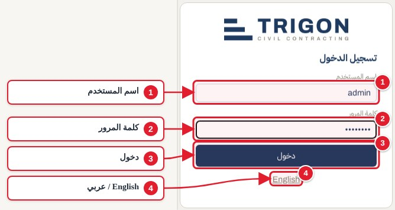

1. اسم المستخدم الذي أعطاك إياه مدير النظام.
2. كلمة المرور. بعد 8 محاولات خاطئة يُقفل الحساب مؤقتاً.
3. اضغط «دخول».
4. تبديل اللغة بين العربية والإنجليزية.

<!--/img-->

### 1.2 اللغة
- في شاشة الدخول اضغط **English / عربي** أسفل الزر.
- بعد الدخول استخدم زر **English / عربي** أسفل القائمة الجانبية، فيتغير اتجاه الواجهة كلها.

### 1.3 الشاشة
- **القائمة الجانبية** مقسّمة إلى: المشاريع والمبيعات، المشتريات والمخزون، المحاسبة، الموارد البشرية، الضرائب والامتثال.
- لا تظهر لك إلا الصفحات المسموحة لدورك (انظر البند 3).
- على الجوال تُفتح القائمة من زر **☰** في الأعلى.
- أغلب القوائم تعمل بنفس الطريقة: **+ إضافة** (أو **+ جديد**) يفتح نموذجاً، والضغط على أي سطر يفتحه للتعديل، و**حفظ** يحفظه، و**حذف** يحذفه (إذا كان مسموحاً).
- في كل صفحة زر **🖨 طباعة بالترويسة**، وفي أغلب القوائم زر **Excel**.
- زر **خروج** أسفل القائمة الجانبية.

<!--img-->

**📷 لوحة التحكم بعد الدخول**

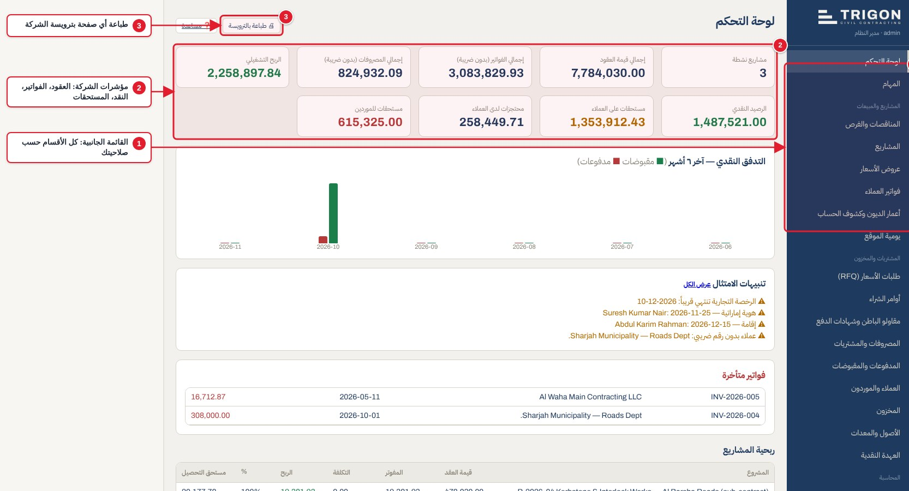

1. القائمة الجانبية: فيها كل أقسام النظام مقسّمة إلى مجموعات، ولا يظهر لك إلا ما يسمح به دورك. في أسفلها زر اللغة وزر الخروج.
2. مؤشرات الشركة: المشاريع النشطة، قيمة العقود، المفوتر، المصروفات، الربح، الرصيد النقدي، المستحقات والمحتجزات. تحتها التدفق النقدي وتنبيهات الامتثال والفواتير المتأخرة وربحية كل مشروع.
3. يطبع الصفحة الحالية على ترويسة الشركة مع الختم والتوقيع. موجود في كل صفحة.

<!--/img-->

---

## 2. الإعداد لأول مرة (مدير النظام)

### 2.1 إنشاء حساب المدير
1. أول مرة يُفتح النظام تظهر شاشة **إعداد النظام لأول مرة**.
2. أدخل **اسم المستخدم** و**كلمة المرور** (6 أحرف على الأقل) و**اسم الشركة**.
3. على الخادم الأونلاين قد يُطلب **رمز الإعداد السري**، وهو قيمة `SETUP_TOKEN` في ملف `.env` على الخادم.
4. اضغط **إنشاء الحساب**، فتدخل كمدير للنظام.

<!--img-->

**📷 شاشة الإعداد لأول مرة**

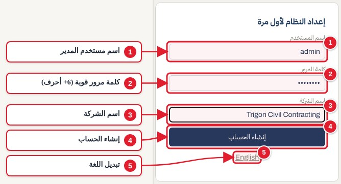

1. اكتب اسم مستخدم للمدير، مثل admin. ستستخدمه في كل مرة تدخل فيها.
2. كلمة مرور قوية من 6 أحرف على الأقل. لا تشاركها مع أحد.
3. اسم الشركة كما سيظهر في النظام (يمكن تعديله لاحقاً من الإعدادات).
4. اضغط «إنشاء الحساب» فتدخل مباشرةً كمدير للنظام.
5. لتبديل لغة الواجهة قبل البدء.

<!--/img-->

### 2.2 بيانات الشركة
القائمة: **الإعدادات** ← البطاقة الأولى.
1. عبّئ:
   - **اسم الشركة (إنجليزي)** و**اسم الشركة (عربي)**
   - **الاسم القانوني كما في الرخصة وشهادة الضريبة**: يُطبع مع الرقم الضريبي أعلى الفواتير الضريبية والإشعارات الدائنة وشهادات مقاولي الباطن، وفي تذييلها (الشعار وباقي المستندات تبقى بالاسم التجاري)
   - **الرقم الضريبي للقيمة المضافة (TRN) — ١٥ رقم**: مطلوب لإصدار الفواتير الضريبية
   - **رقم تسجيل ضريبة الشركات**
   - **الهاتف**، **البريد**، **الموقع الإلكتروني**، **ص.ب**، **العنوان (إنجليزي)**، **العنوان (عربي)**
   - **بادئة أرقام المستندات (مثل TC)**: تُرقَّم عروض الأسعار والخطابات بصيغة `TC26/01-CLIENT`
   - **جهة إصدار الرخصة**، **رقم الرخصة التجارية**، **انتهاء الرخصة** (يصلك تنبيه قبل الانتهاء)
   - **نسبة الضريبة الافتراضية %** (عادةً 5) و**العملة** (AED)
   - **رقم المنشأة — وزارة الموارد البشرية (١٣ رقم)**، **بنك الشركة**، **رمز توجيه بنك الشركة (٩ أرقام)**، **آيبان الشركة**: كلها مطلوبة لملف الرواتب WPS
   - **نص تذييل المستندات**
2. **مسجّل في ضريبة القيمة المضافة؟**: اختر **لا** إذا لم تُسجَّل الشركة بعد، فتصبح الضريبة 0% افتراضياً ويكون عنوان المستند «فاتورة» بدل «فاتورة ضريبية».
3. **بيانات البنك (تظهر في الفاتورة)**: النص الذي يُطبع على كل فاتورة ليدفع لك العميل.
4. **الشروط الافتراضية لعروض الأسعار**: تُضاف تلقائياً لكل عرض سعر جديد.
5. اضغط **حفظ**.

<!--img-->

**📷 الإعدادات — بيانات الشركة**

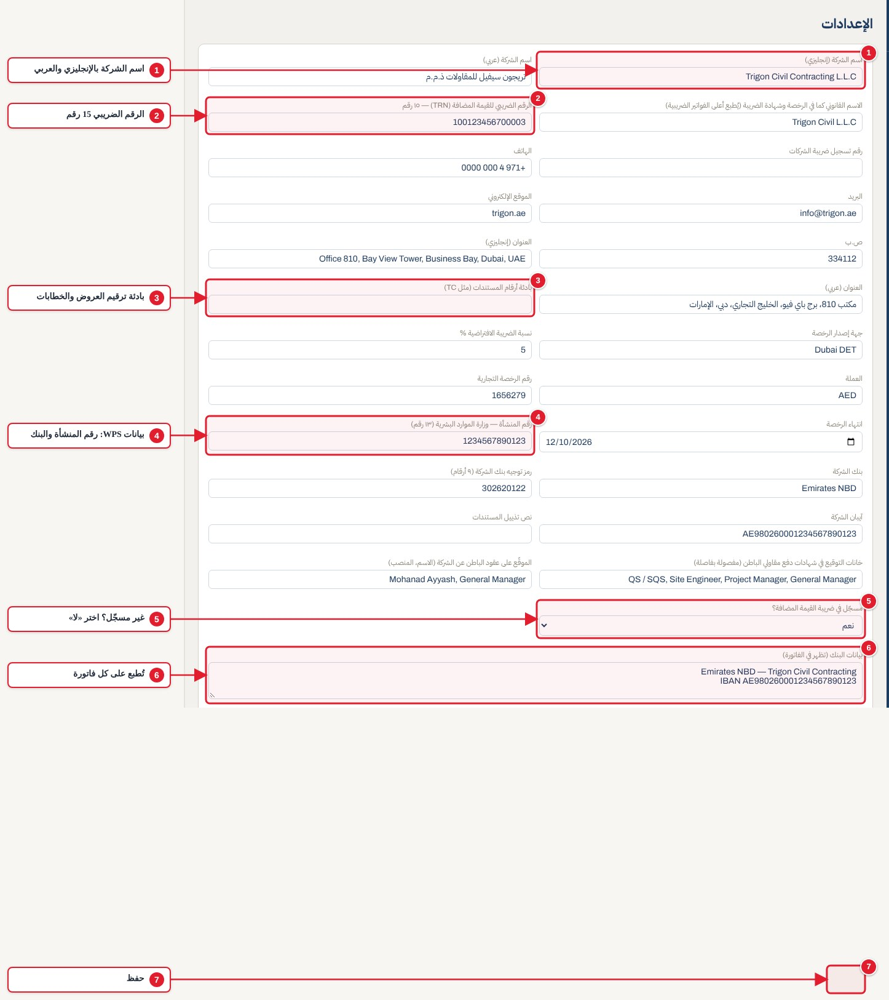

1. اسم الشركة بالإنجليزية والعربية كما في الرخصة، ويُطبع على كل المستندات.
2. الرقم الضريبي (15 رقماً). بدونه لا تُصدر فواتير ضريبية صحيحة.
3. بادئة الترقيم، مثل TC، فتصبح أرقام العروض والخطابات TC26/01-CLIENT.
4. رقم المنشأة في وزارة الموارد البشرية، وبنك الشركة ورمز التوجيه والآيبان: كلها مطلوبة لملف رواتب WPS.
5. إذا لم تُسجَّل الشركة في الضريبة بعد اختر «لا»، فتصبح الضريبة 0% ويكون عنوان المستند «فاتورة».
6. بيانات البنك التي تظهر أسفل كل فاتورة ليحوّل لك العميل عليها.
7. لا تنسَ «حفظ» بعد أي تعديل.

<!--/img-->

### 2.3 الشعار والختم والتوقيع
القائمة: **الإعدادات** ← **هوية الشركة: الشعار والختم والتوقيع**.
1. الطريقة السريعة: اضغط **تركيب هوية تريجون الجاهزة (الشعار والختم والبيانات القانونية)** ووافق. يركّب شعارات تريجون والبيانات القانونية (الاسم، الرخصة، العنوان، ص.ب).
2. أو ارفع كل صورة بنفسك (PNG بخلفية شفافة، حتى 2 ميجابايت): **الشعار الأساسي**، **الشعار العربي (الترويسة الرسمية)**، **الشعار المعكوس**، **سطر الشعار (توقيع الإيميل)**، **العلامة فقط**، **الختم الرسمي**، **التوقيع المعتمد**.
3. الختم الرسمي لا يأتي مع الكود، ارفعه من هنا. يُطبع فقط على المستندات الصادرة من النظام، فأعطِ صلاحية الطباعة للمخوَّلين فقط.
4. لتغيير صورة ارفع صورة جديدة، ولإزالتها اضغط **حذف**.

<!--img-->

**📷 الإعدادات — هوية الشركة**

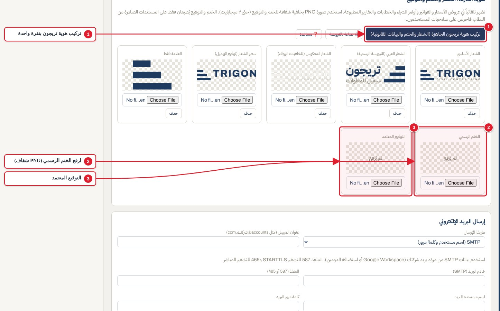

1. يركّب شعارات تريجون والبيانات القانونية بنقرة واحدة.
2. اختر ملف صورة الختم (PNG بخلفية شفافة، حتى 2 ميجابايت) فيُرفع مباشرة ويظهر في المعاينة.
3. بنفس الطريقة ارفع التوقيع المعتمد. يُطبع الختم والتوقيع على الفواتير والخطابات والتقارير.

<!--/img-->

### 2.4 إرسال البريد الإلكتروني (نسخة الخادم)
القائمة: **الإعدادات** ← **إرسال البريد الإلكتروني**.
1. **طريقة الإرسال**:
   - **Microsoft 365** (موصى به لبريد Outlook): أدخل **Directory (tenant) ID** و**Application (client) ID** و**Client secret (Value)** من تطبيق مسجّل في Microsoft Entra بصلاحية *Mail.Send*.
   - **SMTP**: أدخل **خادم البريد (SMTP)**، **المنفذ (587 أو 465)**، **اسم مستخدم البريد**، **كلمة مرور البريد**، و**التشفير**.
2. أدخل **عنوان المرسِل** (مثل `accounts@trigon.ae`).
3. اضغط **حفظ**، ثم اكتب بريدك في خانة التجربة واضغط **إرسال تجربة**.

<!--img-->

**📷 الإعدادات — إرسال البريد**

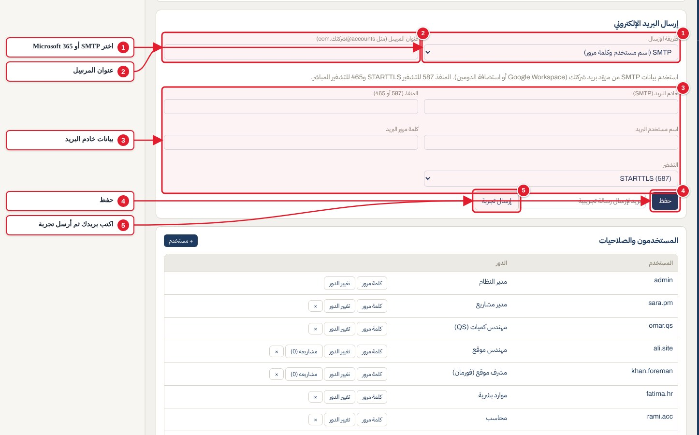

1. طريقة الإرسال: SMTP (اسم مستخدم وكلمة مرور) أو Microsoft 365 (الأفضل لبريد Outlook). تتغير الحقول حسب اختيارك.
2. العنوان الذي تصل منه الرسائل للعملاء والموردين، مثل accounts@trigon.ae.
3. بيانات خادم البريد من مزوّد البريد (الخادم، المنفذ، المستخدم، كلمة المرور، التشفير).
4. احفظ الإعدادات.
5. اكتب بريدك في الخانة واضغط «إرسال تجربة» للتأكد أن الإرسال يعمل.

<!--/img-->

### 2.5 ملفي الشخصي (توقيع الإيميل)
القائمة: **الإعدادات** ← **ملفي الشخصي**. أدخل **الاسم الكامل**، **المسمى الوظيفي**، **الجوال** ← **حفظ**. تظهر في توقيع كل إيميل ترسله من النظام.

### 2.6 تغيير كلمة المرور
القائمة: **الإعدادات** ← **تغيير كلمة المرور** ← اكتب **كلمة المرور الحالية** ثم الكلمة الجديدة ← **تغيير**. بعد التغيير تُسجَّل باقي أجهزتك خروجاً تلقائياً. لحماية أقوى فعّل **التحقق بخطوتين** (القسم 40).

---

### 2.7 نصوص المستندات والتواقيع
القائمة: **الإعدادات** ← بطاقة بيانات الشركة (لمدير النظام). هذه النصوص تُطبع تلقائياً على المستندات:
1. **خانات التوقيع في شهادات دفع مقاولي الباطن**: مفصولة بفاصلة، مثل `QS / SQS, Site Engineer, Project Manager, General Manager`.
2. **الموقّع على عقود الباطن عن الشركة**: `الاسم، المنصب`.
3. **نص اتفاقية عقد الباطن القياسي**: بنود كل اتفاقية. الكلمات بين `{{ }}` تُعبّأ تلقائياً (مثل `{{subcontractor}}` و`{{value}}` و`{{retention_pct}}` و`{{payment_days}}`). السطر الذي يبدأ برقم ونقطة (مثل `6. Payment`) هو عنوان بند.
4. **ملاحظات ثابتة على أوامر الشراء**: سطر لكل ملاحظة.
5. **الشروط العامة لأوامر الشراء**: تُطبع صفحة ثانية في كل أمر شراء؛ اتركها فارغة لعدم طباعتها.
6. اضغط **حفظ**. اعرض نص الاتفاقية وشروط الشراء على محامٍ قبل اعتمادها، فهي نص عام للبداية.

<!--img-->

**📷 الإعدادات — الاسم القانوني والتواقيع**

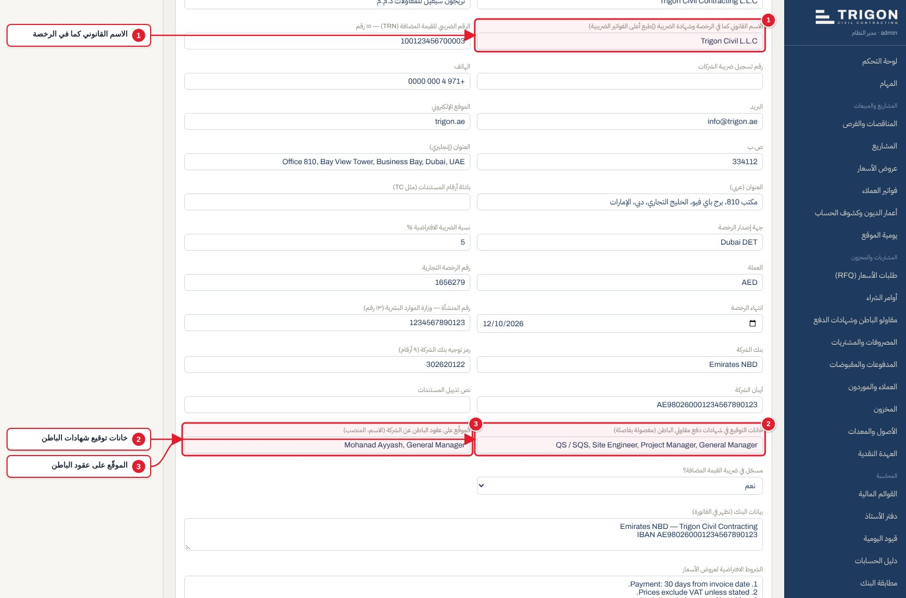

1. الاسم القانوني كما في الرخصة وشهادة الضريبة: يظهر مع الرقم الضريبي أعلى الفواتير الضريبية والإشعارات الدائنة وشهادات مقاولي الباطن.
2. خانات التوقيع في شهادات دفع مقاولي الباطن، مفصولة بفاصلة.
3. اسم ومنصب من يوقّع اتفاقيات عقد الباطن عن الشركة.

<!--/img-->
<!--img-->

**📷 الإعدادات — نصوص الاتفاقية وأوامر الشراء**

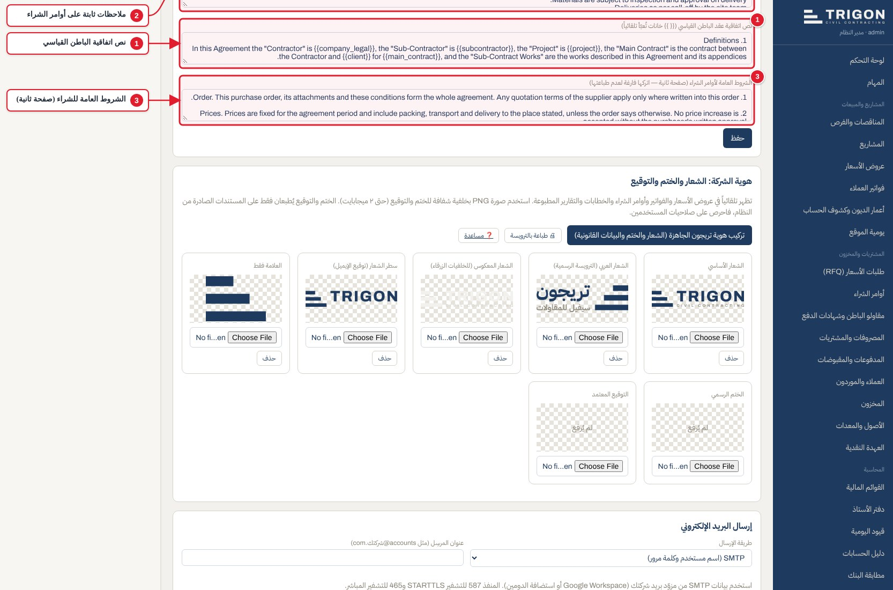

1. نص اتفاقية عقد الباطن القياسي: الكلمات بين {{ }} تُعبّأ تلقائياً من بيانات كل عقد.
2. الملاحظات الثابتة التي تُطبع على كل أمر شراء.
3. الشروط العامة للشراء: صفحة ثانية في كل أمر شراء؛ فارغة = بدون صفحة.

<!--/img-->

---

## 3. المستخدمون والصلاحيات

### 3.1 الأدوار
| الدور | الصلاحيات |
|---|---|
| **مدير النظام** | كل شيء، ومنها الإعدادات والمستخدمون وإلغاء الفواتير الضريبية |
| **محاسب** | المالية والمحاسبة، بدون المستخدمين والإعدادات |
| **مدير مشاريع** | المشاريع والمشتريات والحضور، بدون الرواتب والضرائب |
| **مهندس كميات (QS)** | المناقصات وعروض الأسعار والمشاريع والفواتير (يرى المبالغ) |
| **مهندس موقع** | مشاريعه فقط: نسبة الإنجاز، يومية الموقع، طلبات الأسعار، المخزون، بدون أي مبالغ |
| **مشرف موقع (فورمان)** | حضور فريقه ويومية الموقع لمشاريعه |
| **مسؤول مشتريات** | طلبات الأسعار، أوامر الشراء، مقاولو الباطن، المصروفات، الموردون |
| **أمين مخزن** | المخزون وأوامر الشراء |
| **موارد بشرية** | الموظفون، الإجازات، الطلبات، الخطابات، الرواتب، بدون الحسابات |
| **عرض فقط** | قراءة فقط |
| **موظف (بوابة الموظف)** | بوابته الخاصة فقط (الإجازات، القسائم، الطلبات، الحضور) |

### 3.2 إضافة مستخدم
1. **الإعدادات** ← **المستخدمون والصلاحيات** ← **+ مستخدم**.
2. أدخل **اسم المستخدم** و**كلمة المرور (٦ أحرف على الأقل)**، واختر **الدور**.
3. إذا كان المستخدم موظفاً أيضاً، اختر **الموظف المرتبط** (مطلوب لاعتماد الإجازات وللبوابة).
4. اضغط **إنشاء**.

<!--img-->

**📷 الإعدادات — المستخدمون والصلاحيات**

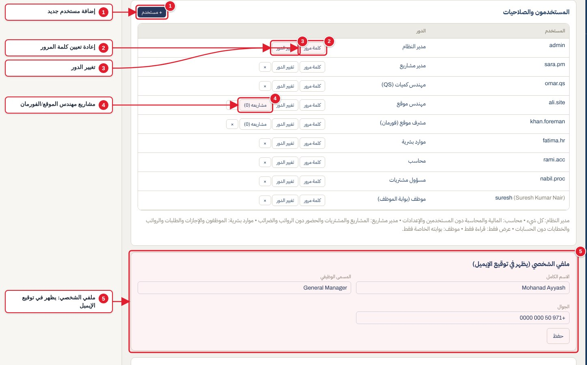

1. يفتح نموذج مستخدم جديد.
2. يضع كلمة مرور جديدة لمستخدم نسي كلمة المرور.
3. يغيّر دور المستخدم، فتتغير الصفحات التي يراها.
4. لمهندس الموقع والفورمان فقط: اختيار المشاريع التي يراها.
5. ملفك الشخصي: الاسم والمسمى والجوال تظهر في توقيع الإيميلات التي ترسلها.

<!--/img-->
<!--img-->

**📷 نموذج مستخدم جديد**

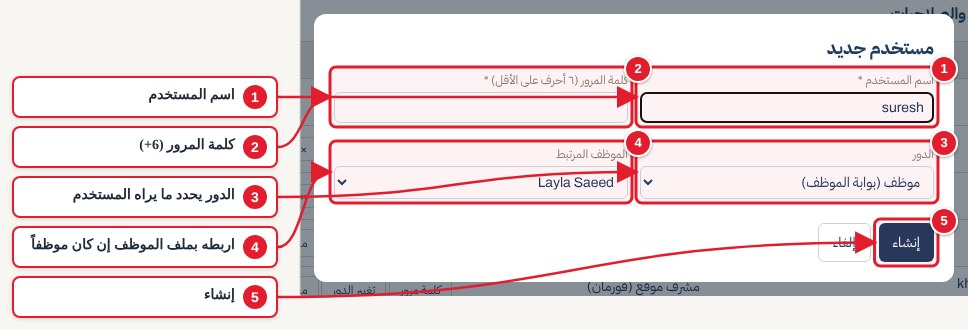

1. اسم المستخدم الذي سيدخل به (بدون مسافات).
2. كلمة مرور مؤقتة (6 أحرف على الأقل). اطلب منه تغييرها من الإعدادات.
3. الدور يحدد الصلاحيات (انظر الجدول أعلاه).
4. إذا كان موظفاً، اربطه بملفه ليرى بوابته وتعمل اعتمادات المدير المباشر.
5. اضغط «إنشاء».

<!--/img-->

### 3.3 إدارة مستخدم
في جدول المستخدمين:
- **كلمة مرور**: لإعادة تعيين كلمة المرور.
- **تغيير الدور**: لاختيار دور جديد.
- **مشاريعه** (لمهندس الموقع والفورمان فقط): علّم المشاريع المسموحة، فلا يرى إلا هذه المشاريع وفرقها.

---

## 4. العملاء والموردون

القائمة: **العملاء والموردون**. أدخلهم قبل عروض الأسعار والفواتير والمشتريات.

1. اضغط **+ إضافة**.
2. **النوع**: **عميل** أو **مورد** أو **مقاول باطن**.
3. **الاسم** (إلزامي).
4. **الرقم الضريبي (TRN)**: مطلوب في الفاتورة الضريبية للشركات المسجّلة، ولاسترداد ضريبة المشتريات من الموردين.
5. **الهاتف**، **البريد** (يُستخدم عند إرسال العروض والفواتير)، **العنوان** (مطلوب في الفاتورة الضريبية).
6. **اسم البنك**، **رقم الآيبان IBAN**، **ملاحظات**.
7. اضغط **حفظ**.
8. افتح السجل مرة أخرى لإرفاق المستندات (الرخصة، شهادة الضريبة…) من لوحة **المستندات المرفقة**.

<!--img-->

**📷 إضافة عميل**

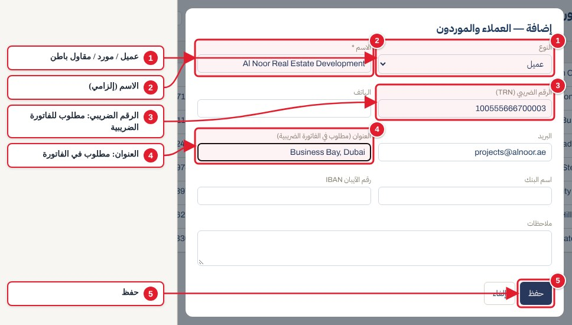

1. النوع: عميل، أو مورد، أو مقاول باطن. يحدد أين يظهر (العروض والفواتير، أو المشتريات).
2. الاسم الرسمي كما في الرخصة (إلزامي).
3. الرقم الضريبي 15 رقماً: يظهر على الفاتورة الضريبية، ويسمح باسترداد ضريبة المشتريات.
4. العنوان مطلوب في الفاتورة الضريبية. أكمل أيضاً الهاتف والبريد والبنك.
5. احفظ. بعدها افتح السجل لإرفاق الرخصة وشهادة الضريبة.

<!--/img-->

---

## 5. المناقصات والفرص

القائمة: **المناقصات والفرص**. تعرض اللوحة كل مرحلة وقيمتها، مع: الفرص المفتوحة، القيمة المرجّحة (القيمة × الاحتمال)، ما فزنا به هذه السنة، ونسبة الفوز.

<!--img-->

**📷 لوحة المناقصات**

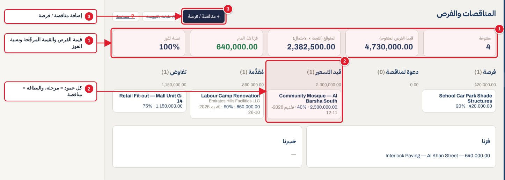

1. ملخص: عدد الفرص المفتوحة، قيمتها، القيمة المتوقعة (القيمة × الاحتمال)، ما فزنا به، ونسبة الفوز.
2. كل عمود مرحلة (فرصة، دعوة، تسعير، مقدَّمة، تفاوض)، وكل بطاقة مناقصة. اضغط البطاقة لفتحها.
3. إضافة مناقصة أو فرصة جديدة.

<!--/img-->

### 5.1 إضافة مناقصة
1. اضغط **+ مناقصة / فرصة**.
2. عبّئ: العنوان، **العميل** أو اكتب **أو اسم جهة جديدة** (يُنشأ العميل تلقائياً)، المصدر (دعوة، توصية، بوابة مناقصات…).
3. **المرحلة**: فرصة ← دعوة لمناقصة ← قيد التسعير ← مُقدَّمة ← تفاوض ← فزنا / خسرنا.
4. **القيمة التقديرية**، **احتمال الفوز %**، تاريخ التقديم، الإغلاق المتوقع، المسؤول، ملاحظات.
5. **حفظ**.

### 5.2 متابعة المناقصة
1. اضغط على بطاقة المناقصة وغيّر **المرحلة** حسب التقدم.
2. **إنشاء عرض سعر**: ينشئ عرض سعر مرتبطاً بالمناقصة (ثم **فتح عرض السعر** للعمل عليه).
3. عند الفوز: **فزنا — تحويل إلى مشروع**، فيتحول العرض إلى مشروع وتُعلَّم المناقصة «فزنا».
4. عند الخسارة: غيّر المرحلة إلى **خسرنا** واكتب **سبب الخسارة**.

<!--img-->

**📷 نافذة المناقصة**

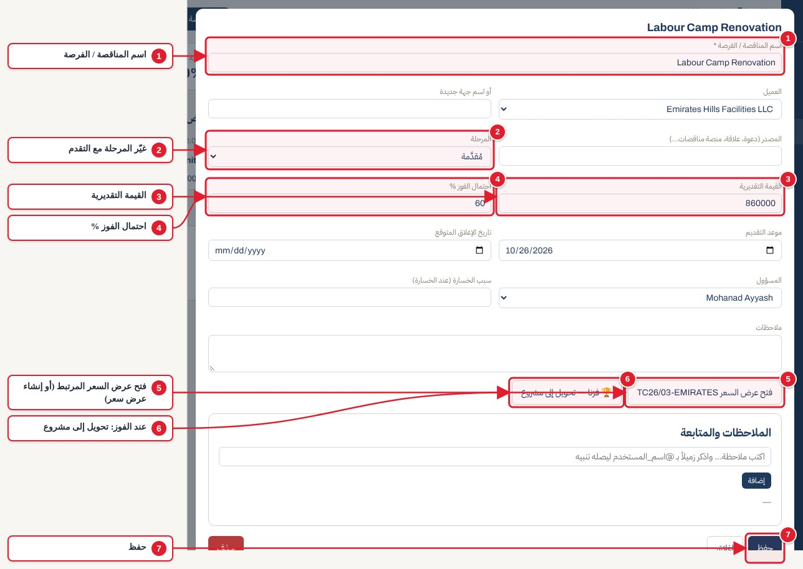

1. اسم المناقصة أو الفرصة.
2. المرحلة الحالية. غيّرها كلما تقدمت، فتنتقل البطاقة إلى العمود الصحيح.
3. القيمة التقديرية للمشروع.
4. احتمال الفوز %: يُستخدم في القيمة المتوقعة.
5. «إنشاء عرض سعر» يجهز عرضاً مرتبطاً بالمناقصة؛ بعد إنشائه يصبح الزر «فتح عرض السعر».
6. «🏆 فزنا — تحويل إلى مشروع»: يحوّل العرض المرتبط إلى مشروع ويعلّم المناقصة «فزنا».
7. احفظ التعديلات.

<!--/img-->

---

## 6. عروض الأسعار

القائمة: **عروض الأسعار**.

### 6.1 إنشاء عرض سعر
1. اضغط **+ جديد**.
2. **رقم العرض**: اتركه فارغاً ليُعطى رقماً تلقائياً (مثل `TC26/01-CLIENT`).
3. **التاريخ**، **العميل**، **اسم المشروع**، **صلاحية العرض (يوم)** (الافتراضي 30)، **الحالة** (مسودة)، **نسبة الضريبة %**.
4. البنود: لكل بند عبّئ **الوصف**، **الوحدة**، **الكمية**، **السعر**، واختر الضريبة (**خاضع 5%** أو **صفري** أو **معفى**). اضغط **+ بند** لإضافة بنود، و**×** لحذف بند. الإجمالي والضريبة يُحسبان أثناء الكتابة.
5. **ملاحظات** و**الشروط** (تأتي من الإعدادات).
6. اضغط **حفظ**.

<!--img-->

**📷 قائمة عروض الأسعار**

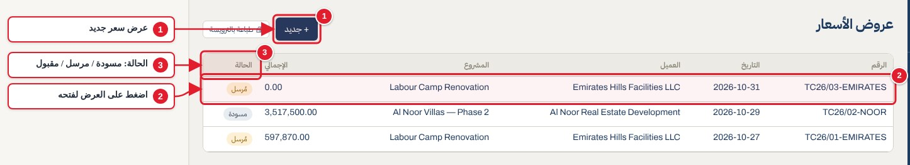

1. عرض سعر جديد.
2. اضغط أي عرض لفتحه وتعديله أو طباعته أو إرساله.
3. الحالة: مسودة، مُرسل، مقبول، مرفوض.

<!--/img-->
<!--img-->

**📷 نموذج عرض سعر جديد**

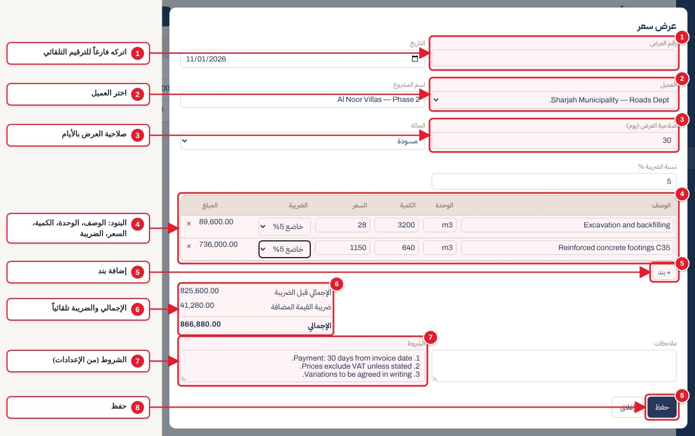

1. اترك رقم العرض فارغاً فيُعطى رقماً تلقائياً حسب البادئة.
2. اختر العميل (يجب أن يكون مضافاً في «العملاء والموردون»).
3. مدة صلاحية العرض بالأيام، وتُطبع على الغلاف.
4. جدول البنود: اكتب الوصف والوحدة والكمية والسعر، واختر نوع الضريبة لكل بند. المبلغ يُحسب تلقائياً، و× يحذف البند.
5. «+ بند» لإضافة سطر جديد.
6. الإجمالي قبل الضريبة، والضريبة، والإجمالي النهائي: تتحدث فوراً.
7. الشروط تأتي من الإعدادات ويمكن تعديلها لهذا العرض.
8. «حفظ» لحفظ العرض في القائمة.

<!--/img-->

### 6.2 إرسال العرض للعميل
افتح العرض ثم:
- **طباعة** أو **PDF**: يُطبع بصفحة غلاف وترويسة الشركة. (لطباعة العرض بدون غلاف أضف `?cover=0` لرابط الطباعة.)
- **إرسال بالإيميل**: اكتب بريد العميل، ويُرفق ملف PDF.
- **🔗 رابط القبول للعميل**: رابط يفتحه العميل بدون تسجيل دخول، يراجع العرض ثم **يقبله** بالاسم والتوقيع أو **يرفضه** بملاحظة. يصلك تنبيه فوراً وتظهر النتيجة على العرض. استخدم **نسخ** أو **إرسال بالبريد مع العرض** أو **معاينة**.
- إذا تابعت يدوياً، غيّر **الحالة** إلى **مُرسل** ثم **مقبول** أو **مرفوض**.

<!--img-->

**📷 أزرار عرض السعر بعد الحفظ**

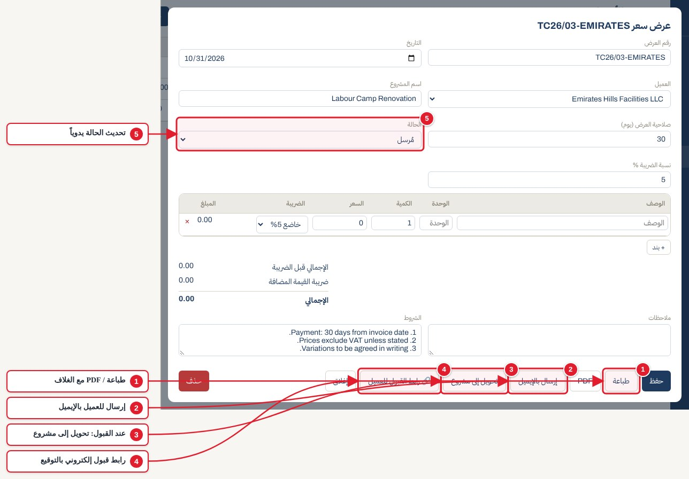

1. «طباعة» و«PDF»: العرض بغلاف وترويسة وختم.
2. «إرسال بالإيميل»: يرسله لبريد العميل مع PDF.
3. بعد موافقة العميل: «تحويل إلى مشروع» ينشئ المشروع وينسخ البنود إلى جدول الكميات.
4. «رابط القبول للعميل»: رابط يقبل فيه العميل العرض بالتوقيع أو يرفضه.
5. إذا تابعت يدوياً، غيّر الحالة إلى مُرسل أو مقبول أو مرفوض ثم احفظ.

<!--/img-->
<!--img-->

**📷 رابط القبول الإلكتروني**

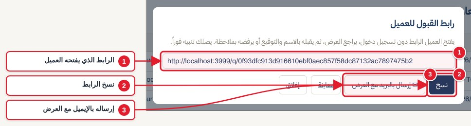

1. الرابط الذي يفتحه العميل بدون حساب.
2. نسخه لإرساله بالواتساب مثلاً.
3. أو إرساله بالإيميل مع العرض مباشرة.

<!--/img-->

### 6.3 تحويل العرض إلى مشروع
عند قبول العميل، افتح العرض واضغط **تحويل إلى مشروع**. يُنشأ المشروع وتُنسخ بنود العرض إلى **جدول الكميات (BOQ)** في المشروع.

---

## 7. المشاريع

القائمة: **المشاريع**.

### 7.1 إضافة مشروع
إما بتحويل عرض سعر (6.3) أو مناقصة (5.2)، أو:
1. اضغط **+ إضافة**.
2. **رمز المشروع** (مثل P-2026-01)، **اسم المشروع** (إلزامي)، **العميل**، **الموقع**.
3. **الإمارة (لإقرار الضريبة)**: مطلوبة للخانة 1 في إقرار الضريبة.
4. **قيمة العقد (بدون ضريبة)**.
5. **نسبة المحتجزات % (للفواتير)**، مثل 10.
6. **الحالة** (نشط)، **تاريخ البدء**، **تاريخ الانتهاء**.
7. الدفعة المقدمة: **الدفعة المقدمة % من العقد** و**استرداد المقدمة % من كل مستخلص** (فارغ = نفس النسبة).
8. الإفراج عن المحتجزات: **تاريخ التسليم**، **نسبة المحتجزات المفرج عنها عند التسليم %** (الافتراضي 50)، **فترة الصيانة (أشهر)** (الافتراضي 12، والباقي يُفرج عنه بعدها).
9. حضور الجوال: **خط العرض للموقع**، **خط الطول للموقع**، **نطاق الموقع بالمتر** (الافتراضي 300). أسهل طريقة: افتح المشروع من جوالك وأنت في الموقع واضغط **📍 استخدم موقعي الحالي (وأنا في الموقع)**.
10. **ملاحظات** ← **حفظ**.

**عند العمل كمقاول باطن لدى مقاول رئيسي** عبّئ أيضاً:
- **العقد الرئيسي**: اسم عقد المقاول الرئيسي.
- **رقم العقد / عقد الباطن / أمر الشراء من العميل**: يُطبع على كل فاتورة وبروفورما (العملاء يرفضون الفاتورة بدونه).
- **مدة الدفع (أيام)**: منها يُحسب تاريخ استحقاق الفواتير الصادرة من الـ PC.
- **أساس الضريبة في شهادات الدفع (PC)**: *على الصافي بعد المحتجزات والخصومات* إذا كان المقاول الرئيسي يعتمد الضريبة بهذه الطريقة (ضريبة المحتجزات عند الإفراج)، وإلا *على قيمة الأعمال*.

<!--img-->

**📷 قائمة المشاريع**

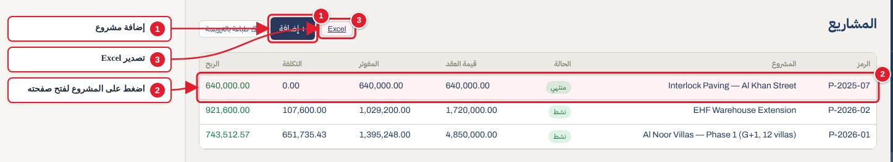

1. إضافة مشروع جديد.
2. اضغط المشروع لفتح صفحته الكاملة.
3. تصدير القائمة إلى Excel.

<!--/img-->
<!--img-->

**📷 نموذج مشروع جديد**

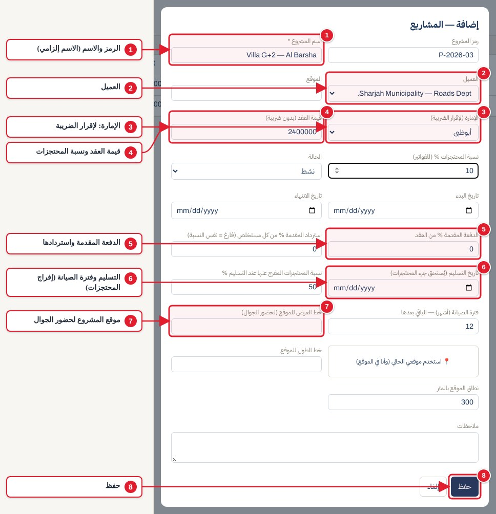

1. رمز المشروع واسمه. الاسم إلزامي، والرمز يساعد في البحث والتقارير.
2. العميل صاحب المشروع.
3. الإمارة: تُستخدم في الخانة 1 من إقرار الضريبة.
4. قيمة العقد بدون ضريبة ونسبة المحتجزات التي تُخصم من كل فاتورة.
5. نسبة الدفعة المقدمة ونسبة استردادها من كل مستخلص.
6. تاريخ التسليم ونسبة المحتجزات المفرج عنها فيه، وفترة الصيانة للباقي.
7. إحداثيات الموقع ونطاقه لتسجيل حضور العمال من الجوال.
8. احفظ.

<!--/img-->
<!--img-->

**📷 حقول العمل مع مقاول رئيسي في نموذج المشروع**

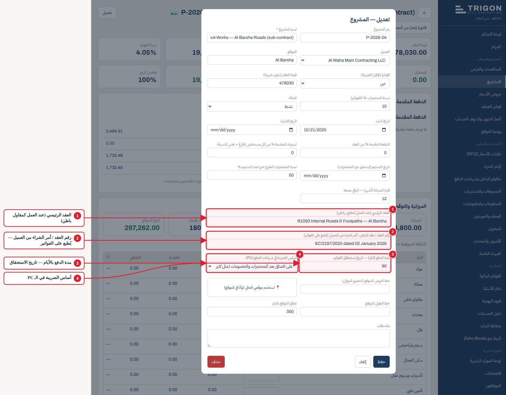

1. العقد الرئيسي: اسم عقد المقاول الرئيسي، يُطبع على البروفورما والفاتورة.
2. رقم العقد أو عقد الباطن أو أمر الشراء من العميل: يُطبع على كل فاتورة.
3. مدة الدفع بالأيام: تاريخ استحقاق الفواتير الصادرة من الـ PC.
4. أساس الضريبة في الـ PC: على الصافي بعد المحتجزات والخصومات، أو على قيمة الأعمال.

<!--/img-->

### 7.2 صفحة المشروع
اضغط على المشروع لفتحه. تظهر:
- الأرقام: **قيمة العقد**، **أوامر التغيير المعتمدة**، **القيمة المعدّلة**، **المفوتر**، **نسبة الفوترة**، **المحصّل**، **مستحق التحصيل**، **التكلفة**، **الربح**، **هامش الربح**.
- الأزرار: **تعديل**، **فاتورة إنجاز من الجدول**، **+ فاتورة**، **+ مصروف**.

<!--img-->

**📷 صفحة المشروع**

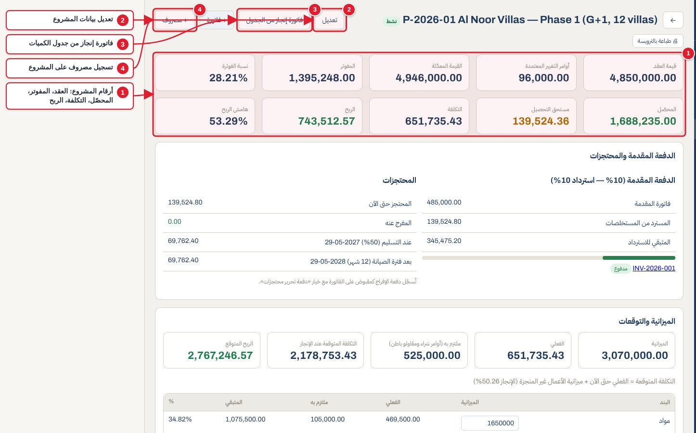

1. أرقام المشروع لحظياً: العقد، أوامر التغيير، المفوتر ونسبته، المحصّل، المستحق، التكلفة، الربح والهامش.
2. تعديل بيانات المشروع أو تغيير حالته.
3. إصدار فاتورة إنجاز حسب نسب الإنجاز في الجدول.
4. تسجيل مصروف مرتبط بالمشروع مباشرة (وبجانبه «+ فاتورة» لفاتورة يدوية).

<!--/img-->

### 7.3 جدول الكميات (BOQ) ونسبة الإنجاز
1. اضغط **+ بند**.
2. **القسم**، **الوصف**، **الوحدة**، **الكمية**، **سعر البيع للوحدة**، **التكلفة المقدّرة للوحدة**، **نسبة الإنجاز %**.
3. **حفظ**. اضغط على البند لاحقاً لتحديث **نسبة الإنجاز %** مع تقدم العمل (مهندس الموقع يحدّثها مباشرة من صفحة مشروعه).
4. أسفل الجدول: **الميزانية مقابل الفعلي** (التكلفة المقدّرة مقابل التكلفة الفعلية).

<!--img-->

**📷 جدول الكميات وأوامر التغيير**

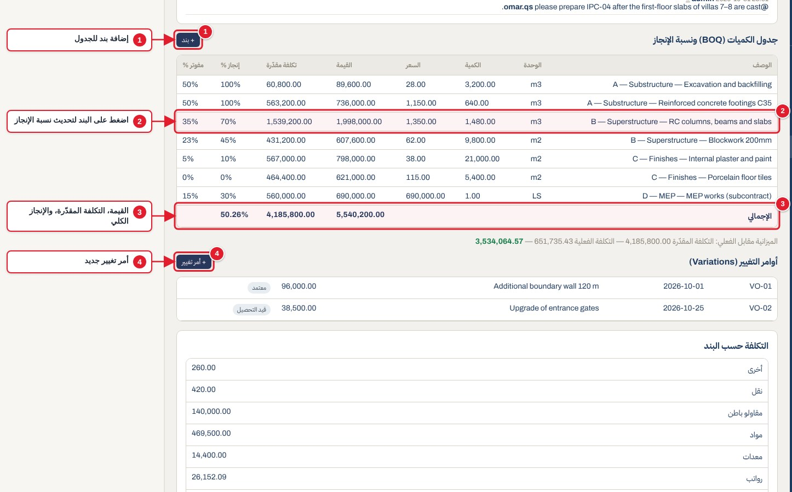

1. إضافة بند جديد للجدول.
2. اضغط أي بند لتعديله أو تحديث نسبة إنجازه.
3. الإجماليات: قيمة الجدول، التكلفة المقدّرة، والإنجاز الكلي للمشروع.
4. إضافة أمر تغيير (Variation).

<!--/img-->
<!--img-->

**📷 نافذة بند الجدول**

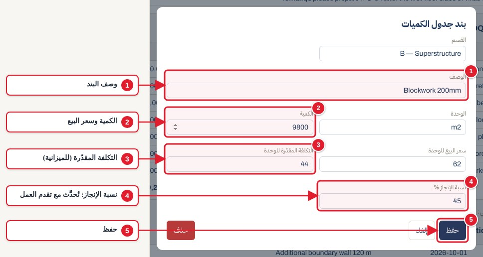

1. وصف البند (والقسم أعلاه لتجميع البنود).
2. الكمية وسعر البيع للوحدة: منها تُحسب قيمة البند.
3. التكلفة المقدّرة للوحدة: تُستخدم في الميزانية والتوقعات.
4. نسبة الإنجاز: حدّثها مع تقدم العمل؛ فاتورة الإنجاز تفوتر الفرق منذ آخر فاتورة.
5. احفظ.

<!--/img-->

### 7.4 أوامر التغيير
1. اضغط **+ أمر تغيير**.
2. **الرقم**، **التاريخ**، **الوصف**، **المبلغ (بدون ضريبة، سالب للتخفيض)**، **الحالة** (قيد الاعتماد / معتمد / مرفوض).
3. **حفظ**. أوامر التغيير **المعتمدة** فقط تُضاف إلى القيمة المعدّلة للعقد.

<!--img-->

**📷 نافذة أمر التغيير**

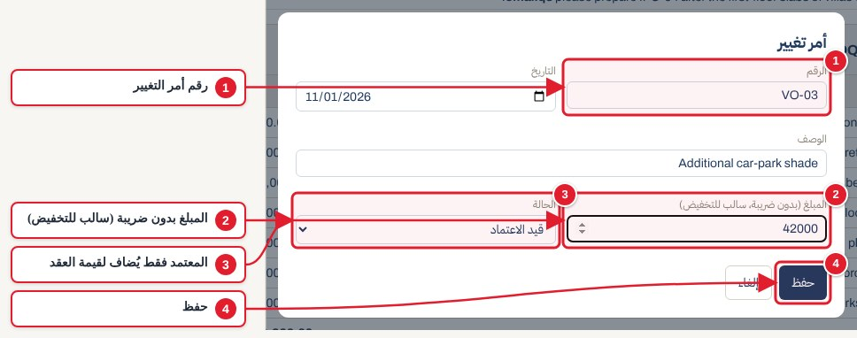

1. رقم أمر التغيير والتاريخ.
2. المبلغ بدون ضريبة. للتخفيض اكتب مبلغاً سالباً.
3. الحالة: «معتمد» فقط يُضاف إلى القيمة المعدّلة للعقد.
4. احفظ.

<!--/img-->

### 7.5 الميزانية والتوقعات
في بطاقة **الميزانية والتوقعات** في صفحة المشروع:
1. أدخل الميزانية لكل بند تكلفة.
2. اضغط **حفظ الميزانية**.
3. تعرض البطاقة: الفعلي، الملتزم به (أوامر الشراء ومقاولو الباطن)، المتبقي، التكلفة المتوقعة عند الإنجاز، والهامش المتوقع. التكلفة المتوقعة = الفعلي حتى الآن + ميزانية الأعمال غير المنجزة. يظهر تنبيه إذا تجاوزت التكلفة المتوقعة الميزانية.

<!--img-->

**📷 بطاقة الميزانية والتوقعات**

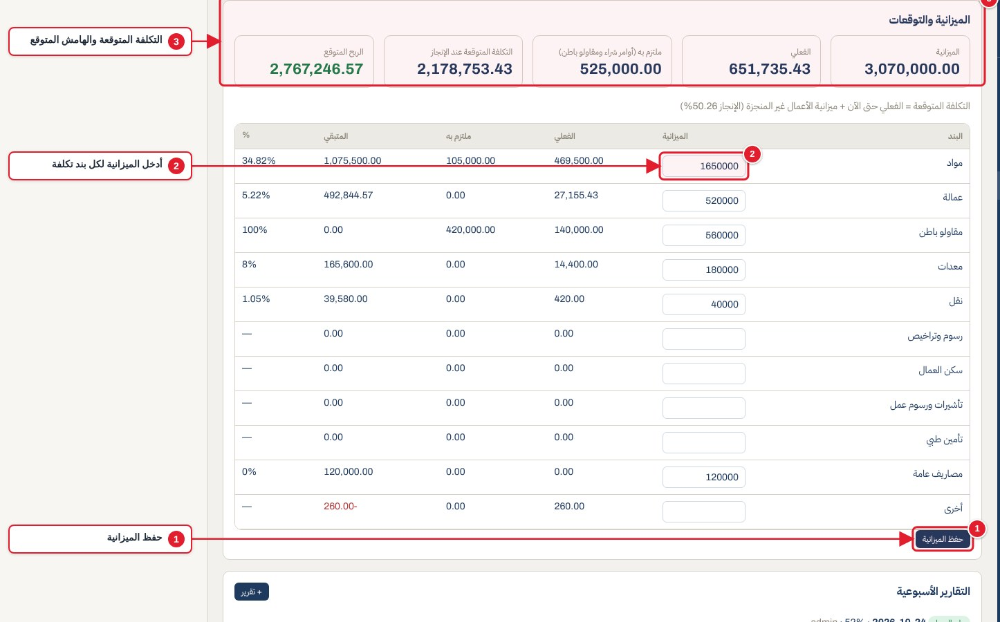

1. بعد إدخال الأرقام اضغط «حفظ الميزانية».
2. أدخل الميزانية لكل بند تكلفة (مواد، عمالة، مقاولو باطن…). بجانبها الفعلي والملتزم به والمتبقي.
3. التكلفة المتوقعة عند الإنجاز والهامش المتوقع؛ يظهر تنبيه أحمر إذا تجاوزت الميزانية.

<!--/img-->

### 7.6 التقارير الأسبوعية
1. في **التقارير الأسبوعية** اضغط **+ تحديث**.
2. اختر الحالة، ونسبة الإنجاز %، والتاريخ، واكتب كيف يسير العمل (المنجز، العوائق، الخطوات القادمة).
3. **حفظ**. تُحفظ أرقام الميزانية والفعلي والتوقعات في ذلك التاريخ مع التقرير.

<!--img-->

**📷 التقارير الأسبوعية والملاحظات والمستندات**

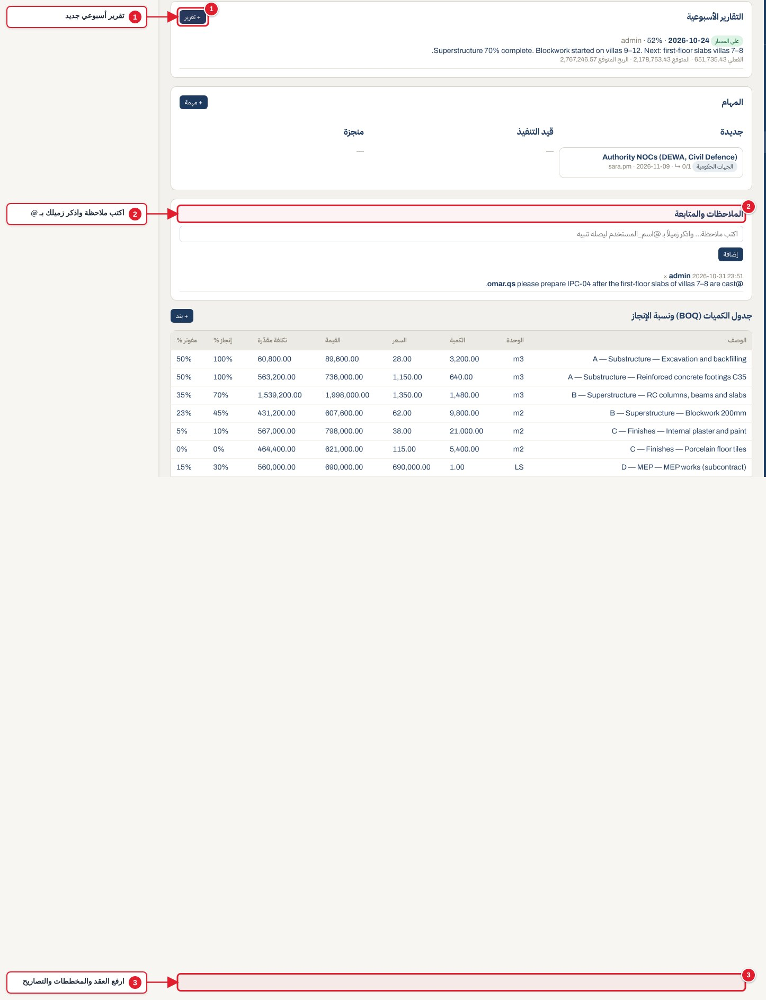

1. تقرير أسبوعي جديد: الحالة، نسبة الإنجاز، وملخص الأسبوع.
2. الملاحظات: اكتب ملاحظة، واذكر زميلاً بـ @اسم_المستخدم فيصله إشعار.
3. المستندات المرفقة: العقد، المخططات، التصاريح، مع تاريخ الانتهاء.

<!--/img-->

### 7.7 الدفعة المقدمة والمحتجزات
بطاقة **الدفعة المقدمة والمحتجزات** تعرض: المقدمة المفوترة، المسترد منها، والمتبقي، والمحتجزات المحجوزة، والمفرج عنها، والمستحقة عند التسليم وبعد فترة الصيانة.
- **إصدار فاتورة الدفعة المقدمة**: ينشئ فاتورة ضريبية للمقدمة (عليها ضريبة)، وتُسترد تلقائياً من كل فاتورة إنجاز.
- للإفراج عن المحتجزات سجّل دفعة مقبوضة على الفاتورة وعلّم **هذه دفعة تحرير محتجزات** (البند 9).

<!--img-->

**📷 الدفعة المقدمة والمحتجزات والإنتاجية**

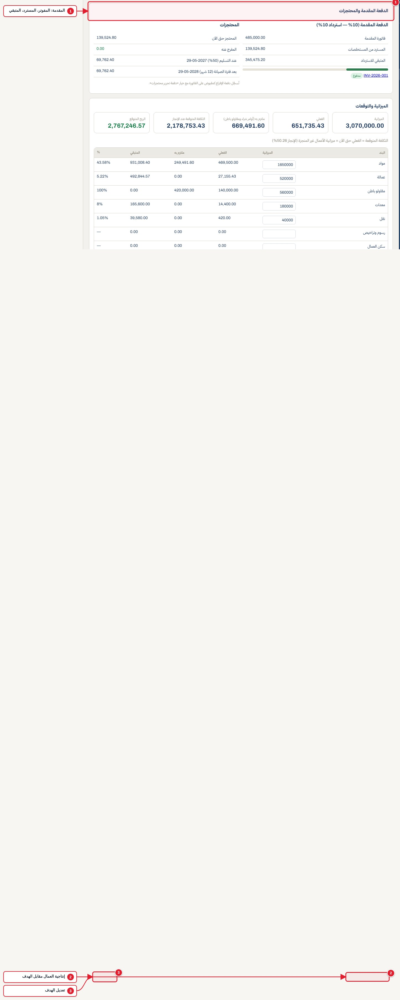

1. الدفعة المقدمة: المفوتر، المسترد من المستخلصات، والمتبقي. والمحتجزات: المحجوز، المفرج عنه، وما يُستحق عند التسليم وبعد الصيانة.
2. الإيراد لكل عامل في اليوم لكل شهر، مقارنةً بالهدف.
3. تعديل الهدف (درهم لكل عامل في اليوم).

<!--/img-->

### 7.8 الإيراد لكل عامل في اليوم
تعرض البطاقة لكل شهر: الأعمال المعتمدة ÷ أيام العمال (من الحضور) = الإيراد لكل عامل في اليوم، مقارنةً بالهدف. اضغط **تعديل الهدف** لتغييره.

### 7.9 الملاحظات والمستندات وغيرها
- **الملاحظات والمتابعة**: اكتب ملاحظة، واذكر زميلك بـ `@اسم_المستخدم` ليصله تنبيه.
- **المستندات المرفقة**: اختر النوع، وتاريخ الانتهاء (اختياري)، والملف (حتى 8 ميجابايت) ← **رفع**.
- تعرض الصفحة أيضاً فواتير المشروع ومصروفاته والتكلفة حسب البند.

### 7.10 تعديل المشروع أو إغلاقه
**تعديل** ← غيّر الحقول ← **حفظ**. لا يمكن حذف مشروع عليه فواتير أو مصروفات، فغيّر **الحالة** إلى **منتهي** أو **متوقف** أو **ملغي** بدلاً من الحذف.

---

## 8. فواتير العملاء

القائمة: **فواتير العملاء**.

<!--img-->

**📷 قائمة فواتير العملاء**

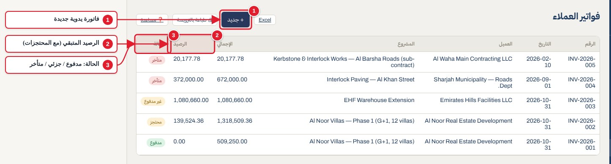

1. فاتورة يدوية جديدة (فاتورة الإنجاز تُنشأ من صفحة المشروع).
2. الرصيد المتبقي على العميل، شاملاً المحتجزات غير المحصّلة.
3. الحالة: مدفوع، جزئي، متأخر، ملغاة…

<!--/img-->

### 8.1 فاتورة إنجاز من جدول الكميات (الطريقة الموصى بها)
1. حدّث **نسبة الإنجاز %** لبنود الجدول (7.3).
2. في صفحة المشروع اضغط **فاتورة إنجاز من الجدول**.
3. ينشئ النظام فاتورة بالأعمال المنجزة الجديدة، ويخصم المحتجزات واسترداد المقدمة، ويفتحها.
4. راجعها واضغط **حفظ**.
5. **شهادة الدفع (المستخلص)** / **المستخلص PDF**: يطبع المستخلص المرحلي (IPC): لكل بند الكمية والسعر، السابق، الحالي، التراكمي والنسبة، ثم المحتجزات، واسترداد المقدمة، والصافي، والضريبة، والمستحق.

### 8.2 فاتورة يدوية
1. **+ جديد** (أو **+ فاتورة** من صفحة المشروع).
2. **رقم الفاتورة** (تلقائي، مثل `INV-2026-001`)، **التاريخ**، **المشروع** (إلزامي)، **تاريخ الاستحقاق**، **نسبة الضريبة %**، **نسبة المحتجزات %**.
3. أضف البنود كما في عرض السعر ← **حفظ**.
4. يظهر تنبيه إذا كان العميل بدون رقم ضريبي أو بدون عنوان، فصحّح بياناته من **العملاء والموردون**.

### 8.3 بعد الإصدار
افتح الفاتورة:
- **طباعة**، **PDF**، **إرسال بالإيميل**.
- **تذكير بالسداد** (يظهر فقط للفاتورة المتأخرة): يرسل تذكيراً بالرصيد المستحق.
- **تسجيل دفعة**: انظر البند 9.
- **إصدار إشعار دائن**: اكتب السبب، فيُنشأ إشعار دائن على الفاتورة (لتخفيض الفاتورة أو إلغائها).
- **إلغاء الفاتورة** (لمدير النظام فقط): اكتب السبب الإلزامي. الفواتير الضريبية لا تُحذف أبداً؛ تُلغى أو يُصدر لها إشعار دائن.

<!--img-->

**📷 فاتورة إنجاز مفتوحة**

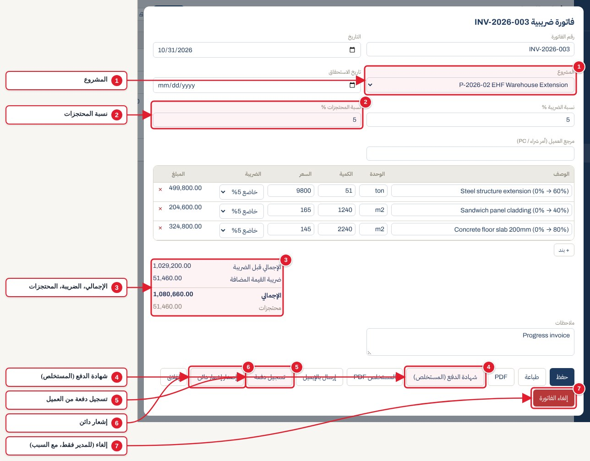

1. المشروع الذي تتبع له الفاتورة.
2. نسبة المحتجزات التي تُخصم من هذه الفاتورة.
3. الإجمالي والضريبة والمحتجزات.
4. «شهادة الدفع (المستخلص)» وPDF: المستخلص المرحلي مع السابق والحالي والتراكمي.
5. «تسجيل دفعة» عند استلام المبلغ من العميل.
6. «إصدار إشعار دائن» لتخفيض الفاتورة أو إلغائها محاسبياً.
7. «إلغاء الفاتورة»: لمدير النظام فقط، مع سبب إلزامي. الفاتورة الضريبية لا تُحذف.

<!--/img-->

---

### 8.4 العمل مع مقاول رئيسي: البروفورما (طلب الدفعة)
عند العمل لدى مقاول رئيسي يكون الترتيب: **بروفورما ← شهادة دفع (PC) من المقاول الرئيسي ← فاتورة ضريبية مطابقة للـ PC**. كل ذلك في صفحة المشروع، بطاقة **البروفورما وشهادات الدفع (PC)**.
1. حدّث **نسبة الإنجاز %** لبنود جدول الكميات (7.3).
2. اضغط **+ بروفورما (طلب دفعة)**. تُعبّأ من جدول الكميات: الكمية السابقة (كما في آخر اعتماد) والكمية التراكمية حتى الآن.
3. أدخل **للأعمال حتى تاريخ**، و**المواد بالموقع (تراكمي)** إن وجدت، وعدّل أي **كمية تراكمية**. اضغط **حفظ وإعادة الحساب**.
4. الملخص تراكمي مثل الـ PC: قيمة الأعمال (A)، ثم المحتجزات، والخصومات حسب آخر PC، والدفعات السابقة (B)، ثم **الصافي**.
5. **طباعة** / **PDF**: **PROFORMA INVOICE** بالإنجليزية: جدول الكميات بالكميات والمبالغ، والملخص، والصافي بالحروف. **بدون ضريبة أو رقم ضريبي أو بيانات بنك** وبدون أثر محاسبي، فهي للمقاول الرئيسي ليطابقها مع جداوله.
6. أرسلها، ثم اضغط **تعليم كمُقدَّم**.

<!--img-->

**📷 بطاقة البروفورما وشهادات الدفع في صفحة المشروع**

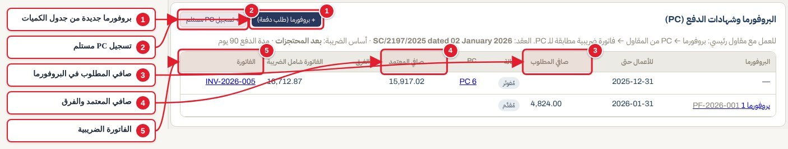

1. بروفورما جديدة تُعبّأ من جدول الكميات.
2. تسجيل PC مستلم بدون بروفورما (مثل أول PC في النظام).
3. صافي المطلوب في كل بروفورما.
4. صافي المعتمد في الـ PC والفرق عن المطلوب (بالأحمر إذا خُصم).
5. الفاتورة الضريبية الصادرة من الـ PC؛ اضغطها لفتحها.

<!--/img-->
<!--img-->

**📷 نافذة البروفورما**

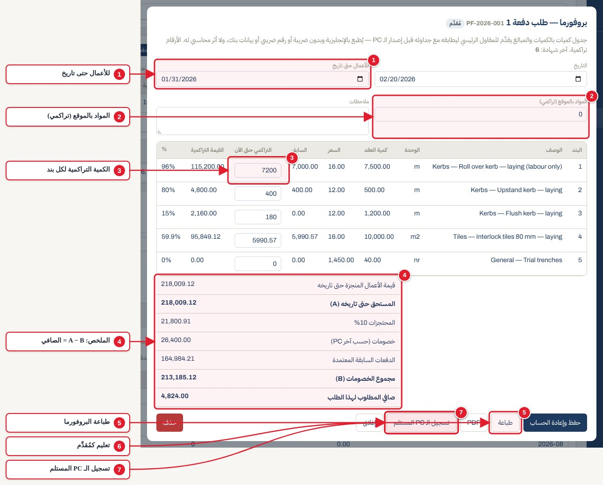

1. للأعمال حتى تاريخ.
2. المواد بالموقع (تراكمي) إن وجدت.
3. الكمية التراكمية لكل بند؛ السابق يأتي من آخر PC.
4. الملخص التراكمي: الأعمال (A)، المحتجزات والخصومات والدفعات السابقة (B)، والصافي.
5. طباعة البروفورما بالإنجليزية بدون ضريبة أو رقم ضريبي أو بيانات بنك.
6. بعد الإرسال للمقاول الرئيسي: تعليم كمُقدَّم.
7. عند وصول الـ PC: تسجيل الـ PC المستلم.

<!--/img-->
<!--img-->

**📷 البروفورما مطبوعة**

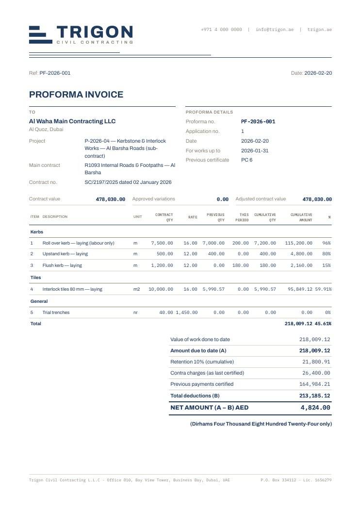

1. جدول الكميات: كمية العقد، السابق، هذه الفترة، التراكمي والمبلغ والنسبة.
2. الملخص والصافي بالحروف — بدون ضريبة أو رقم ضريبي أو بيانات بنك.

<!--/img-->

### 8.5 تسجيل الـ PC المستلم
1. عند وصول الـ PC افتح البروفورما واضغط **تسجيل الـ PC المستلم** (أو **+ تسجيل PC مستلم** من البطاقة).
2. أدخل **رقم الـ PC** و**تاريخ الإصدار** و**للأعمال حتى**، و**الأرقام التراكمية كما هي مطبوعة على الـ PC**: قيمة الأعمال، والمواد، واسترداد المقدمة، والمحتجزات، والإفراج عن المحتجزات، والخصومات، والدفعات السابقة؛ و**الضريبة المعتمدة** إن وُجدت.
3. **قيم الشهادة السابقة** تُعبّأ من آخر PC. إذا كانت هذه أول شهادة تسجّلها في النظام (مثلاً PC رقم 6) فأدخل القيم «السابقة» مرة واحدة من الـ PC.
4. في **الكميات المعتمدة لكل بند** عدّل ما خصمه المقاول الرئيسي، ثم **استخدم مجموع البنود كقيمة الأعمال**.
5. الملخص يحسب الصافي والضريبة فوراً. بعد **حفظ** يتحقق النظام من الحسابات (الدفعات السابقة، الضريبة، مجموع البنود) ويعرض **الفرق بين المطلوب والمعتمد**. أرفق صورة الـ PC في **المستندات المرفقة**.

<!--img-->

**📷 نافذة تسجيل الـ PC**

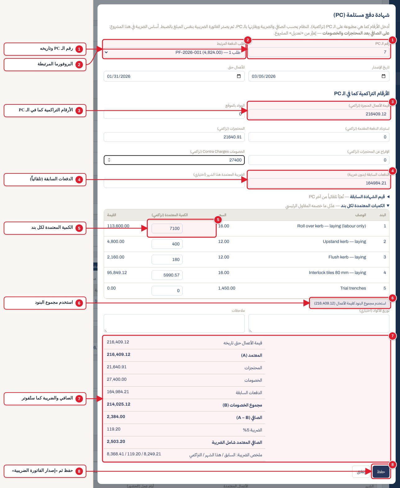

1. رقم الـ PC وتاريخ إصداره.
2. البروفورما التي يعتمدها هذا الـ PC.
3. الأرقام التراكمية كما هي مطبوعة على الـ PC.
4. الدفعات السابقة: تُحسب تلقائياً من الشهادات السابقة؛ قارنها بالـ PC.
5. الكمية المعتمدة لكل بند: عدّل ما خصمه المقاول الرئيسي.
6. استخدم مجموع البنود كقيمة الأعمال.
7. الصافي والضريبة والمجموع كما ستكون في الفاتورة، وملخص الضريبة.
8. احفظ؛ ثم يظهر زر «إصدار الفاتورة الضريبية».

<!--/img-->

### 8.6 الفاتورة الضريبية من الـ PC
1. في نافذة الـ PC اضغط **إصدار الفاتورة الضريبية** (المحاسب / مدير النظام) وأدخل تاريخ الفاتورة.
2. الفاتورة تساوي الـ PC **بالفلس**: قيمة أعمال الفترة، ناقص الخصومات والمحتجزات واسترداد المقدمة؛ والضريبة على الأساس الصحيح؛ وتاريخ الاستحقاق من مدة الدفع في المشروع؛ ورقم الـ PC في **مرجعكم** ورقم العقد في التفاصيل.
3. الدفاتر تبقى صحيحة: الإيراد بقيمة الأعمال، والمحتجزات ذمة على العميل (بدون ضريبة في أساس الصافي)، والخصومات تُنقص الإيراد؛ و**نسبة الفوترة** في جدول الكميات تتبع الكميات المعتمدة.
4. إذا كان في الـ PC فروقات يسألك النظام قبل الإصدار. لتعديل PC مفوتَر **ألغِ الفاتورة** (مدير النظام) فيُفتح الـ PC من جديد.
5. فواتير الـ PC لا تُرسل إلى Zoho تلقائياً حالياً؛ أدخلها في Zoho يدوياً.

<!--img-->

**📷 فاتورة ضريبية صادرة من PC**

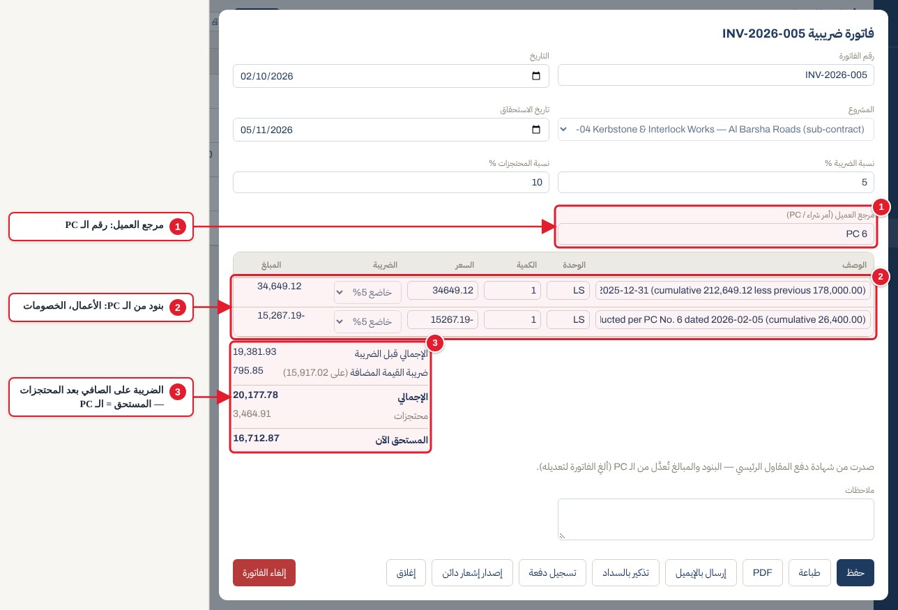

1. مرجع العميل: رقم الـ PC.
2. البنود من الـ PC: أعمال الفترة، والخصومات؛ لا تُعدَّل هنا.
3. الضريبة على الصافي بعد المحتجزات، والمستحق الآن يساوي الـ PC.

<!--/img-->
<!--img-->

**📷 الفاتورة الضريبية مطبوعة**

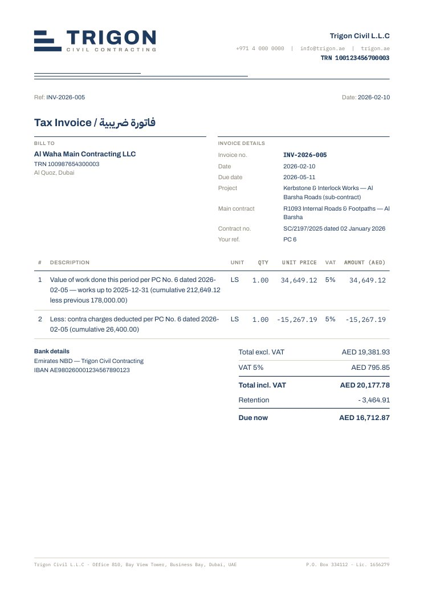

1. الاسم القانوني والرقم الضريبي أعلى الصفحة؛ العميل ورقمه الضريبي وتفاصيل العقد والـ PC.
2. بيانات البنك بجانب الإجماليات، بدون خطوط توقيع.

<!--/img-->

---

## 9. المدفوعات والمقبوضات

القائمة: **المدفوعات والمقبوضات** (أو **تسجيل دفعة** من داخل الفاتورة أو المصروف).

1. اضغط **+ تسجيل دفعة**. المبلغ يجب أن يكون موجباً ولا يتجاوز الرصيد المفتوح للفاتورة أو المصروف. للشيكات المؤجلة انظر القسم 35، ولدفعات الموردين فوق حد الاعتماد انظر القسم 38.
2. **النوع**: **مقبوضات من عميل** أو **دفعة لمورد**.
3. **مرتبطة بـ**: اختر الفاتورة أو المصروف المفتوح.
4. **التاريخ**، **المبلغ**.
5. **طريقة الدفع**: تحويل بنكي، شيك، نقد، بطاقة. إذا كان لديك أكثر من حساب بنكي، اختر **الحساب البنكي**.
6. للشيكات: **تاريخ استحقاق الشيك** و**حالة الشيك** (قيد التحصيل / تم صرفه / مرتجع). الشيكات قيد التحصيل والمرتجعة لا تدخل في الرصيد النقدي، والشيك المرتجع لا يسدد الفاتورة.
7. **المرجع / رقم الشيك**.
8. إذا كانت دفعة محتجزات من العميل، علّم **هذه دفعة تحرير محتجزات**.
9. **حفظ**. لتحديث حالة شيك لاحقاً (مثلاً تم صرفه)، افتحه من قائمة المدفوعات.

<!--img-->

**📷 نافذة تسجيل دفعة**

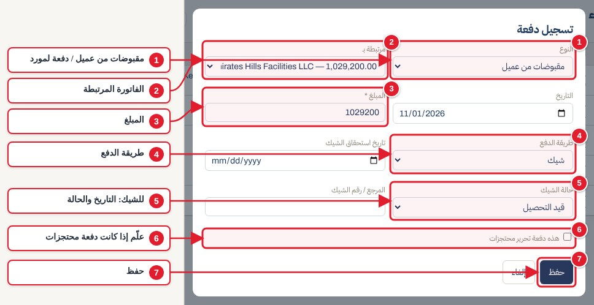

1. النوع: مقبوضات من عميل، أو دفعة لمورد.
2. الفاتورة أو المصروف المرتبط (تظهر المفتوحة فقط مع رصيدها).
3. المبلغ (يُقترح الرصيد المتبقي تلقائياً).
4. طريقة الدفع: تحويل، شيك، نقد، بطاقة. والحساب البنكي إذا كان لديك أكثر من بنك.
5. للشيك: تاريخ الاستحقاق والحالة. الشيك «قيد التحصيل» لا يدخل الرصيد النقدي حتى يُصرف.
6. علّم هذا الخيار إذا كانت الدفعة إفراجاً عن المحتجزات.
7. احفظ.

<!--/img-->

---

## 10. أعمار الديون وكشوف الحساب

القائمة: **أعمار الديون وكشوف الحساب**.
1. اختر **مستحق لنا (العملاء)** أو **مستحق علينا (الموردون)** و**حتى تاريخ**.
2. تُقسم الأرصدة حسب أيام التأخير، والمحتجزات غير المستحقة بعد تظهر منفصلة.
3. اضغط على العميل أو المورد لفتح **كشف حساب**، واختر الفترة (من / إلى)، ثم **طباعة** أو **إرسال بالإيميل** (مع PDF).

<!--img-->

**📷 أعمار الديون**

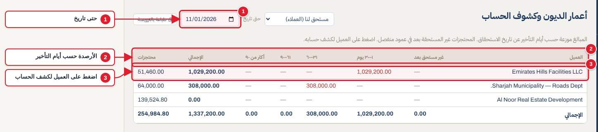

1. التاريخ الذي تُحسب عليه الأعمار.
2. الأرصدة موزعة حسب أيام التأخير: حالي، 1–30، 31–60، 61–90، أكثر من 90، والمحتجزات.
3. اضغط على العميل أو المورد لفتح كشف حسابه.

<!--/img-->
<!--img-->

**📷 كشف حساب عميل**

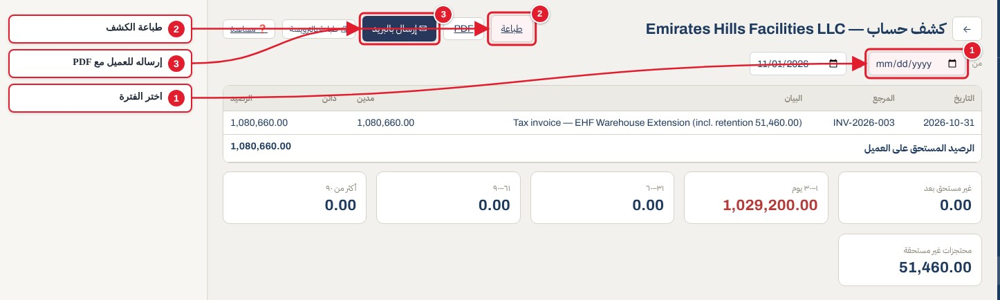

1. اختر الفترة.
2. طباعة الكشف بترويسة الشركة.
3. إرساله بالإيميل للعميل مع PDF.

<!--/img-->

---

## 11. يومية الموقع

القائمة: **يومية الموقع**.
1. **+ إضافة**.
2. **المشروع**، **التاريخ**، **الطقس**، **عدد العمال**، **الأعمال المنجزة**، **العوائق والملاحظات**، **ملاحظات أخرى**.
3. **حفظ**. تُطبع بترويسة الشركة من **🖨 طباعة بالترويسة**.

<!--img-->

**📷 نموذج يومية الموقع**

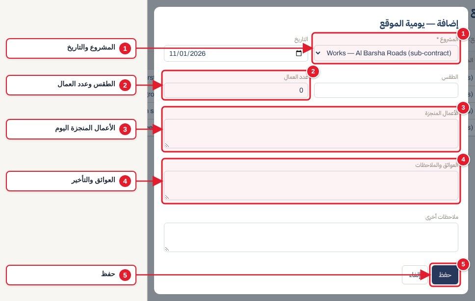

1. المشروع وتاريخ اليوم.
2. الطقس وعدد العمال في الموقع.
3. الأعمال المنجزة اليوم بالتفصيل.
4. العوائق والتأخيرات (مهمة للمطالبات لاحقاً).
5. احفظ.

<!--/img-->

---

## 12. طلبات الأسعار وأوامر الشراء

### 12.1 طلب الأسعار ومقارنة الموردين
القائمة: **طلبات الأسعار (RFQ)**.
1. **+ طلب جديد**.
2. اختر **المشروع** واكتب **الوصف**.
3. أدخل البنود: البند، الوحدة، الكمية (**+ بند** لإضافة المزيد).
4. اضغط **+ مورد** لكل مورد أرسل سعراً، واكتب سعره لكل بند، ومدة التوريد (أيام).
5. يحسب النظام إجمالي كل مورد ويُبرز الأقل.
6. **حفظ**.
7. اضغط **ترسية + أمر شراء** تحت المورد المختار، فيُنشأ أمر الشراء تلقائياً.

<!--img-->

**📷 طلب أسعار ومقارنة الموردين**

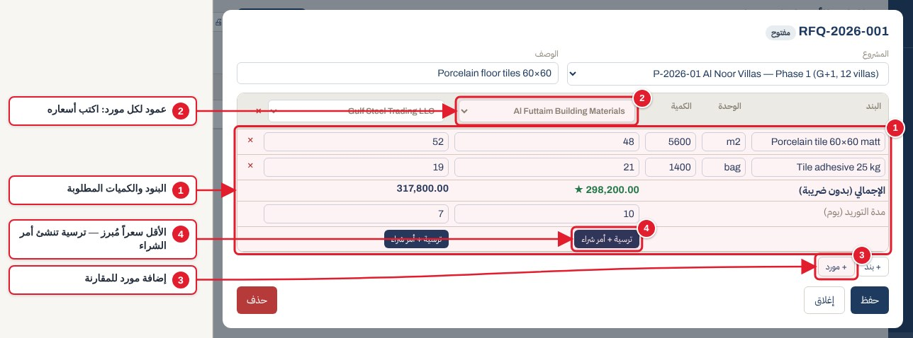

1. البنود المطلوبة: الوصف والوحدة والكمية.
2. عمود لكل مورد: اختر المورد واكتب سعره لكل بند. الإجمالي يُحسب تلقائياً.
3. إضافة مورد آخر للمقارنة.
4. الأقل سعراً يظهر مُبرزاً. «ترسية + أمر شراء» تحت المورد المختار ينشئ أمر الشراء فوراً.

<!--/img-->

### 12.2 أمر الشراء
القائمة: **أوامر الشراء** (أو يُنشأ من طلب الأسعار).
1. **+ أمر شراء**: **المورد**، **المشروع**، **التاريخ**، **تاريخ التسليم**، **نسبة الضريبة %**.
2. **شروط الدفع**، **مكان التسليم** و**مسؤول الاستلام بالموقع (الاسم / الجوال)**، **مدة الاتفاقية من / إلى**، **رقم طلب الشراء الداخلي (PR)**، **مرجع عرض سعر المورد**.
3. البنود: **كود الصنف**، **الوصف** (يقبل عدة أسطر)، **الوحدة**، **الكمية**، **سعر الوحدة**، **خصم %**، الضريبة. الصافي بعد الخصم ومجموع الخصم والإجماليات تتحدث أثناء الكتابة.
4. **شروط خاصة بهذا الأمر** و**ملاحظات** عند الحاجة ← **حفظ**.
5. **طباعة** / **PDF**: أمر شراء عليه الرقم الضريبي للمورد ولتريجون، والأسعار الصافية، والإجمالي بالحروف، والملاحظات الثابتة، وخطوط توقيع للطرفين؛ و**الشروط العامة للشراء** صفحة ثانية (الإعدادات، 2.7).
6. **إرسال للمورد**. عند وصول البضاعة اضغط **استلام وإنشاء فاتورة مورد**، والفاتورة تأخذ الصافي بعد الخصم.

<!--img-->

**📷 نافذة أمر الشراء**

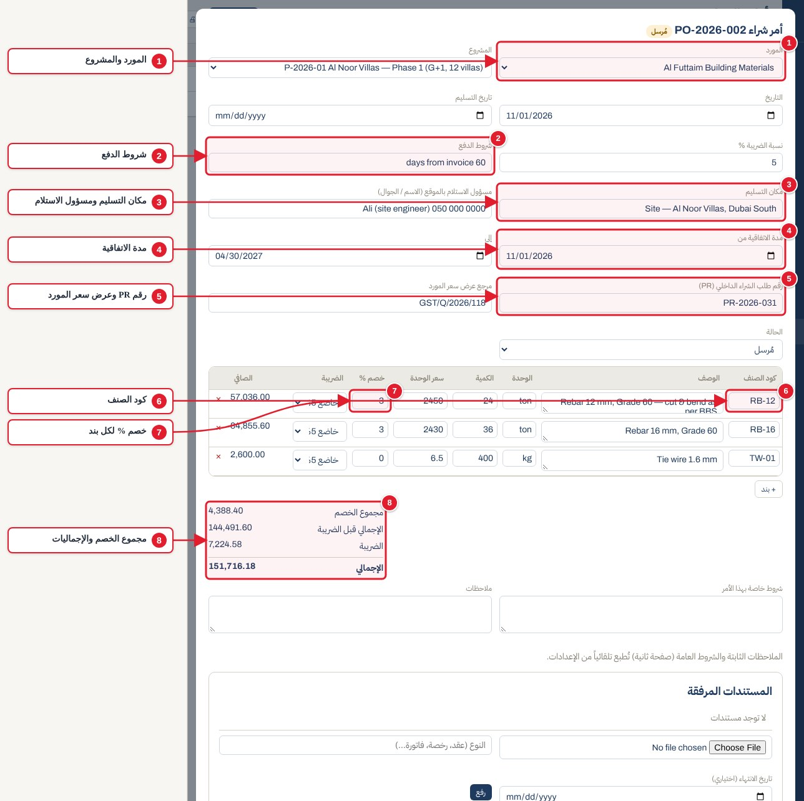

1. المورد والمشروع.
2. شروط الدفع.
3. مكان التسليم ومسؤول الاستلام بالموقع.
4. مدة الاتفاقية من / إلى.
5. رقم طلب الشراء الداخلي ومرجع عرض سعر المورد.
6. كود الصنف لكل بند.
7. الخصم % لكل بند؛ الصافي بعد الخصم.
8. مجموع الخصم والإجمالي قبل وبعد الضريبة.

<!--/img-->
<!--img-->

**📷 أمر الشراء مطبوعاً (الصفحة الأولى)**

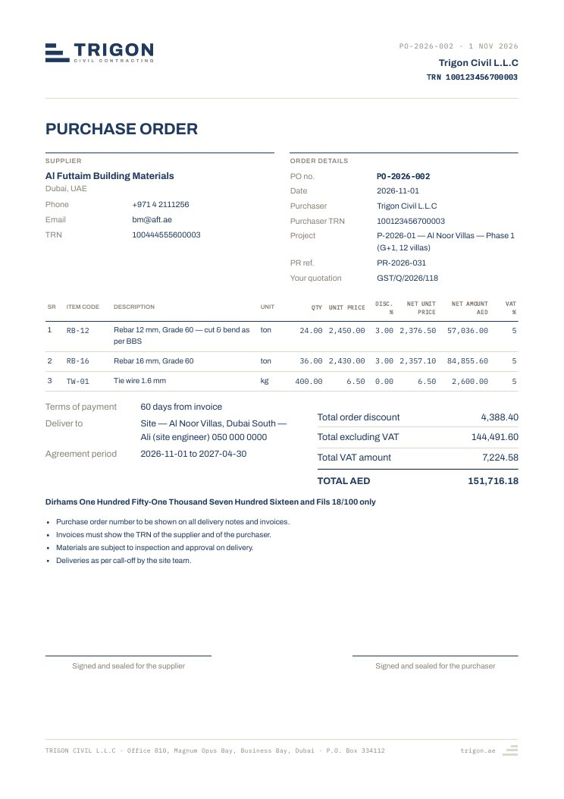

1. المورد ورقمه الضريبي، وتريجون ورقمها الضريبي، وPR وعرض السعر.
2. البنود بالكود والخصم، والإجمالي بالحروف، والملاحظات الثابتة، وتوقيع الطرفين؛ الشروط العامة في الصفحة الثانية.

<!--/img-->

## 13. المصروفات والمشتريات

القائمة: **المصروفات والمشتريات** (أو **+ مصروف** من صفحة المشروع).
1. **+ جديد**.
2. **التاريخ**، **المورد**، **المشروع** (فارغ = مصاريف عامة).
3. **البند**: مواد، عمالة، مقاولو باطن، معدات، نقل، رسوم وتراخيص، سكن العمال، تأشيرات ورسوم عمل، تأمين طبي، مصاريف عامة، أخرى — أو **شراء أصل ثابت (يُهلك)** للأصول.
4. **الوصف**، **المبلغ (بدون ضريبة)**، **ضريبة القيمة المضافة (إن وجدت)**، **رقم فاتورة المورد**.
5. للتكلفة المشتركة (إيجار، معدات مشتركة…): علّم **توزيع المصروف على عدة مشاريع**، وأضف المشاريع بزر **+ مشروع**، واكتب النسبة لكل مشروع (المجموع 100%).
6. **حفظ**، ثم **تسجيل دفعة** عند الدفع.

> لا تُدخل الرواتب هنا كـ«عمالة»؛ الرواتب تُسجَّل من وحدة الرواتب.

<!--img-->

**📷 مصروف موزّع على مشروعين**

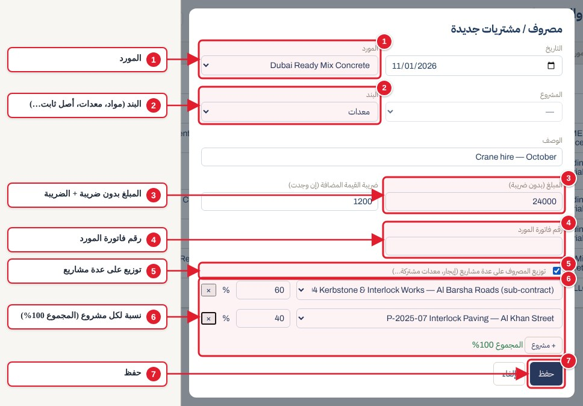

1. المورد.
2. البند: يحدد نوع التكلفة في تقارير المشروع (واختر «شراء أصل ثابت» للأصول).
3. المبلغ بدون ضريبة، ومبلغ الضريبة كما في فاتورة المورد.
4. رقم فاتورة المورد للرجوع إليها.
5. علّم هذا الخيار لتوزيع المصروف على عدة مشاريع.
6. اختر المشاريع ونسبة كل مشروع؛ يجب أن يكون المجموع 100% (يظهر بالأخضر).
7. احفظ، ثم «تسجيل دفعة» عند الدفع.

<!--/img-->

---

## 14. مقاولو الباطن وشهادات الدفع

القائمة: **مقاولو الباطن وشهادات الدفع**.

### 14.1 عقد مقاول الباطن
1. **+ إضافة**: مقاول الباطن، المشروع، نطاق العمل، قيمة العقد (بدون ضريبة)، نسبة المحتجزات %، الدفعة المقدمة، الحالة.
2. للشهادة والاتفاقية عبّئ أيضاً: **رقم اتفاقية عقد الباطن** و**تاريخها**، **تاريخ البدء / الإنجاز / الإنجاز بعد التمديد**، **أوامر التغيير المعتمدة (مجموع)**، **أساس الضريبة في الشهادات** (على الصافي بعد المحتجزات والخصومات، أو على قيمة الأعمال)، و**نسبة الإضافة على الخصومات Contra %** (مثل 12) ← **حفظ**.
3. **الدفعة المقدمة للمقاول:** افتح العقد واضغط **تسجيل الدفعة المقدمة** (للمدير والمحاسب). تُسجَّل كمستحق للمقاول على حساب «دفعات مقدمة لمقاولي الباطن» (أصل وليست مصروفاً على المشروع)، ثم ادفعها من **المدفوعات والمقبوضات**. تُستردّ بعد ذلك من شهادات الدفع عبر حقل استرداد الدفعة المقدمة.

<!--img-->

**📷 عقد مقاول باطن وشهاداته**

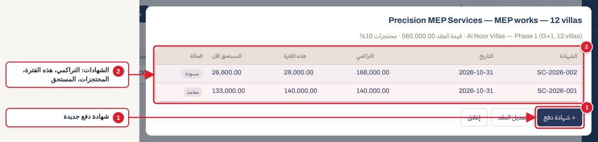

1. شهادة دفع جديدة لهذا العقد.
2. الشهادات السابقة: التراكمي، هذه الفترة، المحتجزات، المستحق، والحالة.

<!--/img-->
<!--img-->

**📷 بيانات عقد الباطن**

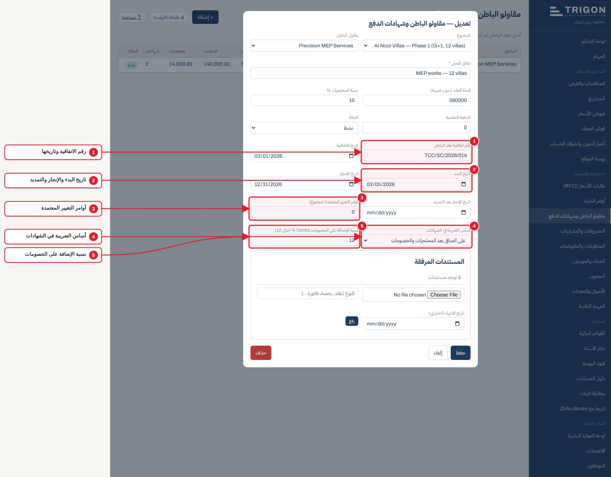

1. رقم الاتفاقية وتاريخها.
2. تواريخ البدء والإنجاز والتمديد.
3. مجموع أوامر التغيير المعتمدة.
4. أساس الضريبة في الشهادات.
5. نسبة الإضافة على الخصومات (مثل 12%).

<!--/img-->

### 14.2 شهادة الدفع
1. افتح العقد ← **+ شهادة دفع**.
2. **تاريخ الإصدار**، **للأعمال حتى تاريخ**، **قيمة الأعمال المنجزة حتى تاريخه (تراكمي)** و**المواد بالموقع (تراكمي)**.
3. لهذه الشهادة: **استرداد الدفعة المقدمة**، **الخصومات Contra Charges** (أو اكتب التكلفة في **تكلفة الخصومات** فتُضاف النسبة)، و**الإفراج عن محتجزات**.
4. **مرجع طلب الدفعة من المقاول**، **توزيع الأكواد** (سطر لكل كود: الكود ثم المبلغ) و**ملاحظات**.
5. الملخص يعرض هذه الشهادة؛ وبعد الحفظ: A وB التراكمية والدفعات السابقة وملخص الضريبة.
6. **طباعة** / **PDF**: **PAYMENT CERTIFICATE FOR SUBCONTRACTOR** بالشكل المعتاد للـ PC: قيمة العقد والتغييرات والضريبة والقيمة المعدّلة والتواريخ؛ الأعمال والمواد والمقدمة (A)؛ المحتجزات والخصومات والإفراج والدفعات السابقة (B)؛ الصافي والضريبة والصافي المعتمد شامل الضريبة، وملخص الضريبة (سابق / هذه / تراكمي)، والأكواد، والملاحظات، والمبلغ بالحروف، وخانات التوقيع من الإعدادات.
7. **اعتماد وإنشاء مصروف** (المحاسب): تُقفل الشهادة وتُسجَّل تكلفة الفترة (الأعمال + المواد − الخصومات) مع الضريبة كما هي معتمدة. أساس الضريبة يُثبَّت على كل شهادة عند إنشائها، فلا تتغير الشهادات الصادرة.
8. ادفعها من **المدفوعات والمقبوضات**.

<!--img-->

**📷 نافذة شهادة دفع مقاول الباطن**

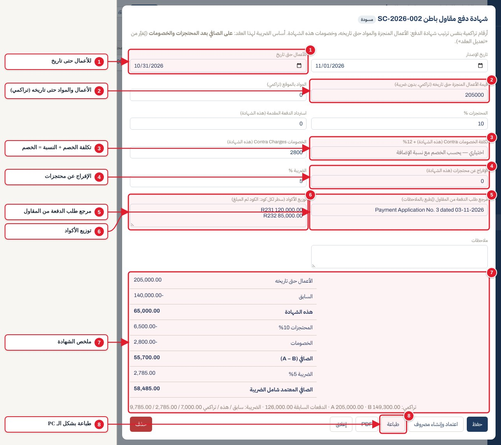

1. للأعمال حتى تاريخ.
2. الأعمال والمواد حتى تاريخه بشكل تراكمي.
3. تكلفة الخصم: اكتبها فتُضاف النسبة وتظهر في الخصومات.
4. الإفراج عن محتجزات في هذه الشهادة.
5. مرجع طلب الدفعة من المقاول؛ يُطبع في الملاحظات.
6. توزيع الأكواد: سطر لكل كود ثم المبلغ.
7. ملخص الشهادة، وبعد الحفظ الأرقام التراكمية وملخص الضريبة.
8. طباعة بشكل الـ PC.

<!--/img-->
<!--img-->

**📷 شهادة دفع مقاول الباطن مطبوعة**

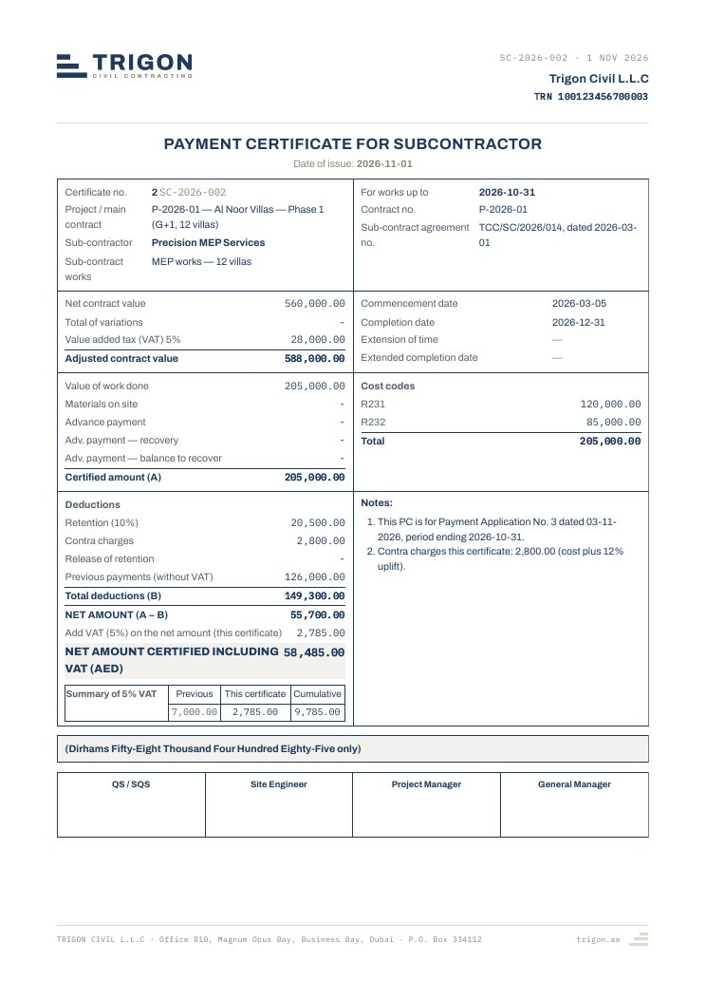

1. بيانات العقد والتواريخ، ثم المعتمد (A) والخصومات (B) والصافي والضريبة.
2. ملخص الضريبة والأكواد والملاحظات والمبلغ بالحروف وخانات التوقيع.

<!--/img-->

### 14.3 اتفاقية عقد الباطن
1. افتح العقد ← **📄 اتفاقية عقد الباطن**.
2. **الدفع خلال (يوم من الفاتورة)**، **فترة الصيانة (أشهر)**، **رقم الرخصة التجارية لمقاول الباطن**، ومن يوقّع عن تريجون (فارغ = من الإعدادات).
3. **ملحق 1 — جدول الكميات**: البند، الوصف، الوحدة، الكمية، السعر. علّم **اجعل المجموع قيمة العقد** عند الحاجة.
4. **ملحق 2 — الشروط الخاصة ونطاق العمل**.
5. **ملحق 3 — مصفوفة المسؤوليات**: لكل بند اختر المقاول، أو مقاول الباطن، أو الاثنين، أو N/A، مع ملاحظة.
6. **نص الاتفاقية لهذا العقد**: النص القياسي من الإعدادات؛ عدّله لهذا العقد فقط، أو **إرجاع النص القياسي**.
7. **حفظ** ثم **طباعة** / **PDF**: صفحة غلاف، والاتفاقية بالخانات معبّأة (الأسماء، الرخصة والرقم الضريبي، القيمة بالأرقام والحروف، المحتجزات وطريقة الإفراج، أيام الدفع، نسبة الخصومات، التواريخ)، وخطوط التوقيع والشهود، وكل ملحق في صفحة مستقلة.

<!--img-->

**📷 نافذة اتفاقية عقد الباطن**

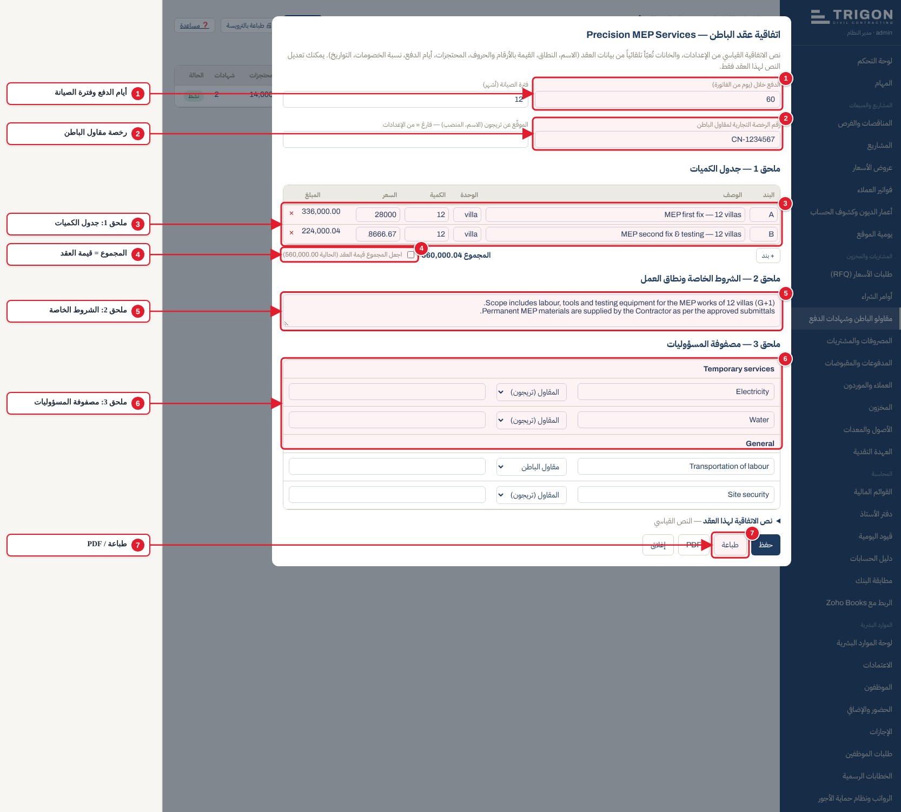

1. أيام الدفع وفترة الصيانة.
2. رقم رخصة مقاول الباطن (يُطبع في مقدمة الاتفاقية).
3. ملحق 1: جدول الكميات.
4. اجعل مجموع الجدول قيمة العقد.
5. ملحق 2: الشروط الخاصة ونطاق العمل.
6. ملحق 3: مصفوفة المسؤوليات — المقاول / مقاول الباطن / الاثنين / N/A.
7. طباعة / PDF.

<!--/img-->
<!--img-->

**📷 صفحة من الاتفاقية مطبوعة**

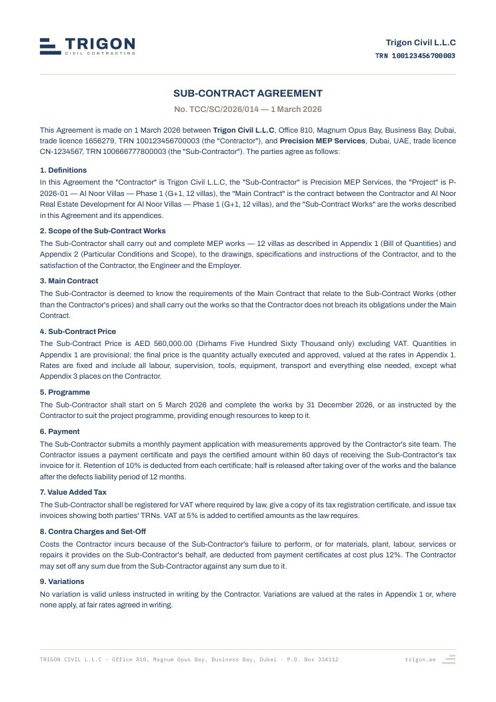

1. الأطراف والبنود مع الخانات معبّأة من بيانات العقد.

<!--/img-->

## 15. المخزون

القائمة: **المخزون**.
1. **+ إضافة** صنف: الرمز، الاسم، الوحدة، حد إعادة الطلب، المكان.
2. **حركة مخزون**: اختر **استلام** أو **صرف للمشروع** أو **تسوية (+/−)**، والصنف، والكمية، وتكلفة الوحدة (للاستلام)، والمشروع، والمرجع ← **حفظ**.
3. تعرض القائمة الكمية، ومتوسط التكلفة، والقيمة، وتنبيه «منخفض» تحت حد إعادة الطلب.

> المخزون يتابع الكميات ومتوسط التكلفة فقط؛ تكلفة المواد تُسجَّل من فواتير الموردين وأوامر الشراء.

<!--img-->

**📷 المخزون**

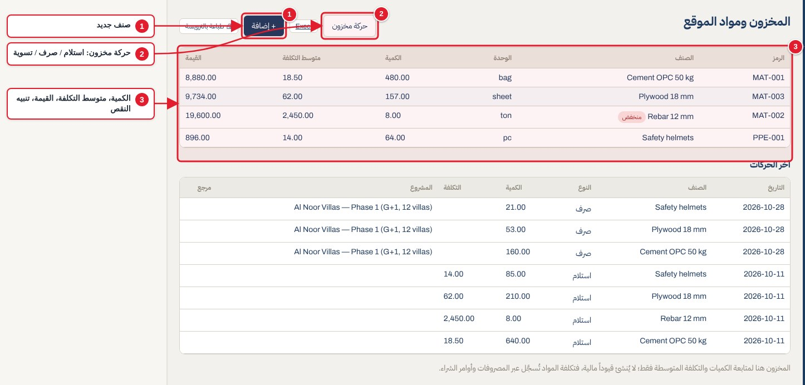

1. إضافة صنف جديد.
2. حركة مخزون: استلام، صرف لمشروع، أو تسوية.
3. الكميات ومتوسط التكلفة والقيمة، وتنبيه عند النزول تحت حد إعادة الطلب.

<!--/img-->

---

## 16. الأصول والمعدات

القائمة: **الأصول والمعدات**.
1. **+ إضافة**: الأصل، الفئة، الرقم التسلسلي / اللوحة، تاريخ الشراء، التكلفة، القيمة التخريدية، العمر الإنتاجي (سنوات)، المشروع الحالي، الحالة، تاريخ الاستبعاد ← **حفظ**.
2. الإهلاك بالقسط الثابت شهرياً من شهر الشراء، وتعرض القائمة مجمع الإهلاك والقيمة الدفترية.
3. سجّل فاتورة الشراء بالبند **شراء أصل ثابت** بنفس التكلفة حتى لا تُحتسب مصروفاً كاملاً. إن كان الأصل **مملوكاً قبل بدء النظام** (بلا فاتورة) اختر ذلك في حقل **مصدر الأصل**؛ تدخل تكلفته المحاسبة مقابل حساب الشريك.
4. إذا ظهر تحذير **سجل الأصول لا يطابق فواتير شراء الأصول** فهناك أصل بلا فاتورة شراء (سجّل فاتورته أو علّمه مملوكاً قبل النظام) أو فاتورة أصل بلا بطاقة أصل.
5. **الاستبعاد أو البيع:** غيّر الحالة إلى مستبعد واكتب تاريخ الاستبعاد و**ثمن البيع** (صفر إن لم يُبع). يُخرج النظام التكلفة ومجمع الإهلاك من الحسابات، يُدخل ثمن البيع البنك، ويسجّل الفرق ربحاً أو خسارة استبعاد. لا تصدر فاتورة مبيعات منفصلة لنفس البيع.

<!--img-->

**📷 الأصول والمعدات**

1. إضافة أصل (سيارة، معدة، جهاز).
2. الإهلاك المجمع والقيمة الدفترية تُحسب شهرياً تلقائياً.

<!--/img-->

---

## 17. العهدة النقدية

القائمة: **العهدة النقدية**.
1. **+ تغذية العهدة**: التاريخ، المبلغ، ملاحظة ← **حفظ**.
2. **+ مصروف نقدي**: التاريخ، المشروع، البند، الوصف، المبلغ (بدون ضريبة)، الضريبة ← **حفظ**. يُسجَّل كمصروف على المشروع ويُدفع من العهدة.
3. تعرض الصفحة رصيد العهدة. احتفظ بإيصال أو فاتورة ضريبية لكل مصروف.

<!--img-->

**📷 العهدة النقدية**

1. تغذية العهدة بمبلغ نقدي.
2. مصروف نقدي على مشروع (يُسجَّل كمصروف مع الضريبة).
3. الرصيد المتبقي في العهدة.

<!--/img-->

---

## 18. إضافة موظف

القائمة: **الموظفون**.

### 18.1 ملف الموظف
1. **+ إضافة**.
2. الهوية: **الاسم (كما في جواز السفر)** (إلزامي)، **المهنة**، **رقم بطاقة العمل / Person Code (١٤ رقم)**، **رقم الهوية الإماراتية**، **رقم الجواز**، **الجنسية**.
3. العمل: **تاريخ الالتحاق**، **الحالة** (نشط)، **تحميل التكلفة على** (مشروع، أو عمومي — الإدارة)، **نهاية فترة التجربة (حتى ٦ أشهر)**، **المدير المباشر (يعتمد الإجازات أولاً)**.
4. الراتب: **الراتب الأساسي**، **بدل سكن**، **بدل مواصلات**، **بدلات أخرى**.
5. بنك الرواتب WPS: **البنك / شركة الصرافة**، **رمز التوجيه (٩ أرقام)**، **الآيبان IBAN**: مطلوبة لملف الرواتب.
6. تواريخ الانتهاء: **انتهاء الهوية**، **انتهاء الإقامة**، **انتهاء الجواز**، **انتهاء بطاقة العمل**، وتصل تنبيهات قبل الانتهاء.
7. **الهاتف**، **البريد**، **جهة اتصال للطوارئ**، **رصيد إجازات افتتاحي (أيام)**، **ملاحظات**.
8. **حفظ**. تعرض القائمة الإجمالي الشهري، ومكافأة نهاية الخدمة التقديرية، وتنبيهاً إذا كان الآيبان ناقصاً.

<!--img-->

**📷 قائمة الموظفين**

1. إضافة موظف جديد.
2. اضغط الموظف لفتح ملفه الكامل.
3. مكافأة نهاية الخدمة التقديرية حتى اليوم.
4. يظهر «ناقص» بالأحمر إذا لم يُدخل الآيبان.

<!--/img-->
<!--img-->

**📷 نموذج موظف جديد**

1. الاسم كما في جواز السفر (إلزامي). بجانبه المهنة.
2. رقم بطاقة العمل 14 رقماً، ورقم الهوية والجواز والجنسية: مطلوبة لـ WPS والمستندات.
3. تاريخ الالتحاق: منه تُحسب الإجازات ونهاية الخدمة.
4. تحميل التكلفة: المشروع الذي يُحمَّل عليه راتبه، أو «عمومي» للإدارة.
5. الراتب الأساسي والبدلات (سكن، مواصلات، أخرى).
6. البنك أو الصرافة، رمز التوجيه 9 أرقام، والآيبان: بدونها لا يدخل في ملف SIF.
7. تواريخ انتهاء الهوية والإقامة والجواز وبطاقة العمل: تصل تنبيهات قبل الانتهاء.
8. المدير المباشر: أول من يعتمد إجازاته.
9. نهاية فترة التجربة (حتى 6 أشهر).
10. احفظ.

<!--/img-->

### 18.2 بعد الحفظ — افتح ملف الموظف مرة أخرى
- **المستندات المرفقة**: ارفع الجواز، الإقامة، الهوية، العقد… مع تواريخ الانتهاء.
- **حساب بوابة الموظف**: اكتب اسم المستخدم وكلمة المرور (٦ أحرف+) ← **إنشاء الحساب**. (أو **إعادة تعيين كلمة المرور** إذا كان الحساب موجوداً.)
- **الانضمام والمغادرة** ← **بدء إجراءات الانضمام**: علّم البنود الـ12 عند إنجازها (تصريح العمل وعقد MOHRE، الفحص الطبي، الهوية، التأمين الصحي، التأمين ضد التعطل ILOE، حساب الرواتب WPS، تعريف السلامة…).
- **الملاحظات والمتابعة** مع الإشارة بـ `@`.

<!--img-->

**📷 أسفل ملف الموظف**

1. المستندات المرفقة: ارفع الجواز والإقامة والعقد مع تاريخ الانتهاء.
2. حساب بوابة الموظف: اسم مستخدم وكلمة مرور ليدخل من جواله.
3. الانضمام والمغادرة: قائمة إجراءات الانضمام، والتسوية عند المغادرة.

<!--/img-->
<!--img-->

**📷 قائمة إجراءات الانضمام**

1. علّم كل بند عند إنجازه؛ يُحفظ اسم من أنجزه والتاريخ.
2. قسم المغادرة والتسوية النهائية (البند 25).

<!--/img-->

---

## 19. الحضور والعمل الإضافي

القائمة: **الحضور والعمل الإضافي**.

<!--img-->

**📷 صفحة الحضور اليومي**

1. اختر التاريخ.
2. «تسجيل حضور الفريق» للعمال بدون هاتف.
3. حالة اليوم لكل موظف: حاضر، غائب، إجازة، مرضي، عطلة، راحة.
4. ساعات الإضافي +25% (نهاري) و+50% (ليلي أو راحة). تنتقل للرواتب.
5. المشروع الذي عمل فيه (لتوزيع تكلفة الراتب).

<!--/img-->

### 19.1 الحضور من الجوال (الموظف)
1. يفتح الموظف **بوابتي** على الجوال ويضغط **تسجيل الحضور** (و**تسجيل الانصراف** في نهاية اليوم).
2. الوقت يُؤخذ من الخادم، ويُرفق موقع الهاتف.
3. خارج نطاق الموقع يُعلَّم السجل ويصل تنبيه للمدير المباشر (أو يُمنع، انظر 26.2).

### 19.2 العمال بدون هاتف (الفورمان / المشرف)
1. **تسجيل حضور الفريق**.
2. اختر **دخول** أو **خروج**، وعلّم الأسماء، ثم **تسجيل**. يُحفظ الوقت الحالي مع موقع جوالك.
3. الموارد البشرية فقط يمكنها إدخال **وقت سابق (تصحيح من الموارد البشرية)**، مثلاً موظف نسي تسجيل الانصراف.

<!--img-->

**📷 تسجيل حضور الفريق**

1. اختر دخول أو خروج.
2. علّم أسماء العمال الموجودين.
3. «تسجيل»: يُحفظ الوقت من الخادم مع موقع جوالك.

<!--/img-->

### 19.3 كشف الحضور اليومي
1. اختر التاريخ. لكل موظف حدّد الحالة، والإضافي +25%، والإضافي +50%، والمشروع، والملاحظة، ويُحفظ كل سطر تلقائياً.
2. للعمل في يوم الراحة اختر التعويض: **أجر +٥٠٪** أو **يوم راحة بديل**.
3. الساعات الإضافية والغياب تنتقل إلى الرواتب عند إنشاء كشف الشهر.

---

## 20. الإجازات

القائمة: **الإجازات**.
1. **تسجيل إجازة لموظف** (أو يطلبها الموظف من البوابة).
2. الموظف، النوع (سنوية، مرضية، بدون راتب، وضع، أبوة، وفاة، أخرى)، من، إلى، السبب ← **حفظ**.
3. **قرار**: موافقة أو رفض مع ملاحظة اختيارية (ثم تمر على مستويات الاعتماد).
4. **أرصدة الإجازات**: لكل موظف الأشهر، المستحق، الافتتاحي، المستخدم، الرصيد، والإجازات المرضية في آخر 12 شهراً. (يومان لكل شهر بعد 6 أشهر، و30 يوماً في السنة بعد السنة الأولى.)
5. أجر الإجازة المرضية يُحسب تلقائياً في الرواتب: 15 يوماً بأجر كامل، 30 بنصف أجر، 45 بدون أجر لكل سنة خدمة، وبدون أجر أثناء التجربة.

<!--img-->

**📷 صفحة الإجازات**

1. تسجيل إجازة لموظف.
2. قرار: موافقة أو رفض الإجازة المعلّقة.
3. أرصدة الإجازات لكل موظف.

<!--/img-->
<!--img-->

**📷 نموذج إجازة**

1. الموظف.
2. نوع الإجازة: سنوية، مرضية، بدون راتب…
3. من تاريخ وإلى تاريخ؛ تُحسب الأيام تلقائياً.
4. السبب.
5. احفظ.

<!--/img-->

---

## 21. طلبات الموظفين والسلف

القائمة: **طلبات الموظفين**.

<!--img-->

**📷 طلبات الموظفين والسلف**

1. تسجيل طلب نيابةً عن موظف.
2. طلب خطاب (شهادة راتب، NOC…): «إصدار الخطاب» مباشرةً.
3. باقي الطلبات (سلفة، تجديد…): «قرار».
4. سلفة جديدة بأقساط تُخصم تلقائياً من الراتب.

<!--/img-->

### 21.1 الطلبات
1. الموظف يطلب من البوابة، أو تضغط الموارد البشرية **طلب نيابةً عن موظف**.
2. الموظف، **نوع الطلب** (شهادة راتب، شهادة عمل، شهادة عدم ممانعة NOC، خطاب تحويل راتب، شهادة خبرة، سلفة على الراتب، تجديد إقامة / هوية / جواز، شكوى / ملاحظة، طلب آخر)، المبلغ وعدد الأقساط (للسلفة)، التفاصيل.
3. لطلبات الخطابات اضغط **إصدار الخطاب** (يُعتمد الطلب ويُنشأ الخطاب)، ولباقي الطلبات اضغط **قرار**. **رفض** يطلب كتابة السبب.

### 21.2 السلف
1. **السلف وجدول السداد** ← **+ سلفة جديدة**.
2. الموظف، المبلغ، عدد الأقساط، شهر أول خصم (YYYY-MM)، طريقة الصرف (بنك / نقد)، ملاحظة ← **حفظ**.
3. يُخصم القسط تلقائياً عند إنشاء رواتب الشهر، ويظهر الرصيد المتبقي في قسيمة الراتب والتسوية النهائية.

---

## 22. الاعتمادات

القائمة: **الاعتمادات**. تعرض الإجازات والطلبات التي وصلت إلى مستواك في سلسلة الاعتماد.
1. راجع الطلب (ورصيد إجازات الموظف).
2. **موافقة** أو **رفض** (مع ملاحظة). بعد موافقتك ينتقل للمستوى التالي، ويصل للموظف القرار النهائي.

<!--img-->

**📷 صفحة الاعتمادات**

1. موافقة: ينتقل الطلب للمستوى التالي أو يُعتمد نهائياً.
2. رفض مع كتابة السبب؛ يصل للموظف.

<!--/img-->

---

## 23. الخطابات الرسمية

القائمة: **الخطابات الرسمية**.
1. **خطاب جديد**.
2. الموظف، **نوع الخطاب** (شهادة راتب، شهادة عمل، شهادة عدم ممانعة NOC، خطاب تحويل راتب، شهادة خبرة)، الجهة الموجّه إليها (اختياري)، الغرض.
3. **إصدار وطباعة**: يأخذ الخطاب رقماً مرجعياً تسلسلياً ويُطبع على الترويسة الرسمية ثنائية اللغة مع الختم والتوقيع. راجع النص قبل التوقيع.
4. لإعادة الطباعة لاحقاً: **طباعة** أو **PDF** من القائمة.

<!--img-->

**📷 نموذج خطاب جديد**

1. الموظف.
2. نوع الخطاب: شهادة راتب، شهادة عمل، NOC، تحويل راتب، خبرة.
3. الجهة الموجّه إليها (مثل اسم البنك أو السفارة).
4. الغرض (سفر، قرض…).
5. إصدار وطباعة: يأخذ رقماً مرجعياً ويُطبع بالترويسة الرسمية والختم.

<!--/img-->

---

## 24. الرواتب ونظام حماية الأجور

القائمة: **الرواتب ونظام حماية الأجور**. الخطوات الشهرية:
1. تأكد أن الحضور والإجازات والسلف للشهر مكتملة.
2. اختر الشهر واضغط **إنشاء كشف الشهر**.
3. اقرأ **بيانات ناقصة / تنبيهات** (آيبان ناقص، رمز توجيه، رقم بطاقة العمل…) وصحّحها في ملف الموظف.
4. عدّل لكل موظف عند الحاجة: أيام العمل، أيام الإجازة، الساعات الإضافية العادية (+25%)، الساعات الليلية/الراحة (+50%)، المكافآت، الخصومات. يُعاد حساب **الصافي** تلقائياً.
   - الراتب اليومي = الإجمالي ÷ 30. أجر ساعة الإضافي = الأساسي ÷ 30 ÷ 8، +25% نهاراً، +50% ليلاً (10م–4ص) أو في الراحة والعطل الرسمية.
   - إذا سُجّل حضور أو إضافي أو إجازة أو سلفة **بعد** إنشاء الكشف، اضغط **تحديث من الحضور**: يعيد قراءتها في المسودة ويُبقي المكافآت والخصومات اليدوية. الشهر الكامل يُحسب 30 يوماً دائماً (بما فيه فبراير).
5. **اعتماد الكشف**: بعده لا يمكن تعديل الشهر، وتُوزَّع التكلفة على المشاريع ويُسجَّل مخصص نهاية الخدمة.
6. **تحميل ملف SIF للبنك** وارفعه عبر بوابة البنك أو شركة الصرافة (اطلب من البنك التحقق من أول ملف).
7. بعد التحويل اضغط **تم تحويل الرواتب**. الرواتب غير المدفوعة بعد 15 يوماً من نهاية الشهر تظهر كتنبيه امتثال.
8. يرى الموظفون قسائمهم في البوابة، وزر **Excel** يصدّر الكشف.

<!--img-->

**📷 كشف رواتب الشهر قبل الاعتماد**

1. اختر الشهر.
2. «إنشاء كشف الشهر»: يجمع الرواتب والحضور والإضافي والإجازات والسلف. إذا كانت هناك بيانات ناقصة (آيبان، رمز توجيه…) يظهر مربع أحمر «بيانات ناقصة / تنبيهات» فوق الجدول؛ صحّحها في ملف الموظف أولاً.
3. الخانات قابلة للتعديل: الأيام، الإضافي، المكافآت، الخصومات؛ ويُعاد حساب الصافي.
4. «اعتماد الكشف»: يقفل الشهر ويسجل القيود ومخصص نهاية الخدمة.

<!--/img-->
<!--img-->

**📷 كشف معتمد ومدفوع**

1. تحميل ملف SIF ورفعه في بوابة البنك أو الصرافة.
2. بعد التحويل اضغط «تم تحويل الرواتب»، فيظهر «مدفوع» مع التاريخ.
3. تصدير الكشف إلى Excel.

<!--/img-->

---

## 25. مغادرة الموظف والتسوية النهائية

افتح ملف الموظف ← **الانضمام والمغادرة** ← **المغادرة والتسوية النهائية**.
1. آخر يوم عمل، السبب (استقالة، إنهاء من الشركة، انتهاء العقد، أخرى)، تاريخ الإشعار، خصومات أخرى.
2. **بدء المغادرة وحساب التسوية**. يعرض النظام: الراتب حتى آخر يوم، بدل الإجازات المتبقية (على الأساسي)، مكافأة نهاية الخدمة (21/30 يوماً)، نقص فترة الإشعار (يجب أن يكون الإشعار بين 30 و90 يوماً)، السلفة المتبقية، الخصومات، والإجمالي.
3. عدّل المدخلات واضغط **إعادة الحساب** إذا لزم، وعلّم بنود المغادرة.
4. **إنهاء الخدمة وإيقاف الحساب**: تصبح حالة الموظف «ترك العمل» ويتوقف حسابه في النظام.

<!--img-->

**📷 المغادرة والتسوية النهائية**

1. أدخل آخر يوم عمل، والسبب، وتاريخ الإشعار، وأي خصومات.
2. «بدء المغادرة وحساب التسوية»: يحسب الراتب حتى آخر يوم وبدل الإجازات ونهاية الخدمة والسلفة.

<!--/img-->

---

## 26. لوحة الموارد البشرية: مستويات الاعتماد وقواعد الحضور

القائمة: **لوحة الموارد البشرية**: الموظفون النشطون، الإجازات والطلبات المعلّقة، من في إجازة اليوم، المستندات التي تنتهي خلال 60 يوماً، وقائمة شهرية لمراجعة الالتزام بقانون العمل (حدود الإضافي، 7 أيام بدون راحة، العمل وقت حظر الظهيرة، تجربة أطول من 6 أشهر، التسجيل خارج الموقع).

<!--img-->

**📷 لوحة الموارد البشرية**

1. الموظفون النشطون، والإجازات والطلبات المعلّقة، ومن في إجازة اليوم.
2. مستندات تنتهي خلال 60 يوماً.
3. مراجعة الالتزام بقانون العمل لهذا الشهر.

<!--/img-->

### 26.1 مستويات الاعتماد
1. في **مستويات الاعتماد** حدّد المستويات للإجازات ولطلبات الموظفين.
2. لكل مستوى: المعتمِد (المدير المباشر أو دور معيّن) والحد الأدنى (عدد الأيام للإجازة، أو المبلغ للطلب).
3. **حفظ**. الافتراضي: الإجازة ← المدير المباشر ثم الموارد البشرية؛ الطلبات ← الموارد البشرية ثم مدير النظام من 5,000.

<!--img-->

**📷 مستويات الاعتماد وقواعد الحضور**

1. مستويات الاعتماد: لكل مستوى المعتمِد والحد الأدنى (أيام أو مبلغ).
2. حفظ المستويات.
3. قواعد الحضور: ساعات العمل، يوم الراحة، التسجيل خارج الموقع، رمضان، حظر الظهيرة.

<!--/img-->

### 26.2 قواعد الحضور
- **ساعات العمل اليومية (الحد ٨)**، دقائق الاستراحة، **يوم الراحة الأسبوعية**.
- **التسجيل خارج نطاق الموقع**: *يُسمح ويُعلَّم وينبَّه المدير* أو *يُمنع*.
- **رمضان من / إلى** (ساعتان أقل يومياً).
- **حظر الظهيرة من / إلى (شهر-يوم)**، مثل `06-15` إلى `09-15`، وساعة بداية ونهاية الحظر (12:30–15:00).
- **خانة «أيام الفترة» في ملف SIF**.
- **حفظ** (مدير النظام).

---

## 27. بوابة الموظف

يدخل الموظف بالحساب الذي أنشأته الموارد البشرية (18.2)، فتفتح له **بوابتي**:
1. **تسجيل الحضور / تسجيل الانصراف**.
2. رصيد الإجازة السنوية (أيام)، المستحق حتى اليوم، الإجازات المرضية في آخر 12 شهراً، تواريخ انتهاء مستنداته.
3. **طلب إجازة**: **نوع الإجازة**، من، إلى، السبب ← **حفظ**.
4. **طلب آخر**: **نوع الطلب**، المبلغ والأقساط للسلفة، التفاصيل ← **حفظ**.
5. **طلباتي**: الحالة، والخطابات المعتمدة تُفتح بزر **تحميل الخطاب** أو **PDF**.
6. **قسائم الراتب** ← **عرض / طباعة**.
7. ثبّت النظام على الجوال (البند 32) لتصلك الإشعارات.

<!--img-->

**📷 بوابة الموظف على الجوال**

1. زر كبير لتسجيل الحضور والانصراف مع الموقع.
2. طلب إجازة.
3. طلب آخر: شهادة راتب، NOC، سلفة…
4. رصيد الإجازات. وفي الأسفل: طلباتي، والخطابات، وقسائم الراتب.

<!--/img-->

---

## 28. المحاسبة

أغلب القيود تُنشأ تلقائياً من الفواتير والمصروفات والمدفوعات والرواتب والأصول.

- **دليل الحسابات** ← **+ حساب**: الرمز (3–6 أرقام)، الاسم بالإنجليزية، الاسم بالعربية، النوع ← **حفظ**. الحسابات الأساسية لا تُحذف.
- **قيود اليومية** ← **+ قيد جديد**: التاريخ، البيان، والأسطر (الحساب، مدين، دائن، و**+ سطر**). يجب أن يكون القيد متوازناً ← **حفظ**.
- **دفتر الأستاذ**: اختر الحساب والفترة ← **عرض**. الرصيد الموجب = مدين، والسالب = دائن.
- **القوائم المالية**: اختر الفترة ← **عرض**: ميزان المراجعة، قائمة الدخل، المركز المالي.
- **مطابقة البنك**:
  1. **إضافة حساب** (الاسم، البنك، الآيبان، الحساب في الدفتر) إذا كان لديك أكثر من بنك.
  2. **استيراد كشف الحساب**: ارفع ملف CSV من البنك أو الصق الأسطر ← **استيراد**.
  3. **مطابقة تلقائية**، ثم **مطابقة** الباقي يدوياً (أو **إلغاء** المطابقة).
  4. تأكد أن الفرق صفر.

<!--img-->

**📷 دليل الحسابات**

1. حساب جديد.
2. اضغط حساباً لتعديل اسمه.

<!--/img-->
<!--img-->

**📷 قيد يومية يدوي**

1. التاريخ والبيان.
2. الأسطر: اختر الحساب واكتب المدين أو الدائن.
3. إضافة سطر.
4. الحفظ يتطلب أن يتساوى المدين والدائن.

<!--/img-->
<!--img-->

**📷 القوائم المالية**

1. الفترة من / إلى.
2. عرض.
3. الإيرادات والمصروفات وصافي الربح، ثم ميزان المراجعة وقائمة الدخل والمركز المالي.

<!--/img-->
<!--img-->

**📷 مطابقة البنك**

1. الحسابات البنكية.
2. استيراد كشف البنك (CSV أو لصق).
3. مطابقة تلقائية للحركات.
4. رصيد الكشف، رصيد الدفاتر، والفرق (يجب أن يكون صفراً).

<!--/img-->

---

## 29. الربط مع Zoho Books

القائمة: **الربط مع Zoho Books** (مدير النظام / المحاسب). التفاصيل الكاملة في [ZOHO.md](../ZOHO.md).
1. **الاتصال**: مفاتيح Zoho تُقرأ من ملف `.env` على الخادم. أنشئ Self Client في Zoho API Console، وولّد كوداً بالصلاحيات الظاهرة، والصقه في **كود الربط (Grant code)** ← **ربط**، ثم اختر مؤسسة Zoho Books.
2. **ربط الحسابات والمشاريع**: البنك/النقد، حساب المصروفات الافتراضي، وتاغ أو مشروع Zoho لكل مشروع.
3. اختر تاريخ بداية الإرسال، ثم اضغط **تجربة بدون إرسال (Dry run)** للمعاينة.
4. **إرسال إلى Zoho الآن**، أو علّم **تفعيل الربط** و**إرسال تلقائي كل يوم**.
5. سجل الإرسال ← **إعادة المحاولة للأخطاء**. و**تقرير المعاملات اليومي** يعرض ما فُوتر وصُرف وقُبض ودُفع كل يوم.
6. في النسخة المستقلة استخدم **ملفات جاهزة للاستيراد في Zoho Books (بدون API)**.

<!--img-->

**📷 الربط مع Zoho Books**

1. تجربة بدون إرسال: تعرض ما سيُنشأ أو يُحدَّث في Zoho دون كتابة أي شيء. بعد الربط يظهر بجانبها «إرسال إلى Zoho الآن».
2. تقرير المعاملات اليومي: ما فُوتر وصُرف وقُبض ودُفع في كل يوم.

<!--/img-->

---

## 30. الضرائب والامتثال

- **ضريبة القيمة المضافة**: اختر الفترة ← **عرض**. يعرض المبيعات الخاضعة والصفرية والمعفاة، ضريبة المخرجات، المشتريات، الضريبة القابلة للاسترداد، **صافي الضريبة المستحقة للهيئة**، الخانة 1 حسب الإمارة، والتنبيهات (مثل ضريبة مشتريات بدون رقم ضريبي للمورد). يُقدَّم الإقرار خلال 28 يوماً من نهاية الفترة عبر EmaraTax.
- **ضريبة الشركات**: اختر السنة. يعرض الإيرادات والمصروفات والرواتب والربح والدخل الخاضع و9% فوق 375,000 درهم، وإعفاء الأعمال الصغيرة إذا كانت الإيرادات أقل من 3 ملايين.
- **الامتثال والتدقيق**: كل التنبيهات (TRN أو رقم المنشأة ناقص، انتهاء الرخصة والإقامات، رواتب غير مدفوعة، شيكات مرتجعة…)، المواعيد المهمة، جاهزية الفوترة الإلكترونية، و**سجل التدقيق** لكل تعديل.
- **المستندات**: كل المرفقات في مكان واحد، مع **مستندات الشركة (الرخصة، عقد التأسيس، التأمينات…)**. ارفعها مع تاريخ الانتهاء لتصلك التنبيهات.

> النظام غير معتمد رسمياً من الهيئة الاتحادية للضرائب أو وزارة الموارد البشرية أو المصرف المركزي. راجع الإقرارات وملف SIF مع محاسبك وبنكك.

<!--img-->

**📷 تقرير ضريبة القيمة المضافة**

1. الفترة الضريبية.
2. المبيعات وضريبة المخرجات والمدخلات وصافي الضريبة.
3. المبيعات حسب الإمارة للخانة 1 في الإقرار.

<!--/img-->
<!--img-->

**📷 الامتثال والتدقيق**

1. كل التنبيهات في مكان واحد: انتهاء الرخصة والهويات والإقامات، عملاء بدون رقم ضريبي، رواتب متأخرة، شيكات مرتجعة.
2. المواعيد الأساسية: إقرار الضريبة، ضريبة الشركات، الرواتب، ومدة حفظ السجلات.
3. جاهزية الفوترة الإلكترونية: الفواتير التي ينقصها بيانات.

<!--/img-->
<!--img-->

**📷 المستندات**

1. مستندات الشركة مع تاريخ الانتهاء.
2. كل المرفقات في النظام.

<!--/img-->

---

## 31. المهام والملاحظات والإشعارات

- **المهام**: **+ مهمة** ← المهمة، المسؤول، تاريخ الاستحقاق، الحالة، التاغ، المشروع، التفاصيل، المهام الفرعية ← **حفظ**. بدّل بين **مهامي** و**كل المهام المفتوحة**.
- **الملاحظات**: في المشاريع والموظفين، اذكر `@اسم_المستخدم` لتنبيه زميلك.
- **الإشعارات**: الاعتمادات، القرارات، الإشارات، والتنبيهات. اضغط **تفعيل الإشعارات على هذا الجهاز** لتصلك على الجوال (على الآيفون أضف التطبيق للشاشة الرئيسية أولاً، iOS 16.4 أو أحدث). **إرسال تجربة**، **تعليم الكل كمقروء**.

<!--img-->

**📷 مهمة جديدة**

1. عنوان المهمة.
2. المسؤول عنها، ويصله إشعار.
3. تاريخ الاستحقاق.
4. المشروع المرتبط.
5. احفظ.

<!--/img-->
<!--img-->

**📷 الإشعارات**

1. تفعيل الإشعارات على هذا الجهاز (الجوال) لتصلك الاعتمادات والتنبيهات حتى والتطبيق مغلق. أسفلها قائمة الإشعارات، و«تعليم الكل كمقروء» عند وجود إشعارات.

<!--/img-->

---

## 32. الطباعة وPDF وExcel والجوال

1. **المستندات** (عرض سعر، فاتورة، أمر شراء، مستخلص، خطاب، قسيمة راتب): **طباعة** أو **PDF** من داخل المستند.
2. **أي صفحة**: **🖨 طباعة بالترويسة**، وزر **Excel** يصدّر القائمة.
3. **التثبيت على الجوال**:
   - آيفون: Safari ← زر المشاركة ← **إضافة إلى الشاشة الرئيسية**.
   - أندرويد: قائمة المتصفح ← **تثبيت التطبيق / Add to Home screen**.
   - عند توفر نسخة جديدة اضغط على الشريط للتحديث.

<!--img-->

**📷 النظام على الجوال**

1. زر ☰ يفتح القائمة.

<!--/img-->
<!--img-->

**📷 القائمة على الجوال**

1. اختر الصفحة من القائمة.

<!--/img-->

---

**الترويسة على كل صفحة:** المستندات المطبوعة تكرر الترويسة أعلى كل صفحة وتترك مساحة للتذييل، فلا يمر النص تحتهما. الفواتير الضريبية والإشعارات الدائنة وشهادات مقاولي الباطن تُظهر **الاسم القانوني** والرقم الضريبي في الأعلى؛ والبروفورما بدون رقم ضريبي.

---

## 33. النسخ الاحتياطي ونصائح مهمة

1. **النسخ التلقائي:** يأخذ النظام نسخة من قاعدة البيانات كل يوم ويحتفظ بآخر 30 يوماً في مجلد `data\backups` على جهاز الخادم. من **الإعدادات** ← **النسخ الاحتياطي التلقائي** ترى آخر نسخة والنسخ المحفوظة، وتأخذ نسخة فورية بزر **خذ نسخة الآن**.
   - **مجلد النسخة الثانية:** نسخة على نفس الجهاز لا تحميك من تلف القرص أو السرقة. اكتب مسار مجلد خارج الجهاز (قرص خارجي، مجلد OneDrive، مشاركة شبكة) واضغط **حفظ المجلد**؛ تُنسخ إليه كل نسخة تلقائياً.
   - لوحة التحكم تنبّهك إذا مرّ يومان بلا نسخة، أو إذا فشل النسخ إلى المجلد الثاني.
   - **الاستعادة:** على جهاز الخادم شغّل `Trigon-Restore.bat` من مجلد النظام، اختر النسخة واكتب YES. يوقف النظام، يفحص النسخة، يحتفظ بالقاعدة الحالية باسم `erp-before-restore-…`، ثم يعيد التشغيل. كل ما أُدخل بعد تلك النسخة يُستبدل.
   - يبقى زر **تحميل النسخة الاحتياطية** لتنزيل نسخة يدوياً. تحتوي على المرفقات وكلمة مرور البريد، فاحفظها في مكان آمن.
2. استخدم كلمة مرور طويلة وفريدة للمدير، ولا تشارك حساب المدير؛ أعطِ كل شخص مستخدماً ودوراً خاصاً به.
3. احتفظ بالسجلات المالية 5–7 سنوات.
4. بعد كل تحديث للكود أعد تشغيل الخادم.

---

## 34. أسئلة شائعة

| السؤال | الجواب |
|---|---|
| لا أستطيع حذف فاتورة | الفواتير الضريبية لا تُحذف. أصدر **إشعاراً دائناً**، أو يلغيها مدير النظام بزر **إلغاء الفاتورة** مع السبب. |
| لا أستطيع حذف مشروع | عليه فواتير أو مصروفات، فغيّر حالته إلى **ملغي**. |
| كشف الرواتب مقفل | تم اعتماده. التصحيح يكون في الشهر التالي (مكافأة / خصم). |
| الموظف لا يرى بوابته | يجب ربط المستخدم بملف الموظف (الإعدادات ← المستخدمون، أو أنشئ الحساب من ملف الموظف). |
| مهندس الموقع لا يرى مشاريع | الإعدادات ← المستخدمون ← **مشاريعه** ← علّم مشاريعه. |
| تسجيل الحضور يقول خارج الموقع | حدّد خط العرض والطول ونطاق المشروع (7.1، الخطوة 9). |
| «تعذّر تحميل الصفحة… نسخة قديمة» | أعد تشغيل الخادم وحدّث الصفحة (Ctrl+F5). |

---

## 35. الشيكات المؤجلة

القائمة: **الشيكات المؤجلة**. تعرض كل الشيكات المسجلة في **المدفوعات والمقبوضات** (الواردة من العملاء والصادرة للموردين) مرتبة حسب تاريخ الاستحقاق.

1. سجّل الشيك كدفعة عادية بطريقة **شيك**، واكتب **تاريخ استحقاق الشيك** واختر الحالة **مؤجل**.
2. في شاشة الشيكات المؤجلة ترى: إجمالي الشيكات الواردة المؤجلة، الصادرة المؤجلة، وما يستحق لك وعليك خلال 7 أيام.
3. عند تحصيل الشيك أو صرفه غيّر حالته من العمود **الحالة** إلى **محصَّل / مصروف**؛ وإذا رجع اختر **مرتجع** (يعود المبلغ مستحقاً على الفاتورة).
4. الشيك المؤجل لا يدخل في رصيد البنك حتى يُحصَّل.
5. لوحة التحكم تنبّهك للشيكات التي تستحق خلال 7 أيام، وللشيكات التي فات تاريخها ولم تُحدَّث حالتها.

<!--img-->

**📷 الشيكات المؤجلة**

1. الإجماليات: المؤجل لك، المؤجل عليك، وما يستحق خلال 7 أيام.
2. كل شيك مع تاريخ استحقاقه وكم بقي عليه.
3. غيّر الحالة هنا عند التحصيل أو الارتجاع (المدير والمحاسب).

<!--/img-->

---

## 36. توقع التدفق النقدي

القائمة: **توقع التدفق النقدي**. يجيب عن سؤال: هل يكفي النقد للأشهر القادمة؟

1. اختر المدة (1، 2، 3 أو 6 أشهر).
2. **الرصيد النقدي الآن**: المقبوض فعلاً ناقص المدفوع فعلاً (الشيكات المؤجلة غير محسوبة).
3. التحصيلات المتوقعة: فواتير العملاء المفتوحة في تاريخ استحقاقها، المحتجزات في موعد التسليم ونهاية فترة الصيانة، والشيكات الواردة المؤجلة.
4. المدفوعات المتوقعة: فواتير الموردين بعد 30 يوماً من تاريخها، الشيكات الصادرة المؤجلة، الرواتب (المعتمدة غير المدفوعة، وتقدير للأشهر القادمة من آخر شهر معتمد)، و**دفعة ضريبة القيمة المضافة**: الربع السابق إن لم يحن موعد سداده، والربع الحالي حتى اليوم كتقدير، في اليوم 28 بعد نهاية الربع. مدير النظام يحدد من أعلى الشاشة في أي شهر يبدأ ربعك الضريبي.
5. كل ما فات موعده يُحسب مستحقاً **الآن**. اضغط على أي شهر لترى تفاصيله.
6. إذا نزل الرصيد المتوقع تحت الصفر يظهر تحذير هنا وتنبيه في لوحة التحكم.

**غير مشمول في التوقع:** الأعمال التي لم تُفوتر بعد، وأوامر الشراء التي لم تصل فواتيرها. أضفها ذهنياً عند القراءة.

<!--img-->

**📷 توقع التدفق النقدي**

1. الرصيد الآن، المتوقع تحصيله ودفعه، وأدنى رصيد متوقع.
2. الرصيد آخر كل شهر.
3. تفاصيل الشهر المختار، والمتأخر مبيَّن بتاريخه الأصلي.

<!--/img-->

---

## 37. الضمانات البنكية

القائمة: **الضمانات البنكية**. سجل لضمانات حسن التنفيذ، الدفعة المقدمة، المناقصات والمحتجزات الصادرة من بنكك لصالح العملاء.

1. **+ إضافة**: النوع، المشروع، المستفيد، البنك، رقم الضمان، القيمة، **الهامش النقدي المحجوز**، تاريخ الإصدار وتاريخ الانتهاء.
2. الشاشة تعرض عدد الضمانات السارية، إجمالي قيمتها والهامش المحجوز.
3. قبل انتهاء الضمان بـ 30 يوماً يظهر تنبيه في لوحة التحكم: جدّده أو اطلب الإفراج.
4. عند انتهاء الالتزام اطلب **خطاب الإفراج** من العميل وغيّر الحالة إلى **مُفرج عنها**؛ الضمان الساري يستمر في حجز الهامش وعمولة البنك.

<!--img-->

**📷 الضمانات البنكية**

1. ملخص الضمانات السارية والهامش المحجوز.
2. تاريخ الانتهاء مع تنبيه عند اقترابه.

<!--/img-->

---

## 38. اعتماد المشتريات والمدفوعات

لضبط الصرف: أي أمر شراء أو دفعة لمورد فوق حد معيّن يحتاج اعتماد **مدير النظام**.

**التفعيل (المدير):** **الإعدادات** ← **حدود اعتماد المشتريات والمدفوعات** ← اكتب حد أمر الشراء (شامل الضريبة) وحد الدفعة ← **حفظ الحدود**. اترك الحقل فارغاً لإيقاف الاعتماد (هذا هو الوضع الافتراضي).

**أمر شراء فوق الحد:**
1. يُحفظ كمسودة، ولا يمكن إصداره أو طباعته أو إرساله أو استلامه قبل الاعتماد.
2. من القائمة **اعتماد المشتريات والمدفوعات** اضغط **اطلب الاعتماد**؛ يصل المدير إشعار.
3. المدير يضغط **اعتماد** أو **رفض** من نفس الشاشة، ويصل الطالب إشعار بالقرار.
4. إذا تغيّر مبلغ أمر الشراء بعد الاعتماد يُطلب الاعتماد من جديد.

**دفعة لمورد فوق الحد:**
1. من نفس الشاشة اضغط **اطلب اعتماد الدفع** على فاتورة المورد واكتب المبلغ.
2. بعد اعتماد المدير يسجّل المحاسب الدفعة كالعادة حتى المبلغ المعتمد.
3. الدفعات الأصغر من الحد، وتغيير حالة شيك، لا تحتاج اعتماداً.

المدير نفسه يتصرف مباشرة، ويُسجَّل تصرفه كاعتماد في سجل التدقيق.

<!--img-->

**📷 اعتماد المشتريات والمدفوعات**

1. الحدود الحالية.
2. مستندات فوق الحد تحتاج طلب اعتماد.
3. الطلبات: المدير يعتمد أو يرفض هنا.

<!--/img-->

---

## 39. إقفال الفترة المحاسبية

**الإعدادات** ← **إقفال الفترة المحاسبية** (مدير النظام).

1. بعد تقديم إقرار ضريبة القيمة المضافة أو اعتماد حسابات شهر، اختر تاريخ نهاية الفترة واضغط **حفظ**.
2. بعد الإقفال لا يمكن إضافة أو تعديل أو إلغاء أو حذف أي فاتورة، مصروف، دفعة، قيد يومية، رواتب، شهادة دفع أو حركة مخزون بتاريخ داخل الفترة المقفلة.
3. التصحيح يكون في الفترة المفتوحة: **إشعار دائن** للفاتورة، أو قيد يومية بتاريخ جديد.
4. يبقى ممكناً: تسجيل دفعة جديدة بتاريخ مفتوح على فاتورة قديمة، وتغيير حالة شيك مؤجل من فترة مقفلة إلى محصَّل أو مرتجع.
5. لإعادة الفتح: امسح التاريخ واحفظ. كل إقفال وإعادة فتح يُسجَّل في سجل التدقيق.

<!--img-->

**📷 إقفال الفترة والنسخ الاحتياطي**

1. تاريخ الإقفال الحالي، وحقل تغييره.
2. حالة آخر نسخة احتياطية والمجلد الثاني (انظر القسم 33).

<!--/img-->

---

## 40. التحقق بخطوتين عند الدخول

حماية إضافية للحساب: حتى لو عُرفت كلمة المرور لا يمكن الدخول بدون هاتفك. موصى به للمدير والمحاسب.

**التفعيل (كل مستخدم لحسابه):**
1. نزّل على هاتفك تطبيق مصادقة مجاني: Google Authenticator أو Microsoft Authenticator.
2. **الإعدادات** ← **التحقق بخطوتين عند الدخول** ← **تفعيل**.
3. في التطبيق اختر **إضافة حساب** ← **إدخال مفتاح الإعداد**، واكتب اسم الحساب والمفتاح الظاهرين على الشاشة (النوع: حسب الوقت). أو افتح الصفحة من الهاتف واضغط **إضافة مباشرة من هذا الهاتف**.
4. اكتب الرمز المكوّن من 6 أرقام الذي يظهر في التطبيق واضغط **تأكيد وتفعيل**.

**الدخول بعدها:** اسم المستخدم وكلمة المرور، ثم يظهر حقل **رمز التحقق** فتكتب الرمز الحالي من التطبيق.

**الإيقاف:** من نفس البطاقة مع كتابة كلمة المرور الحالية.

**فقدت الهاتف؟** المدير يوقفه عن حسابك: **الإعدادات** ← **المستخدمون** ← 🔐 **إيقاف التحقق بخطوتين**. وإذا كان المدير نفسه هو من فقد هاتفه، على جهاز الخادم داخل مجلد النظام: `node --no-warnings scripts/reset-2fa.js admin`.

<!--img-->

**📷 التحقق بخطوتين**

1. اسم الحساب والمفتاح اللذان تُدخلهما في تطبيق المصادقة.
2. اكتب الرمز من التطبيق للتأكيد.

<!--/img-->

---

## 41. تشغيل وصيانة المعدات

القائمة: **تشغيل وصيانة المعدات**. المعدات نفسها تُضاف من **الأصول والمعدات** (القسم 16)، وهناك يُحدَّد **سعر ساعة التشغيل الداخلي** لكل معدة.

1. **+ تشغيل**: المعدة، التاريخ، المشروع، ساعات التشغيل، المشغّل. (الفورمان ومهندس الموقع يسجّلون لمشاريعهم.)
2. **+ ديزل / وقود**: اللترات والتكلفة.
3. **+ صيانة**: ما الذي تم، التكلفة، و**الصيانة القادمة** بتاريخ أو عند عدد ساعات.
4. الجدول يعرض لكل معدة: ساعات التشغيل، الوقود، **لتر/ساعة**، تكلفة الوقود والصيانة و**التكلفة/ساعة**، وموعد الصيانة القادمة.
5. تنبيه في لوحة التحكم عند اقتراب موعد الصيانة (14 يوماً أو 25 ساعة) وعند تجاوزه.
6. **استخدام المعدات حسب المشروع**: ساعات كل مشروع × سعر الساعة الداخلي.

هذا سجل تشغيلي للمتابعة: لا يُرحَّل شيء منه إلى المحاسبة. تكلفة الوقود والصيانة تدخل الحسابات من فواتير الموردين، والإهلاك من سجل الأصول. أدوار الموقع لا ترى التكاليف.

<!--img-->

**📷 تشغيل وصيانة المعدات**

1. أزرار تسجيل التشغيل والوقود والصيانة.
2. ملخص كل معدة مع موعد الصيانة القادمة.
3. سجل الحركات؛ اضغط على معدة لعرض حركاتها فقط.

<!--/img-->

---

## 42. الجدول الزمني للمشروع (Gantt)

القائمة: **الجدول الزمني**. اختر المشروع من أعلى الشاشة.

1. لمشروع بلا جدول: **إنشاء جدول مبدئي من بنود الكميات (BOQ)** ينشئ نشاطاً لكل بند موزعاً على مدة المشروع، ثم عدّل التواريخ. أو أضف الأنشطة يدوياً بـ **+ نشاط**.
2. لكل نشاط: الاسم، البداية، النهاية، ونسبة الإنجاز. إذا ربطته ببند كميات تُقرأ نسبة الإنجاز من جدول الكميات تلقائياً.
3. المخطط: الشريط الفاتح هو المدة المخططة، والغامق هو المنجز، والخط الأحمر هو اليوم.
4. **المخطط حتى اليوم** مقابل **الإنجاز الفعلي** يبيّن إن كان المشروع متقدماً أو متأخراً.
5. الحالات: ⚠ متأخر عن الخطة (الفعلي أقل من المخطط بأكثر من 10 نقاط)، ⛔ تجاوز تاريخ الانتهاء ولم يكتمل.
6. إذا انتهى الجدول بعد تاريخ انتهاء المشروع يظهر تحذير بعدد الأيام.
7. مهندس الموقع يحدّث نسبة الإنجاز فقط؛ التواريخ يعدّلها المدير، المحاسب، مدير المشاريع أو مهندس الكميات.

<!--img-->

**📷 الجدول الزمني**

1. الإنجاز الفعلي مقابل المخطط، والأنشطة المتأخرة.
2. المخطط الزمني مع خط اليوم.
3. جدول الأنشطة وحالة كل نشاط؛ اضغط على نشاط لتعديله.

<!--/img-->

---

## 43. العمالة والمعدات المستأجرة

القائمة: **عمالة ومعدات مستأجرة**. للعمال غير المسجلين على كشف الرواتب (من شركة توريد عمالة، أو عمال يومية يُدفع لهم نقداً) وللمعدات المستأجرة. اختر من أعلى الشاشة **عمالة** أو **معدات مستأجرة**.

**القاعدة: كل شيء يُحسب بالساعة.** لكل مصدر أو عقد سعر (لكل شهر أو يوم أو ساعة) وعدد الساعات التي يغطيها هذا السعر، فيكون سعر الساعة = السعر ÷ الساعات. مثال: حفار بـ 13,000 شهرياً على أساس 260 ساعة = 50 للساعة؛ إذا اشتغل 12 ساعة في يوم فتكلفته 600، وإذا اشتغل 6 ساعات فتكلفته 300.

**1. أضف العقد أو المصدر** (المدير، المحاسب، مدير المشاريع، المشتريات):
1. **+ عقد إيجار** للمعدة: المعدة، المؤجّر، المشروع، السعر لكل (شهر / يوم / ساعة)، السعر، **عدد الساعات التي يغطيها السعر** (الشهر عادة 260 = 26 يوماً × 10 ساعات، واليوم 10)، تاريخ البدء وتاريخ الإرجاع المتوقع.
2. **+ مصدر عمالة**: اختر **شركة توريد عمالة** (واختر الشركة) أو **عامل يومية** (بدون شركة)، ثم المهنة أو اسم العامل والسعر بنفس الطريقة.

**2. سجّل الساعات يومياً** (ومنهم الفورمان ومهندس الموقع لمشاريعهم): **+ تسجيل ساعات** ← المعدة أو المهنة، التاريخ، المشروع، عدد العمال، الساعات. أدوار الموقع ترى الساعات فقط ولا ترى الأسعار.

**3. المستحق غير المفوتر:** الساعات المسجلة التي لم تُفوتر بعد تظهر في جدول **مستحقات غير مفوترة** لكل مورد ومشروع، وتظهر في ميزانية المشروع كتكلفة **ملتزم بها**.

**4. عند وصول فاتورة المورد** (المدير والمحاسب): **مطابقة فاتورة المورد** ← اكتب رقم الفاتورة ومبلغها والضريبة. يبيّن النظام الفرق بين الفاتورة والساعات المسجلة؛ إن وُجد فرق راجع المورد قبل الحفظ. تُسجَّل فاتورة مورد عادية على المشروع (بند عمالة أو معدات) وتُقفل تلك الساعات، ثم تدفعها من **المدفوعات والمقبوضات**.

**5. عمال اليومية:** **صرف اليوميات** ← اختر الدفع من النقدية أو العهدة. يُسجَّل مصروف عمالة على المشروع مدفوعاً نقداً وتُقفل الساعات.

**6. عند إرجاع المعدة أو انتهاء المصدر:** افتح العقد واكتب **تاريخ الإرجاع الفعلي**؛ يُغلق ولا يقبل ساعات جديدة في القائمة.

**تنبيهات لوحة التحكم:** مستأجَر تجاوز تاريخ انتهائه وما زال مفتوحاً، ومعدة مستأجرة بلا ساعات تشغيل منذ 5 أيام (تدفع إيجارها وهي متوقفة).

**ملاحظات:** الأسعار بدون ضريبة؛ الضريبة تُكتب عند مطابقة الفاتورة. إذا كان عقدك يضمن للمؤجّر حداً أدنى من الساعات شهرياً فالنظام لا يحسبه تلقائياً: اكتب مبلغ الفاتورة الفعلي عند المطابقة. تشغيل عمال يومية نقداً خارج كشف الرواتب له اشتراطات قانونية (تصاريح العمل ونظام حماية الأجور)؛ تأكد من وضعهم مع مسؤول الموارد البشرية.

<!--img-->

**📷 المعدات المستأجرة**

1. الملخص: المعدات المستأجرة، ساعات الشهر، المستحق غير المفوتر.
2. كل عقد مع سعره وكيف يُحسب بالساعة، وتنبيه عند تجاوز موعد الإرجاع.
3. المستحقات غير المفوترة وزر مطابقة فاتورة المورد.

<!--/img-->

<!--img-->

**📷 العمالة المستأجرة واليومية**

1. مصادر العمالة: شركة توريد أو عامل يومية.
2. زر صرف اليوميات لعمال اليومية، ومطابقة الفاتورة لشركة التوريد.

<!--/img-->

