# Trigon ERP — User Guide (English)

> Arabic version: [USER-GUIDE-AR.md](USER-GUIDE-AR.md)
>
> This guide follows the screens of the system step by step, in the order a contracting company normally works:
> set up the company → clients → tender → quotation → project → invoicing and collection → purchasing → HR and payroll → accounting and tax.
> Button and menu names are written **in bold**, exactly as they appear in the English interface.
>
> **Searchable guide inside the system:** click **📘 User guide** in the side menu, or **❓ Help** on any page to open the part that explains it. Type any word in the search box (e.g. retention, add employee, SIF) to show only the matching sections, with the word highlighted.
>
> **Reading the screenshots:** every image is taken from the system itself with demo data. A red box marks the button or field, its number matches the numbered explanation under the image, and the arrow links each callout to its place on the screen.

---

## Contents

1. [Getting started](#1-getting-started)
2. [First-time setup (administrator)](#2-first-time-setup-administrator)
3. [Users and roles](#3-users-and-roles)
4. [Clients and suppliers](#4-clients-and-suppliers)
5. [Tenders and opportunities](#5-tenders-and-opportunities)
6. [Quotations](#6-quotations)
7. [Projects](#7-projects)
8. [Sales invoices](#8-sales-invoices)
9. [Payments and receipts](#9-payments-and-receipts)
10. [Ageing and statements of account](#10-ageing-and-statements-of-account)
11. [Site diary](#11-site-diary)
12. [Requests for quotation (RFQ) and purchase orders](#12-requests-for-quotation-rfq-and-purchase-orders)
13. [Expenses and purchases](#13-expenses-and-purchases)
14. [Subcontracts and payment certificates](#14-subcontracts-and-payment-certificates)
15. [Stock](#15-stock)
16. [Assets and equipment](#16-assets-and-equipment)
17. [Petty cash](#17-petty-cash)
18. [Adding an employee](#18-adding-an-employee)
19. [Attendance and overtime](#19-attendance-and-overtime)
20. [Leave](#20-leave)
21. [Employee requests and salary advances](#21-employee-requests-and-salary-advances)
22. [Approvals](#22-approvals)
23. [Official letters](#23-official-letters)
24. [Payroll and WPS](#24-payroll-and-wps)
25. [Employee leaving and final settlement](#25-employee-leaving-and-final-settlement)
26. [HR dashboard: approval chains and attendance rules](#26-hr-dashboard-approval-chains-and-attendance-rules)
27. [Employee portal (for staff)](#27-employee-portal-for-staff)
28. [Accounting](#28-accounting)
29. [Zoho Books link](#29-zoho-books-link)
30. [Tax and compliance](#30-tax-and-compliance)
31. [Tasks, notes and notifications](#31-tasks-notes-and-notifications)
32. [Printing, PDF, Excel and mobile](#32-printing-pdf-excel-and-mobile)
33. [Backup and good practice](#33-backup-and-good-practice)
34. [Common questions](#34-common-questions)

---

## 1. Getting started

### 1.1 Opening the system
1. Open the system's address in Chrome, Edge or Safari:
   - In the office: `http://<server-IP>:3000`
   - Online: your sub-domain, for example `https://erp.trigon.ae`
2. Enter your **Username** and **Password**, then press **Sign in**.
3. After 8 wrong passwords the account is locked for a while. Ask the administrator to reset your password if you forgot it.

<!--img-->

**📷 Sign-in screen**

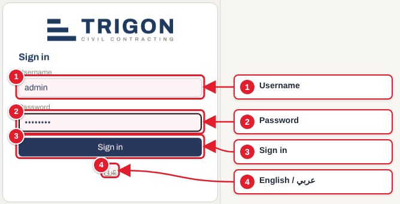

1. The username the administrator gave you.
2. Your password. After 8 wrong attempts the account is locked for a while.
3. Press Sign in.
4. Switch between Arabic and English.

<!--/img-->

### 1.2 Language
- On the sign-in screen, click **English / عربي** under the button.
- After signing in, use the **English / عربي** button at the bottom of the side menu. The whole interface switches direction (RTL/LTR).

### 1.3 The screen
- **Side menu** (on the right in Arabic, on the left in English) grouped as: Projects & sales, Procurement & stock, Accounting, Human resources, Tax & compliance.
- You only see the pages your role allows (see section 3).
- On a phone the menu opens from the **☰** button at the top.
- Most lists work the same way: **+ Add** (or **+ New**) opens a form; click any row to open and edit it; **Save** stores it; **Delete** removes it (when allowed).
- Every page has a **🖨 Print on letterhead** button, and most lists have an **Excel** button.
- **Logout** is at the bottom of the side menu.

<!--img-->

**📷 The dashboard after signing in**

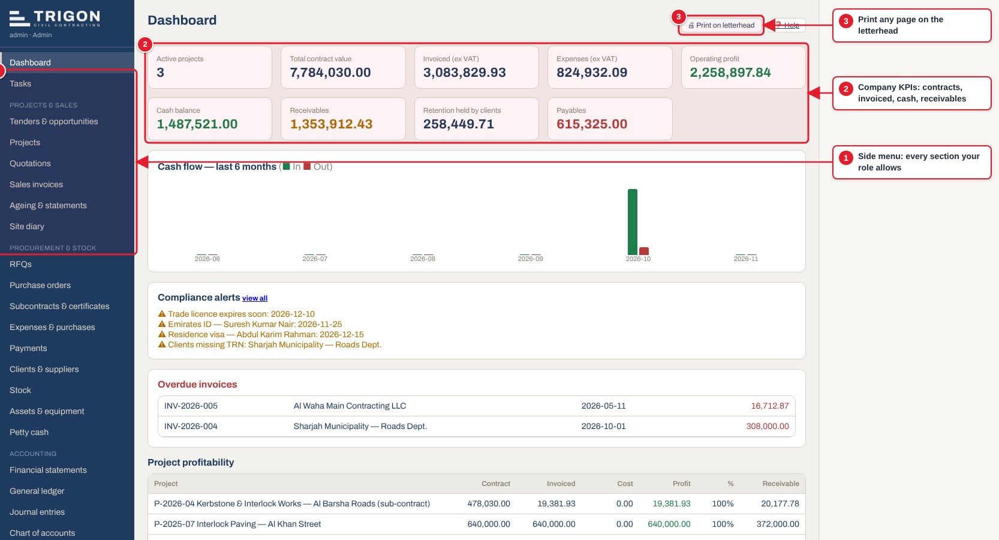

1. The side menu: every section of the system grouped by area; you only see what your role allows. Language and Logout buttons are at its bottom.
2. Company KPIs: active projects, contract value, invoiced, expenses, profit, cash, receivables and retention. Below: cash flow, compliance alerts, overdue invoices and profit per project.
3. Prints the current page on the company letterhead with stamp and signature. It is on every page.

<!--/img-->

---

## 2. First-time setup (administrator)

### 2.1 Create the administrator account
1. The first time the system opens, it shows **First-time setup**.
2. Enter **Username**, **Password** (at least 6 characters) and **Company name**.
3. On an online server you may be asked for a **Setup token** — it is the `SETUP_TOKEN` value in the server's `.env` file.
4. Press **Create account**. You are now signed in as administrator.

<!--img-->

**📷 First-time setup screen**

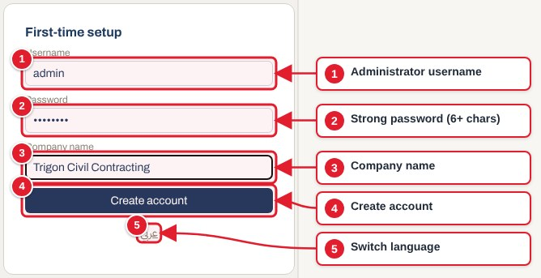

1. Type an administrator username, e.g. admin. You will use it every time you sign in.
2. A strong password of at least 6 characters. Do not share it.
3. The company name as it will show in the system (you can change it later in Settings).
4. Press Create account; you are signed in as administrator right away.
5. Switches the interface language before you start.

<!--/img-->

### 2.2 Company details
Menu: **Settings** → first card.
1. Fill in:
   - **Company name (English)** and **Company name (Arabic)**
   - **Legal name as on the trade licence / TRN certificate** — printed with the TRN at the top of tax invoices, credit notes and subcontractor certificates, and in their footer (the logo and other documents keep the brand name)
   - **VAT TRN (15 digits)** — required to issue tax invoices
   - **Corporate tax TRN**
   - **Phone**, **Email**, **Website**, **P.O. Box**, **Address (English)**, **Address (Arabic)**
   - **Document reference prefix (e.g. TC)** — quotations and letters are numbered like `TC26/01-CLIENT`
   - **Licence authority**, **Trade licence no.**, **Licence expiry** (you get an alert before it expires)
   - **Default VAT %** (normally 5) and **Currency** (AED)
   - **MOHRE establishment ID (13 digits)**, **Company bank**, **Company bank routing code (9 digits)**, **Company IBAN** — all needed for the WPS salary file
   - **Document footer text**
2. **VAT registered?** — choose **No** if the company is not registered yet: invoices then default to 0% VAT and are titled "Invoice" instead of "Tax invoice".
3. **Bank details (shown on invoices)** — the text printed on every invoice for clients to pay you.
4. **Default quotation terms** — pre-filled into every new quotation.
5. Press **Save**.

<!--img-->

**📷 Settings — company details**

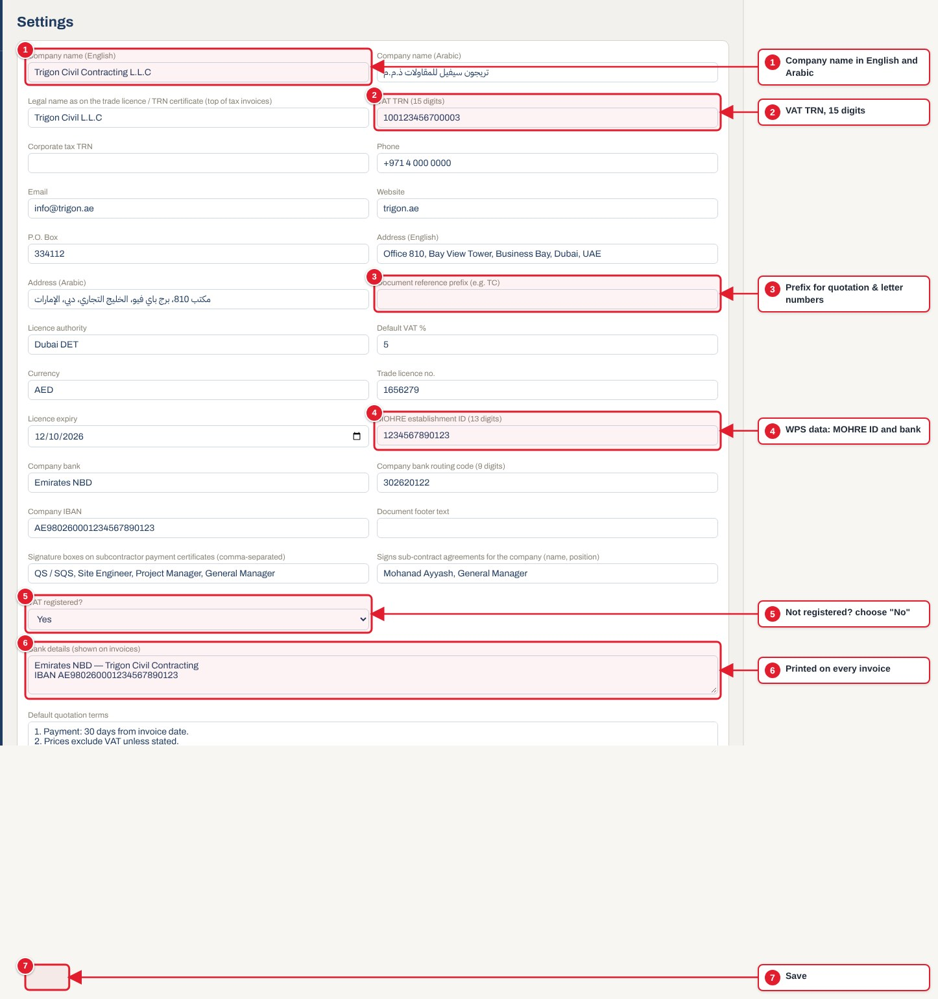

1. Company name in English and Arabic as on the licence; printed on every document.
2. VAT TRN (15 digits). Without it tax invoices are not valid.
3. Numbering prefix, e.g. TC, so quotations and letters are numbered TC26/01-CLIENT.
4. MOHRE establishment ID, company bank, routing code and IBAN: all required for the WPS salary file.
5. If the company is not VAT-registered yet choose No: VAT becomes 0% and documents are titled Invoice.
6. Bank details printed at the bottom of every invoice so clients can pay you.
7. Remember to press Save after any change.

<!--/img-->

### 2.3 Logo, stamp and signature
Menu: **Settings** → **Company identity: logo, stamp & signature**.
1. Quick way: press **Install the Trigon brand pack (logos, stamp, legal details)** and confirm. This installs the Trigon logos and the legal details (name, licence, address, P.O. Box).
2. Or upload each image yourself (PNG with transparent background, up to 2 MB): **Primary logo**, **Arabic logo (official letterhead)**, **Reversed logo**, **Logo line (e-mail signature)**, **Mark only**, **Official stamp**, **Authorised signature**.
3. The official stamp is not shipped with the code — upload it here. It prints only on documents issued by the system, so give printing rights only to authorised people.
4. To replace an image, upload a new one; to remove it, press **Remove**.

<!--img-->

**📷 Settings — company identity**

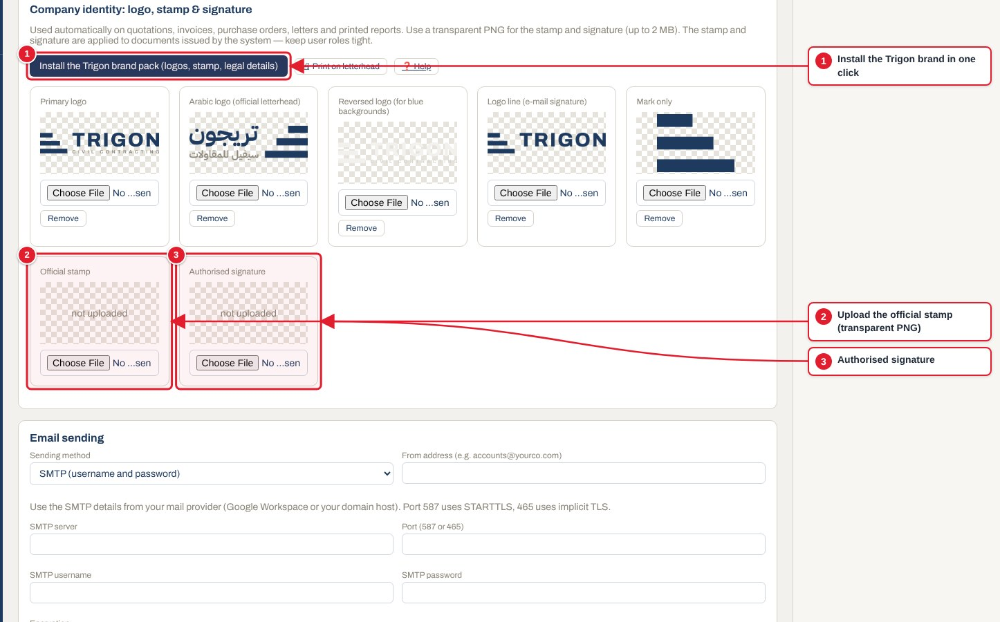

1. Installs the Trigon logos and legal details in one click.
2. Choose the stamp image (transparent PNG, up to 2 MB); it uploads at once and shows in the preview.
3. Upload the authorised signature the same way. Stamp and signature print on invoices, letters and reports.

<!--/img-->

### 2.4 Email sending (server edition)
Menu: **Settings** → **Email sending**.
1. **Sending method**:
   - **Microsoft 365** (recommended for Outlook mail): enter **Directory (tenant) ID**, **Application (client) ID**, **Client secret (Value)** from an app registered in Microsoft Entra with the *Mail.Send* application permission.
   - **SMTP**: enter **SMTP server**, **Port (587 or 465)**, **SMTP username**, **SMTP password** and **Encryption**.
2. Enter **From address** (e.g. `accounts@trigon.ae`).
3. Press **Save**, then type your email in the test box and press **Send test**.

<!--img-->

**📷 Settings — email sending**

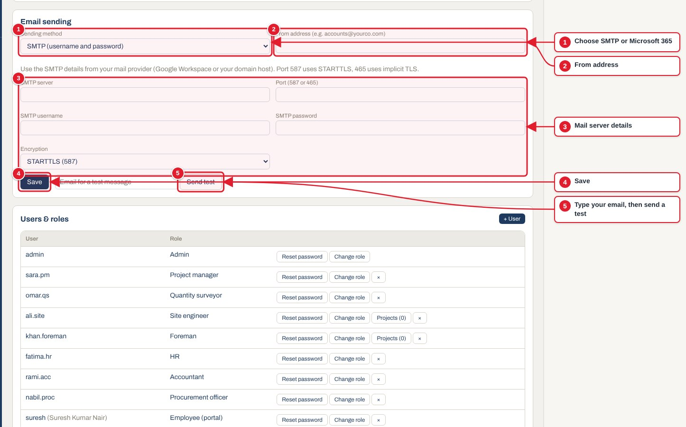

1. Sending method: SMTP (username & password) or Microsoft 365 (best for Outlook mail). The fields change with your choice.
2. The address clients and suppliers receive mail from, e.g. accounts@trigon.ae.
3. Mail-server details from your mail provider (server, port, user, password, encryption).
4. Save the settings.
5. Type your email in the box and press Send test to check sending works.

<!--/img-->

### 2.5 My profile (email signature)
Menu: **Settings** → **My profile**. Enter **Full name**, **Job title**, **Mobile** → **Save**. These appear in the signature of every email you send from the system.

### 2.6 Change your password
Menu: **Settings** → **Change password** → type the new password → **Change**.

---

### 2.7 Document texts and signatories
Menu: **Settings** → company card (administrator). These texts are printed on documents automatically:
1. **Signature boxes on subcontractor payment certificates** — comma-separated, e.g. `QS / SQS, Site Engineer, Project Manager, General Manager`.
2. **Signs sub-contract agreements for the company** — `Name, Position`.
3. **Standard sub-contract agreement wording** — the clauses of every sub-contract agreement. Words between `{{ }}` fill in by themselves (e.g. `{{subcontractor}}`, `{{value}}`, `{{retention_pct}}`, `{{payment_days}}`). A line that starts with a number and a dot (e.g. `6. Payment`) is a clause heading.
4. **Standard notes on purchase orders** — one per line.
5. **General conditions of purchase** — printed as the second page of every purchase order; leave it empty for no conditions page.
6. Press **Save**. Have a lawyer review the agreement and purchase conditions before you rely on them — they are a general starting text.

<!--img-->

**📷 Settings — legal name and signatories**

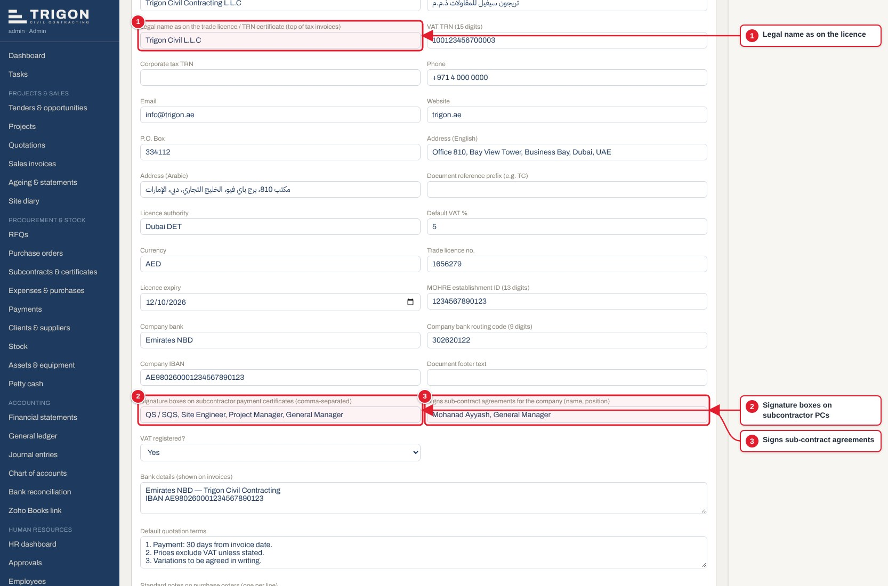

1. Legal name as on the licence and TRN certificate: shown with the TRN at the top of tax invoices, credit notes and subcontractor certificates.
2. Signature boxes on subcontractor payment certificates, comma-separated.
3. Name and position of whoever signs sub-contract agreements for the company.

<!--/img-->
<!--img-->

**📷 Settings — agreement and purchase-order texts**

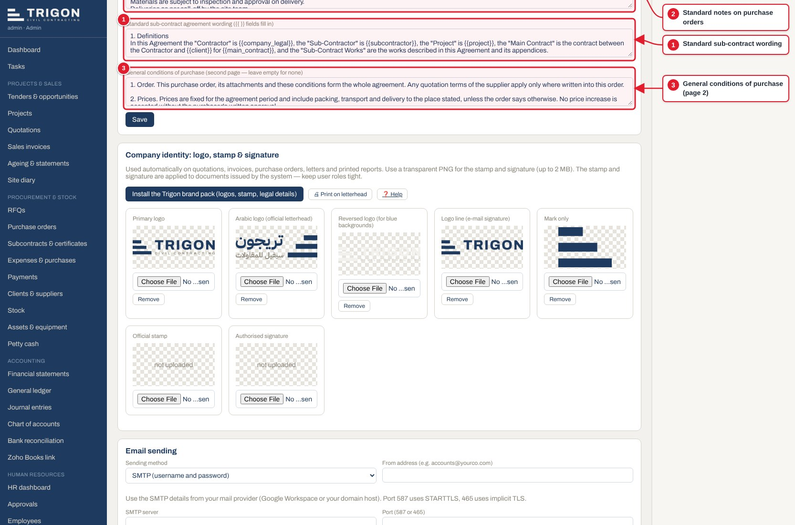

1. Standard sub-contract wording: words between {{ }} fill in from each subcontract.
2. Standard notes printed on every purchase order.
3. General conditions of purchase: page 2 of every purchase order; empty = no page.

<!--/img-->

---

## 3. Users and roles

### 3.1 Roles
| Role | What it can do |
|---|---|
| **Admin** | Everything, including settings, users and voiding tax invoices |
| **Accountant** | Finance and accounting; no users or settings |
| **Project manager** | Projects, purchasing, attendance; no payroll or tax |
| **Quantity surveyor** | Tenders, quotations, projects, invoices (sees values) |
| **Site engineer** | Assigned projects only, BOQ progress, site diary, RFQs, stock — no money figures |
| **Foreman** | Attendance of their crew and site diary of assigned projects |
| **Procurement officer** | RFQs, purchase orders, subcontracts, expenses, suppliers |
| **Storekeeper** | Stock and purchase orders |
| **HR** | Employees, leave, requests, letters, payroll; no accounts |
| **Viewer** | Read only |
| **Employee (portal)** | Their own portal only (leave, payslips, requests, attendance) |

### 3.2 Add a user
1. **Settings** → **Users & roles** → **+ User**.
2. Enter **Username** and **Password (min 6)**, choose the **Role**.
3. If the user is also an employee, choose **Linked employee** (needed for leave approvals and the portal).
4. Press **Create**.

<!--img-->

**📷 Settings — users & roles**

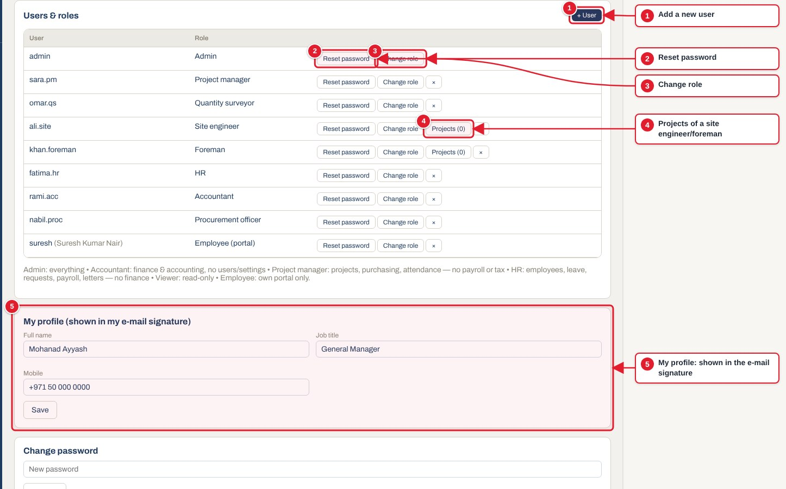

1. Opens the new-user form.
2. Sets a new password for a user who forgot theirs.
3. Changes the user's role, which changes the pages they see.
4. Site engineers and foremen only: choose the projects they see.
5. Your profile: name, title and mobile appear in the signature of emails you send.

<!--/img-->
<!--img-->

**📷 New user form**

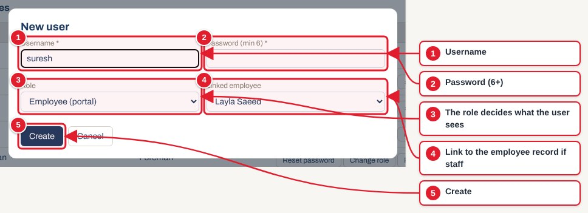

1. The username they will sign in with (no spaces).
2. A temporary password (6+ characters). Ask them to change it in Settings.
3. The role decides the permissions (see the table above).
4. If they are staff, link their employee record so the portal and line-manager approvals work.
5. Press Create.

<!--/img-->

### 3.3 Manage a user
In the users table:
- **Reset password** — type the new password.
- **Change role** — type/choose the new role.
- **Projects** (site engineers and foremen only) — tick the projects they may see. They see only these projects and their crews.

---

## 4. Clients and suppliers

Menu: **Clients & suppliers**. Do this before quotations, invoices and purchases.

1. Press **+ Add**.
2. **Type**: **Client**, **Supplier** or **Subcontractor**.
3. **Name** (required).
4. **Tax registration no. (TRN)** — required for tax invoices to VAT-registered businesses, and for recovering input VAT from suppliers.
5. **Phone**, **Email** (used when emailing quotations/invoices), **Address** (required on tax invoices).
6. **Bank name**, **IBAN**, **Notes**.
7. Press **Save**.
8. Open the record again to attach documents (trade licence, VAT certificate…) in the **Attached documents** panel.

<!--img-->

**📷 Adding a client**

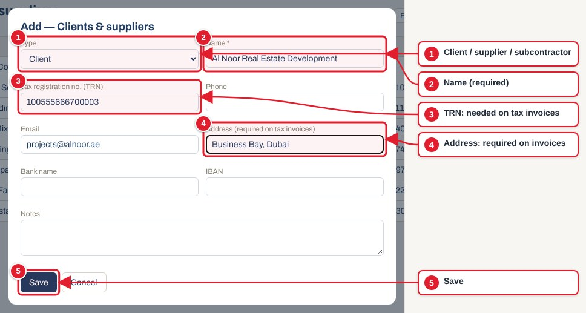

1. Type: client, supplier or subcontractor. Decides where it appears (quotes & invoices, or purchasing).
2. The legal name as on the licence (required).
3. 15-digit TRN: shown on tax invoices and needed to recover input VAT.
4. The address is required on tax invoices. Also fill phone, email and bank.
5. Save. Then open the record to attach the licence and VAT certificate.

<!--/img-->

---

## 5. Tenders and opportunities

Menu: **Tenders & opportunities**. The board shows each stage with its value, plus **Open pipeline**, **Weighted (value × probability)**, **Won this year** and **Win rate**.

<!--img-->

**📷 Tender board**

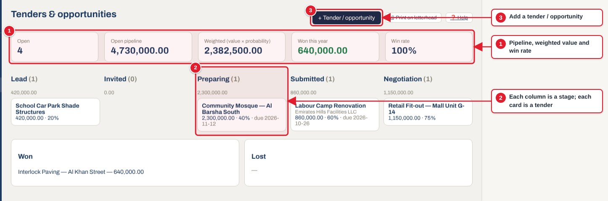

1. Summary: open count, pipeline value, weighted value (value × probability), won this year, win rate.
2. Each column is a stage (lead, invited, preparing, submitted, negotiation); each card is a tender. Click a card to open it.
3. Add a new tender or opportunity.

<!--/img-->

### 5.1 Add a tender
1. Press **+ Tender / opportunity**.
2. Fill in: **Tender / opportunity** (title), **Client** — or type **Or a new organisation name** (the client is created for you), **Source** (invitation, referral, tender portal…).
3. **Stage**: Lead → Invited → Preparing → Submitted → Negotiation → Won / Lost.
4. **Estimated value**, **Win probability %**, **Submission date**, **Expected close**, **Owner**, **Notes**.
5. **Save**.

### 5.2 Move it forward
1. Click the tender card to open it and change the **Stage** as it progresses.
2. **Create quotation** — makes a quotation linked to the tender (then **Open quotation** to work on it).
3. When you win: **Won — convert to project** — converts the quotation to a project and marks the tender as won.
4. When you lose: set the stage to **Lost** and fill **Lost reason**.

<!--img-->

**📷 Tender window**

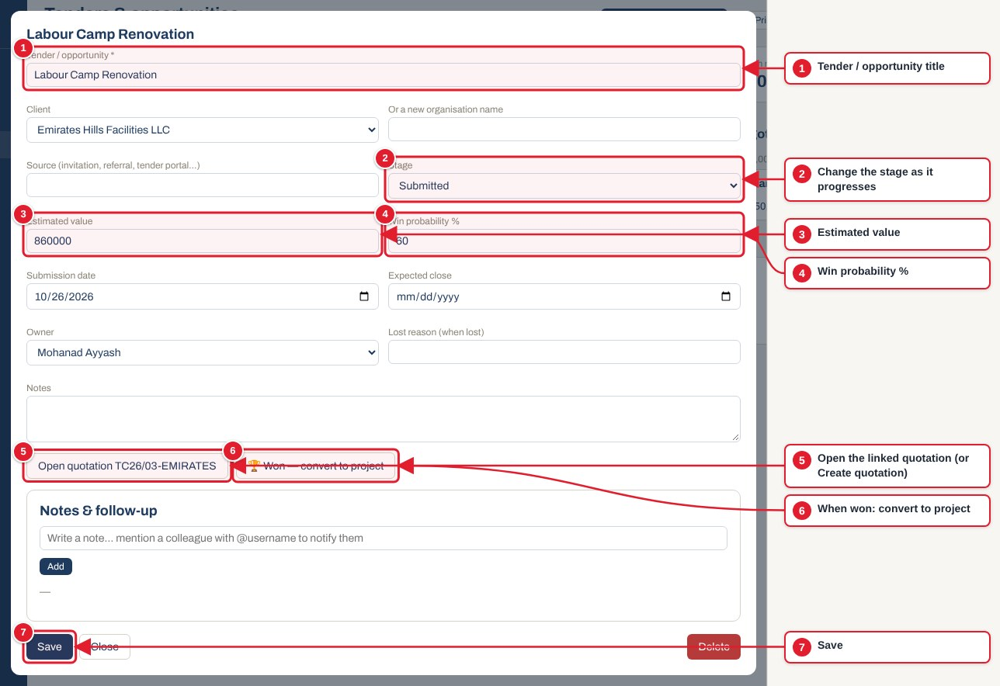

1. The tender or opportunity title.
2. The current stage. Change it as it moves; the card moves to the right column.
3. Estimated project value.
4. Win probability %: used for the weighted value.
5. Create quotation makes a quotation linked to the tender; afterwards it becomes Open quotation.
6. 🏆 Won — convert to project: turns the linked quotation into a project and marks the tender as won.
7. Save the changes.

<!--/img-->

---

## 6. Quotations

Menu: **Quotations**.

### 6.1 Create a quotation
1. Press **+ New**.
2. **Quote no.** — leave empty to get the automatic number (e.g. `TC26/01-CLIENT`).
3. **Date**, **Client**, **Project name**, **Validity (days)** (default 30), **Status** (Draft), **VAT %**.
4. Lines: for each line fill **Description**, **Unit**, **Qty**, **Rate** and choose VAT (**Standard 5%**, **Zero-rated** or **Exempt**). Press **+ Line** for more lines and **×** to delete a line. The subtotal, VAT and total update as you type.
5. **Notes** and **Terms** (pre-filled from Settings).
6. Press **Save**.

<!--img-->

**📷 Quotation list**

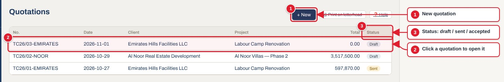

1. New quotation.
2. Click any quotation to open, edit, print or send it.
3. Status: draft, sent, accepted, rejected.

<!--/img-->
<!--img-->

**📷 New quotation form**

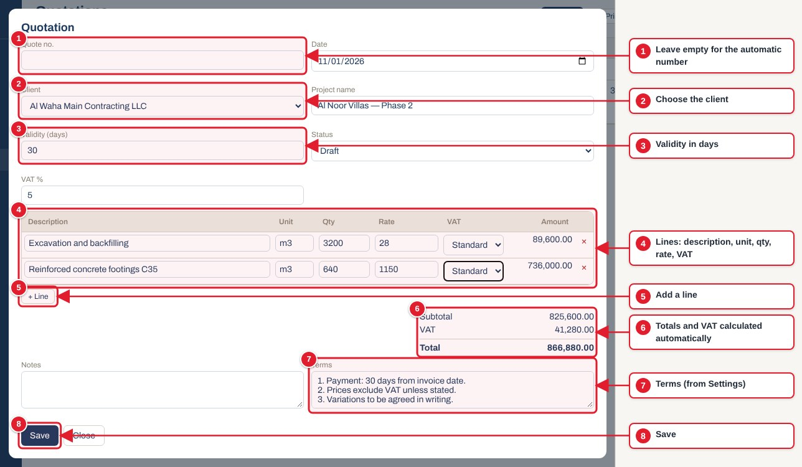

1. Leave the number empty to get an automatic number from the prefix.
2. Choose the client (it must exist in Clients & suppliers).
3. Validity in days; printed on the cover.
4. Lines: type description, unit, qty, rate and pick the VAT type per line. The amount is calculated; × deletes a line.
5. + Line adds a row.
6. Subtotal, VAT and total update instantly.
7. Terms come from Settings and can be edited for this quotation.
8. Save stores the quotation in the list.

<!--/img-->

### 6.2 Send it to the client
Open the quotation, then:
- **Print** or **PDF** — prints with the cover page and letterhead. (Add `?cover=0` to the print link to print without the cover.)
- **Email** — type the client's email; the PDF is attached.
- **🔗 Client acceptance link** — gives a link the client opens without signing in. They review the quotation and either **accept** with their name and signature or **decline** with a comment. You are notified at once and the result shows on the quotation. Use **Copy**, **Email with the quotation** or **Preview**.
- Change **Status** to **Sent**, then **Accepted** or **Rejected** if you follow up by hand.

<!--img-->

**📷 Quotation buttons after saving**

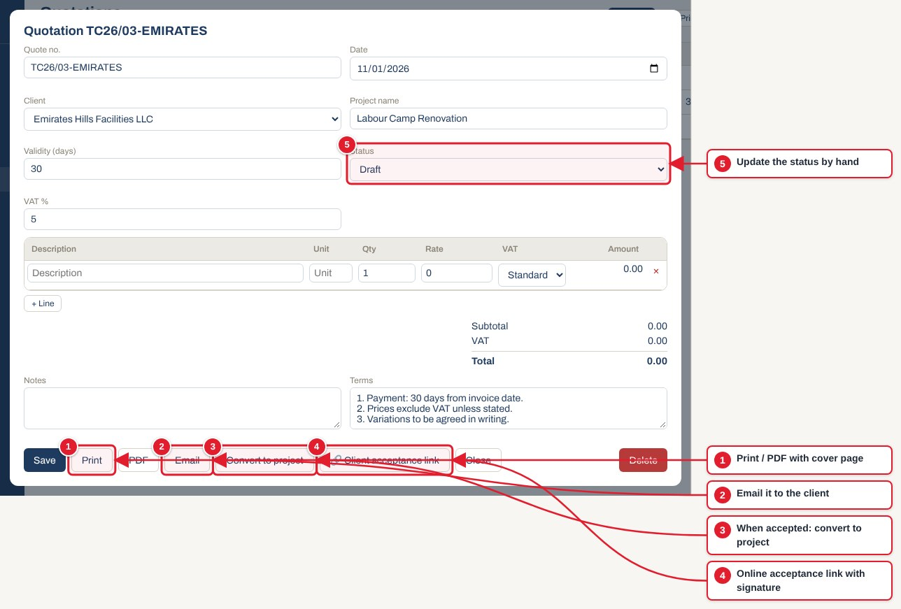

1. Print and PDF: the quotation with cover, letterhead and stamp.
2. Email: sends it to the client with a PDF.
3. After approval: Convert to project creates the project and copies the lines into the BOQ.
4. Client acceptance link: the client accepts with a signature or declines.
5. If you follow up by hand, set the status to sent, accepted or rejected and save.

<!--/img-->
<!--img-->

**📷 Online acceptance link**

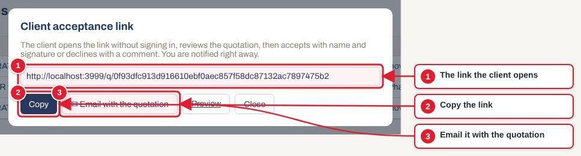

1. The link the client opens without an account.
2. Copy it, e.g. to send by WhatsApp.
3. Or email it with the quotation directly.

<!--/img-->

### 6.3 Convert to a project
When the client accepts, open the quotation and press **Convert to project**. The project is created and the quotation lines are copied into the project's **BOQ**.

---

## 7. Projects

Menu: **Projects**.

### 7.1 Add a project
Either convert a quotation (6.3) or a tender (5.2), or:
1. Press **+ Add**.
2. **Code** (e.g. P-2026-01), **Project name** (required), **Client**, **Location**.
3. **Emirate (for VAT return)** — needed for box 1 of the VAT return.
4. **Contract value (ex VAT)**.
5. **Retention % (on invoices)** — e.g. 10.
6. **Status** (Active), **Start date**, **End date**.
7. Advance payment: **Advance payment % of contract** and **Advance recovery % per progress invoice** (empty = same %).
8. Retention release: **Handover date**, **Retention released at handover %** (default 50), **Defects liability period (months)** (default 12; the rest is released after it).
9. Phone attendance: **Site latitude**, **Site longitude**, **Site radius (m)** (default 300). The easiest way: open the project on your phone while on site and press **📍 Use my current location (while on site)**.
10. **Notes** → **Save**.

**Working as a subcontractor under a main contractor** — also fill:
- **Main contract** — the main contractor's contract name.
- **Contract / sub-contract / PO no. from the client** — printed on every invoice and proforma (clients reject invoices without it).
- **Payment terms (days)** — gives the due date of invoices issued from a PC.
- **VAT basis on payment certificates (PC)** — *On the net after retention and contra charges* if the main contractor certifies VAT that way (the retention is taxed when released), otherwise *On the work value*.

<!--img-->

**📷 Project list**

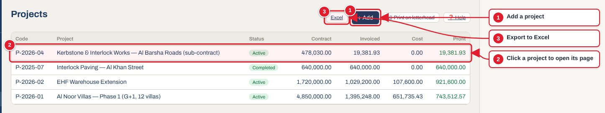

1. Add a new project.
2. Click a project to open its full page.
3. Export the list to Excel.

<!--/img-->
<!--img-->

**📷 New project form**

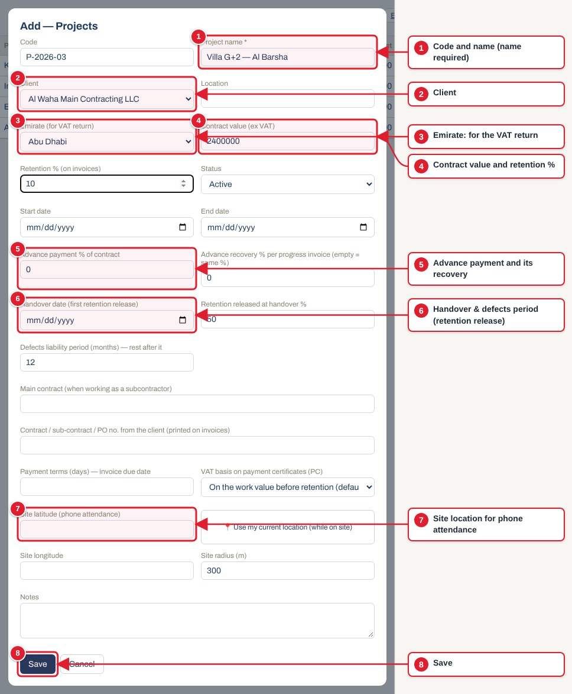

1. Project code and name. The name is required; the code helps searching and reports.
2. The client who owns the project.
3. Emirate: used in box 1 of the VAT return.
4. Contract value ex VAT and the retention % deducted from each invoice.
5. Advance payment % and the recovery % per progress invoice.
6. Handover date, the retention % released then, and the defects period for the rest.
7. Site coordinates and radius for phone attendance.
8. Save.

<!--/img-->
<!--img-->

**📷 Fields for work under a main contractor**

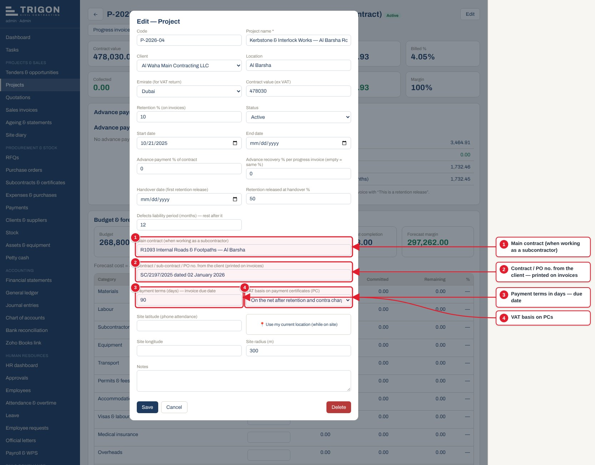

1. Main contract: the main contractor's contract name, printed on the proforma and invoice.
2. Contract / sub-contract / PO no. from the client: printed on every invoice.
3. Payment terms in days: due date of invoices issued from a PC.
4. VAT basis on PCs: on the net after retention and contra charges, or on the work value.

<!--/img-->

### 7.2 The project page
Click the project to open it. You see:
- Figures: **Contract value**, **Approved variations**, **Revised value**, **Invoiced**, **Billed %**, **Collected**, **Receivable**, **Cost**, **Profit**, **Margin**.
- Buttons: **Edit**, **Progress invoice from BOQ**, **+ Invoice**, **+ Expense**.

<!--img-->

**📷 Project page**

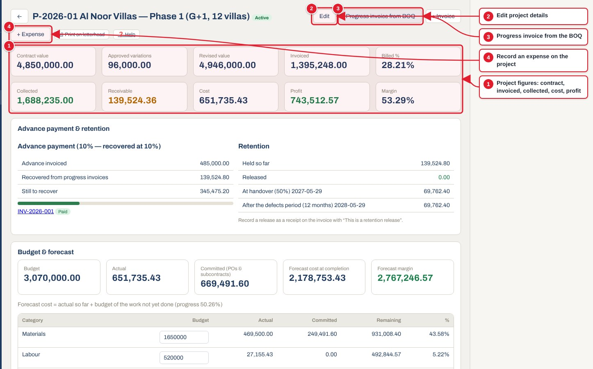

1. Live figures: contract, variations, invoiced and %, collected, receivable, cost, profit, margin.
2. Edit the project or change its status.
3. Issue a progress invoice from the BOQ completion.
4. Record an expense on the project (next to it, + Invoice for a manual invoice).

<!--/img-->

### 7.3 Bill of quantities (BOQ) and progress
1. Press **+ Item**.
2. **Section**, **Description**, **Unit**, **Quantity**, **Sell rate / unit**, **Budget cost / unit**, **Completion %**.
3. **Save**. Click an item later to update **Completion %** as work progresses (site engineers can update completion straight from their project page).
4. Below the table: **Budget vs actual** (budget cost against actual cost).

<!--img-->

**📷 BOQ and variation orders**

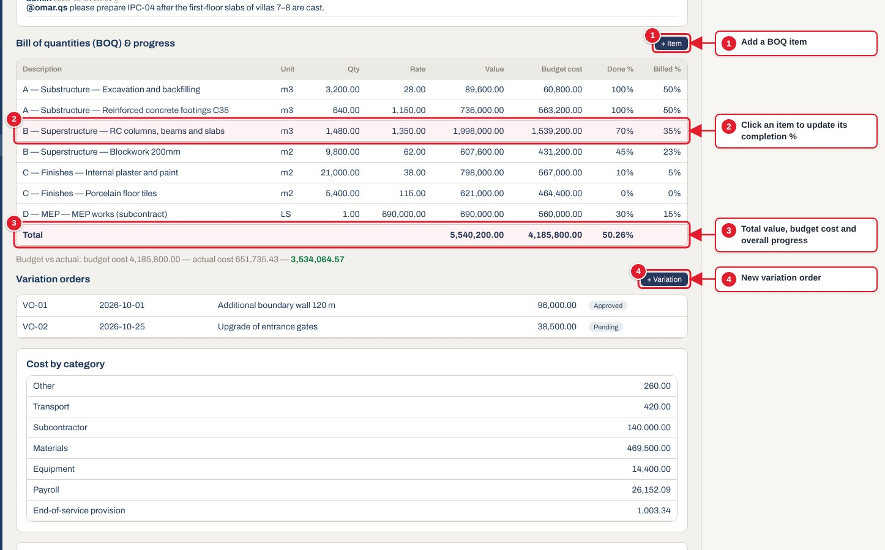

1. Add a new BOQ item.
2. Click any item to edit it or update its completion %.
3. Totals: BOQ value, budget cost and overall progress.
4. Add a variation order.

<!--/img-->
<!--img-->

**📷 BOQ item window**

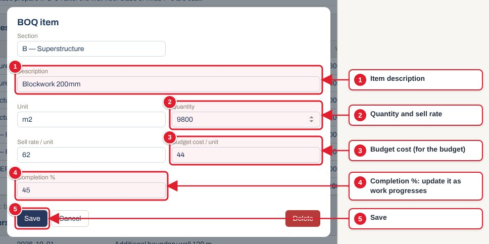

1. Item description (and the section above it to group items).
2. Quantity and sell rate: they give the item value.
3. Budget cost per unit: used in the budget and forecast.
4. Completion %: update it as work progresses; the progress invoice bills the change since the last one.
5. Save.

<!--/img-->

### 7.4 Variation orders
1. Press **+ Variation**.
2. **Number**, **Date**, **Description**, **Amount (ex VAT, negative for omission)**, **Status** (Pending / Approved / Rejected).
3. **Save**. Only **Approved** variations are added to the revised contract value.

<!--img-->

**📷 Variation order window**

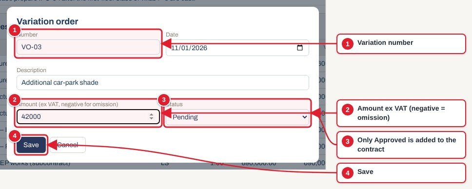

1. Variation number and date.
2. Amount ex VAT. For an omission use a negative amount.
3. Status: only Approved is added to the revised contract value.
4. Save.

<!--/img-->

### 7.5 Budget and forecast
In the **Budget & forecast** card on the project page:
1. Enter the budget for each cost category.
2. Press **Save budget**.
3. The card shows **Actual**, **Committed (POs & subcontracts)**, **Remaining**, **Forecast cost at completion** and **Forecast margin**. Forecast cost = actual so far + budget of the work not yet done. A warning appears when the forecast is over budget.

<!--img-->

**📷 Budget & forecast card**

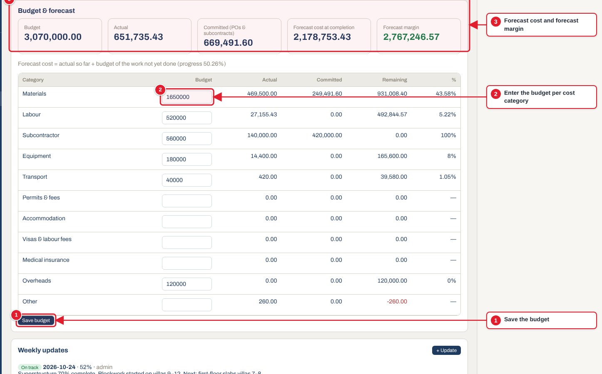

1. After entering the figures press Save budget.
2. Enter the budget per category (materials, labour, subcontract…). Next to it: actual, committed and remaining.
3. Forecast cost at completion and forecast margin; a red warning shows when over budget.

<!--/img-->

### 7.6 Weekly updates
1. In **Weekly updates** press **+ Update**.
2. Choose the status, **Progress %**, **Date**, and write **How is it going? (done, issues, next steps)**.
3. **Save** — the budget, actual and forecast figures of that date are saved with the update.

<!--img-->

**📷 Weekly updates, notes and documents**

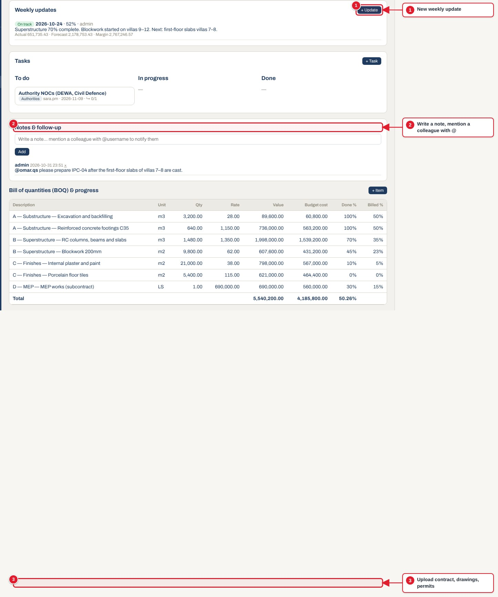

1. New weekly update: status, progress % and a summary.
2. Notes: write a note; mention a colleague with @username to notify them.
3. Attached documents: contract, drawings, permits, with expiry date.

<!--/img-->

### 7.7 Advance payment and retention
The **Advance payment & retention** card shows the advance invoiced, recovered and still to recover, and retention held, released, due at handover and after the defects period.
- **Issue the advance payment invoice** — creates the tax invoice for the advance (VAT applies). It is recovered automatically from each progress invoice.
- To release retention, record a receipt on the invoice and tick **This is a retention release** (section 9).

<!--img-->

**📷 Advance, retention and productivity**

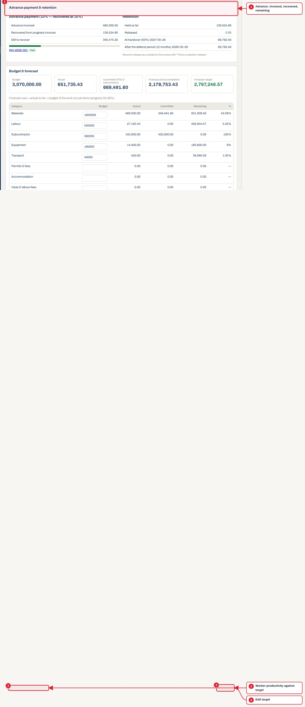

1. Advance: invoiced, recovered from progress invoices, remaining. Retention: held, released, due at handover and after the defects period.
2. Revenue per worker-day per month against the target.
3. Edit the target (AED per worker-day).

<!--/img-->

### 7.8 Revenue per worker-day
The card shows, per month: **Certified work** ÷ **Worker-days (attendance)** = **Per worker-day**, against the **Target**. Press **Edit target** to change it.

### 7.9 Notes, documents and other sections
- **Notes & follow-up**: write a note; mention a colleague with `@username` to notify them.
- **Attached documents**: choose **Type**, **Expiry date (optional)**, choose a file (max 8 MB) → **Upload**.
- The page also lists the project's **Invoices**, **Expenses** and **Cost by category**.

### 7.10 Editing or closing a project
**Edit** → change fields → **Save**. A project that has invoices or expenses cannot be deleted — set its **Status** to **Completed**, **On hold** or **Cancelled** instead.

---

## 8. Sales invoices

Menu: **Sales invoices**.

<!--img-->

**📷 Sales invoice list**

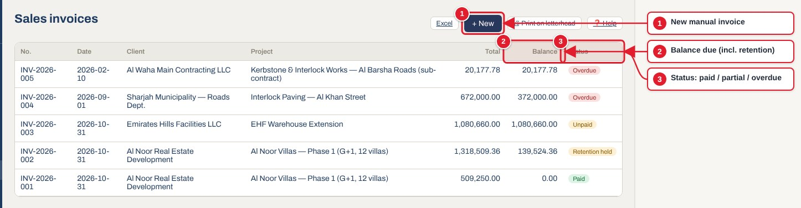

1. New manual invoice (progress invoices are created from the project page).
2. Balance owed by the client, including uncollected retention.
3. Status: paid, partial, overdue, void…

<!--/img-->

### 8.1 Progress invoice from the BOQ (recommended)
1. Update the **Completion %** of the BOQ items (7.3).
2. On the project page press **Progress invoice from BOQ**.
3. The system creates an invoice for the newly completed work, deducts retention and advance recovery, and opens it.
4. Check it and press **Save**.
5. **Payment certificate** / **Certificate PDF** prints the interim payment certificate (IPC): per item contract qty, previous, this period, cumulative and %, then retention, advance recovery, net, VAT and amount due.

### 8.2 Manual invoice
1. **+ New** (or **+ Invoice** on the project page).
2. **Invoice no.** (automatic, e.g. `INV-2026-001`), **Date**, **Project** (required), **Due date**, **VAT %**, **Retention %**.
3. Add lines as in quotations → **Save**.
4. Warnings appear if the client has no TRN or no address — fix them in **Clients & suppliers**.

### 8.3 After issuing
Open the invoice:
- **Print**, **PDF**, **Email**.
- **Payment reminder** (only when overdue) — emails a reminder with the outstanding balance.
- **Record payment** — see section 9.
- **Issue credit note** — enter the reason; a credit note is created against the invoice (use it to reduce or cancel an invoice).
- **Void** (administrator only) — enter the mandatory reason. Tax invoices are never deleted; they are voided or credited.

<!--img-->

**📷 An open progress invoice**

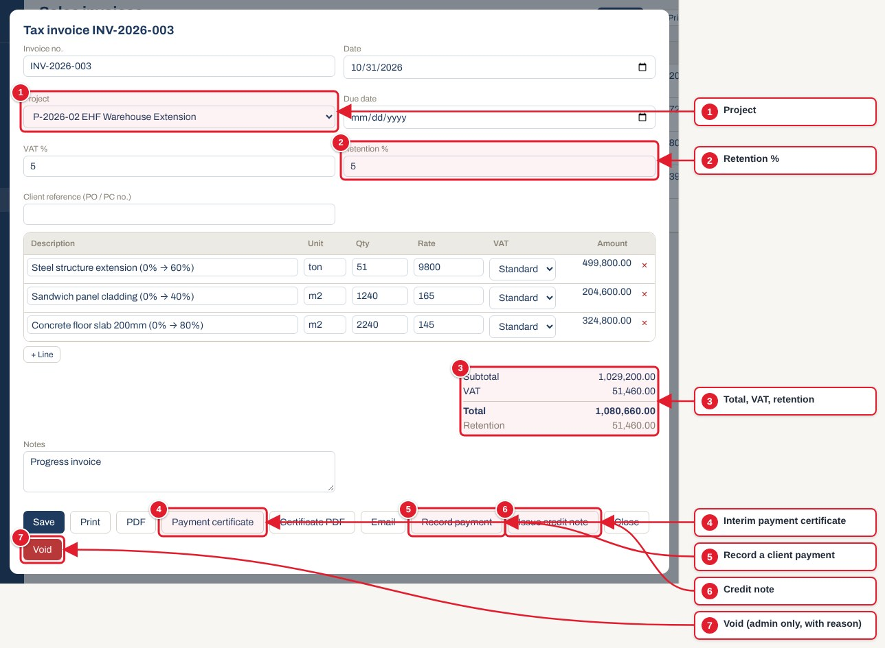

1. The project the invoice belongs to.
2. Retention % deducted on this invoice.
3. Totals, VAT and retention.
4. Payment certificate and PDF: the IPC with previous, current and cumulative.
5. Record payment when the client pays.
6. Issue credit note to reduce or reverse the invoice.
7. Void: administrator only, with a mandatory reason. Tax invoices are never deleted.

<!--/img-->

---

### 8.4 Working under a main contractor: proforma (payment application)
When you work for a main contractor the order is: **proforma → payment certificate (PC) from the main contractor → tax invoice equal to the PC**. Everything is on the project page, card **Proformas & payment certificates (PC)**.
1. Update the **Completion %** of the BOQ items (7.3).
2. Press **+ Proforma (payment application)**. It is filled from the BOQ: previous quantity (as last certified) and cumulative quantity to date.
3. Enter **For works up to**, **Materials on site (cumulative)** if any, and change any **cumulative quantity**. Press **Save & recalculate**.
4. The summary is cumulative, as on a PC: value of work done (A); retention, contra charges as last certified, previous payments (B); **net amount**.
5. **Print** / **PDF** — an English **PROFORMA INVOICE**: the BOQ with quantities and amounts, the summary and the net amount in words. It has **no VAT, TRN or bank details** and no accounting effect — it is for the main contractor to check against their records.
6. Send it, then press **Mark as submitted**.

<!--img-->

**📷 Proformas & payment certificates card on the project page**

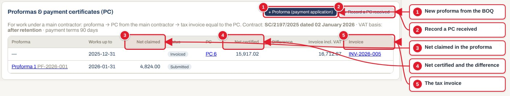

1. New proforma filled from the BOQ.
2. Record a PC received without a proforma (e.g. the first PC in the system).
3. Net claimed on each proforma.
4. Net certified on the PC and the difference from the claim (red when cut).
5. The tax invoice issued from the PC; click it to open.

<!--/img-->
<!--img-->

**📷 Proforma window**

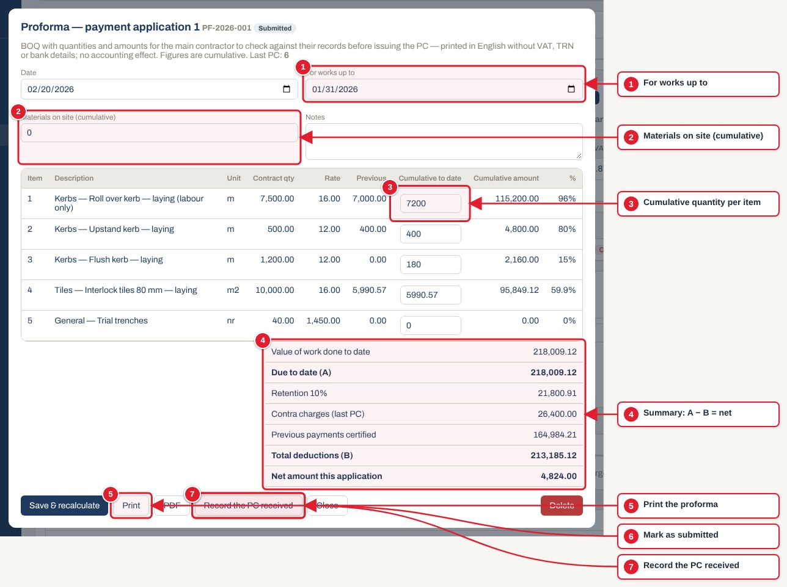

1. For works up to.
2. Materials on site (cumulative), if any.
3. Cumulative quantity per item; the previous one comes from the last PC.
4. Cumulative summary: work (A), retention, contra and previous payments (B), and the net.
5. Print the proforma in English without VAT, TRN or bank details.
6. After sending it to the main contractor: mark as submitted.
7. When the PC arrives: record the PC received.

<!--/img-->
<!--img-->

**📷 The printed proforma**

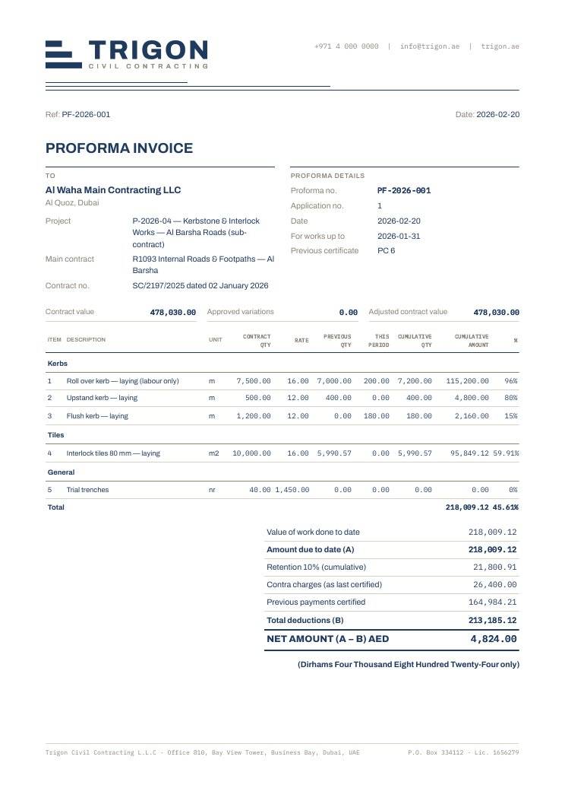

1. BOQ: contract quantity, previous, this period, cumulative, amount and %.
2. Summary and the net in words — no VAT, TRN or bank details.

<!--/img-->

### 8.5 Recording the PC received
1. When the PC arrives, open the proforma and press **Record the PC received** (or **+ Record a PC received** on the card).
2. Enter the **PC no.**, **date of issue** and **works up to**, and the **cumulative figures exactly as printed on the PC**: value of work done, materials, advance recovery, retention, release of retention, contra charges, previous payments; and the **VAT certified** if shown.
3. **Previous certificate values** fill in from the last PC. If this is the first PC you record in the system (e.g. PC No. 6), enter the "previous" values once from the PC.
4. Under **Certified quantity per item** change what the main contractor cut, then **Use the item total as the value of work done**.
5. The summary works out the net and VAT live. After **Save**, the system checks the arithmetic (previous payments, VAT, item total) and shows the **difference between claimed and certified**. Attach the scanned PC in **Attached documents**.

<!--img-->

**📷 Recording a PC**

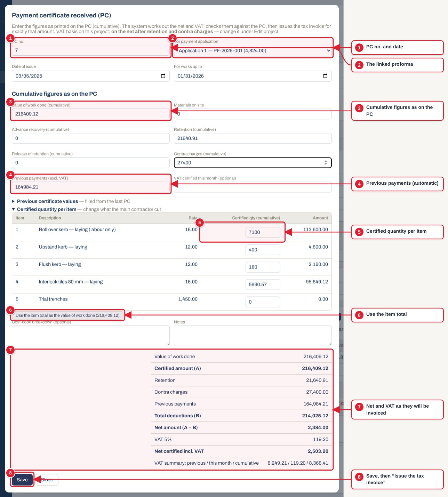

1. PC no. and date of issue.
2. The proforma this PC certifies.
3. The cumulative figures exactly as printed on the PC.
4. Previous payments: worked out from the earlier certificates; compare with the PC.
5. Certified quantity per item: change what the main contractor cut.
6. Use the item total as the value of work done.
7. Net, VAT and total as they will be invoiced, and the VAT summary.
8. Save; the Issue the tax invoice button then appears.

<!--/img-->

### 8.6 Tax invoice from the PC
1. In the PC window press **Issue the tax invoice** (accountant / administrator) and enter the invoice date.
2. The invoice equals the PC **to the fils**: value of work done this period, less contra charges, retention and advance recovery; VAT on the right basis; due date from the project's payment terms; the PC no. in **Your ref.** and the contract no. in the details.
3. The books stay right: revenue at the work value, retention as receivable (without VAT under the net basis), contra charges reduce revenue; the BOQ **Billed %** follows the certified quantities.
4. If the PC has differences the system asks before issuing. To change an invoiced PC, **void** the invoice (administrator) — the PC opens again.
5. Invoices from PCs are not sent to Zoho automatically yet — enter them in Zoho by hand.

<!--img-->

**📷 Tax invoice issued from a PC**

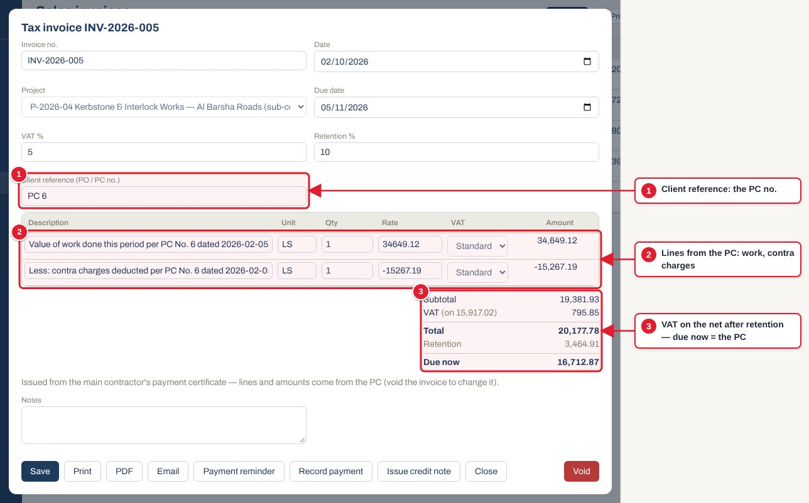

1. Client reference: the PC number.
2. Lines from the PC: work of the period and contra charges; not edited here.
3. VAT on the net after retention; due now equals the PC.

<!--/img-->
<!--img-->

**📷 The printed tax invoice**

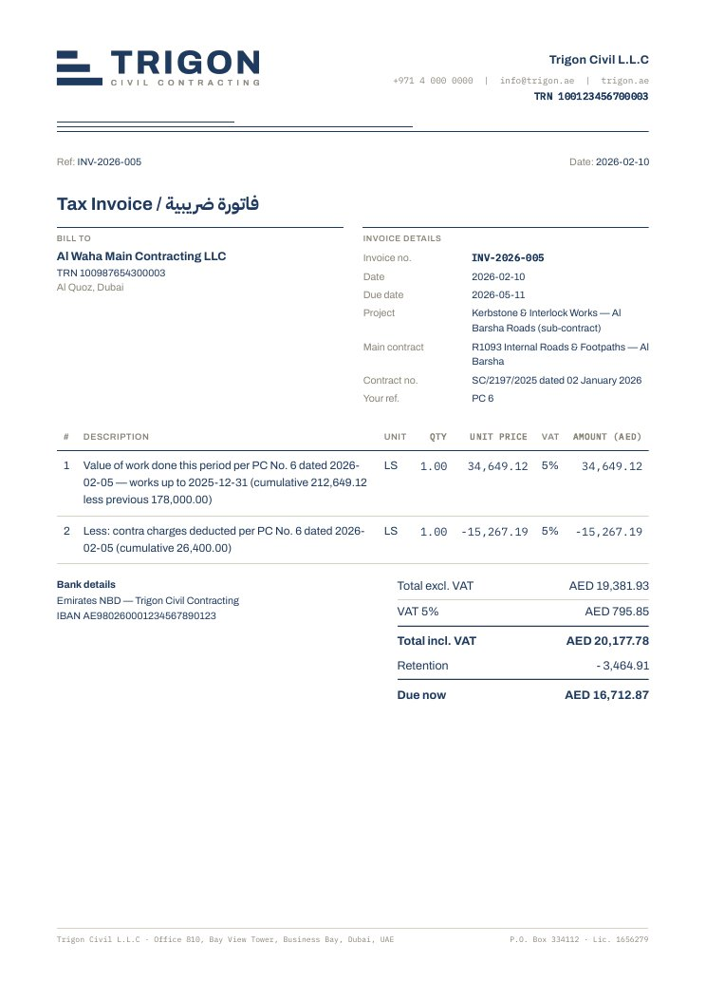

1. Legal name and TRN at the top; client with TRN, contract details and the PC.
2. Bank details beside the totals, no signature lines.

<!--/img-->

---

## 9. Payments and receipts

Menu: **Payments** (or **Record payment** inside an invoice or expense).

1. Press **+ Record payment**.
2. **Type**: **Receipt from client** or **Payment to supplier**.
3. **Against**: choose the open invoice or bill.
4. **Date**, **Amount**.
5. **Method**: Bank transfer, Cheque, Cash or Card. If you have more than one bank account, choose the **Bank account**.
6. For cheques: **Cheque date** and **Cheque status** (Pending / Cleared / Bounced). Pending and bounced cheques are not counted in the cash balance, and a bounced cheque does not settle the invoice.
7. **Reference / cheque no.**
8. For a retention payment from the client tick **This is a retention release**.
9. **Save**. To update a cheque later (e.g. it cleared), open it in the payments list.

<!--img-->

**📷 Record payment window**

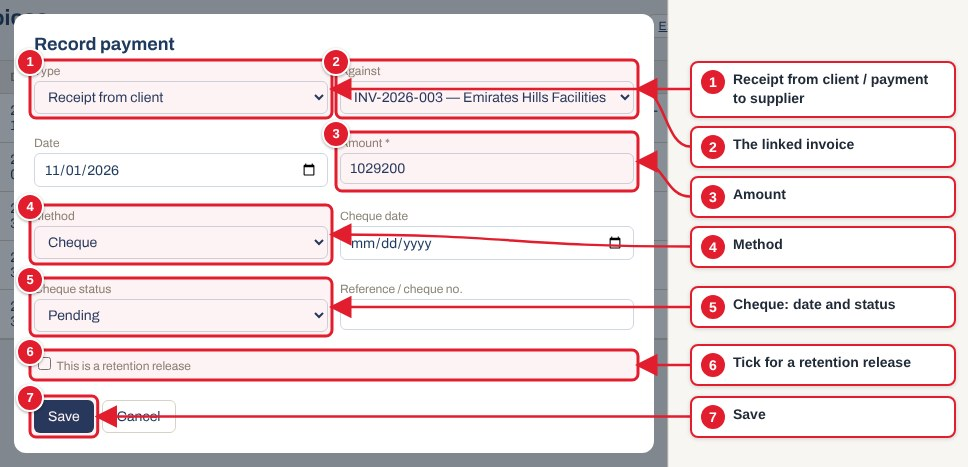

1. Type: receipt from a client, or payment to a supplier.
2. The linked invoice or bill (only open ones, with their balance).
3. Amount (the remaining balance is suggested).
4. Method: transfer, cheque, cash, card; and the bank account if you have several.
5. For cheques: date and status. A pending cheque is not counted in cash until it clears.
6. Tick this if the payment is a retention release.
7. Save.

<!--/img-->

---

## 10. Ageing and statements of account

Menu: **Ageing & statements**.
1. Choose **Receivables (customers)** or **Payables (suppliers)** and the **As of** date.
2. Balances are split by days past due. Retention not yet due is shown apart.
3. Click a customer or supplier to open the **Statement of account**, choose **From** / **To**, then **Print** or **Email** (sent with a PDF).

<!--img-->

**📷 Ageing report**

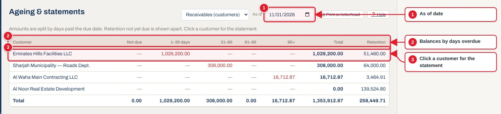

1. The date ageing is calculated at.
2. Balances split by days overdue: current, 1–30, 31–60, 61–90, 90+, and retention.
3. Click a customer or supplier to open its statement.

<!--/img-->
<!--img-->

**📷 Customer statement**

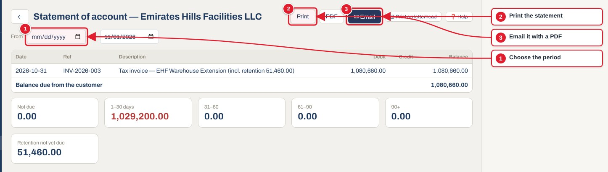

1. Choose the period.
2. Print the statement on the letterhead.
3. Email it to the client with a PDF.

<!--/img-->

---

## 11. Site diary

Menu: **Site diary**.
1. **+ Add**.
2. **Project**, **Date**, **Weather**, **Manpower**, **Work done**, **Issues / delays**, **Other notes**.
3. **Save**. It prints on the letterhead with **🖨 Print on letterhead**.

<!--img-->

**📷 Site diary form**

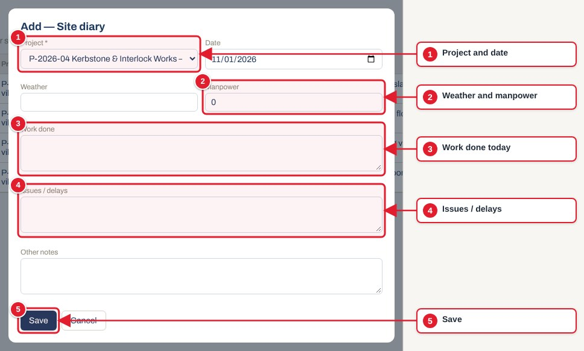

1. Project and date.
2. Weather and manpower on site.
3. Work done today in detail.
4. Issues and delays (useful for claims later).
5. Save.

<!--/img-->

---

## 12. Requests for quotation (RFQ) and purchase orders

### 12.1 RFQ and supplier comparison
Menu: **RFQs**.
1. **+ New RFQ**.
2. Choose the **Project** and write a **Description**.
3. List the items: **Item**, **Unit**, **Qty** (**+ Item** for more).
4. Press **+ Supplier** for each supplier that quoted and type their rate for every item, plus **Delivery (days)**.
5. The system totals each supplier and highlights the lowest.
6. **Save**.
7. Press **Award + PO** under the chosen supplier — a purchase order is created automatically.

<!--img-->

**📷 RFQ and supplier comparison**

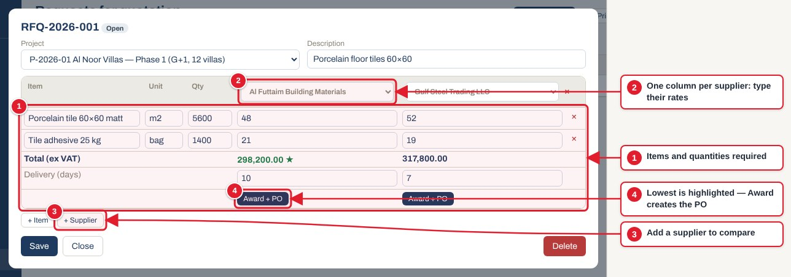

1. Required items: description, unit, quantity.
2. One column per supplier: pick the supplier and type their rate per item. Totals are automatic.
3. Add another supplier to compare.
4. The lowest total is highlighted. Award + PO under the chosen supplier creates the purchase order at once.

<!--/img-->

### 12.2 Purchase order
Menu: **Purchase orders** (or created from the RFQ).
1. **+ New PO**: **Supplier**, **Project**, **Date**, **Delivery date**, **VAT %**.
2. **Terms of payment**, **Deliver to** and **Site contact (name / mobile)**, **Agreement period from / to**, **Purchase request ref. (PR)**, **Supplier quotation ref.**
3. Lines: **Item code**, **Description** (several lines allowed), **Unit**, **Qty**, **Unit price**, **Disc. %**, VAT. The net amount after the discount, the total discount and the totals update as you type.
4. **Special conditions for this order** and **Notes** if needed → **Save**.
5. **Print** / **PDF**: purchase order with the supplier's and Trigon's TRNs, net unit prices, total in words, the standard notes and signature lines for both parties; the **general conditions of purchase** print as page 2 (Settings, 2.7).
6. **Email supplier**. When the goods arrive press **Receive → create bill** — the bill uses the net amount after discounts.

<!--img-->

**📷 Purchase order window**

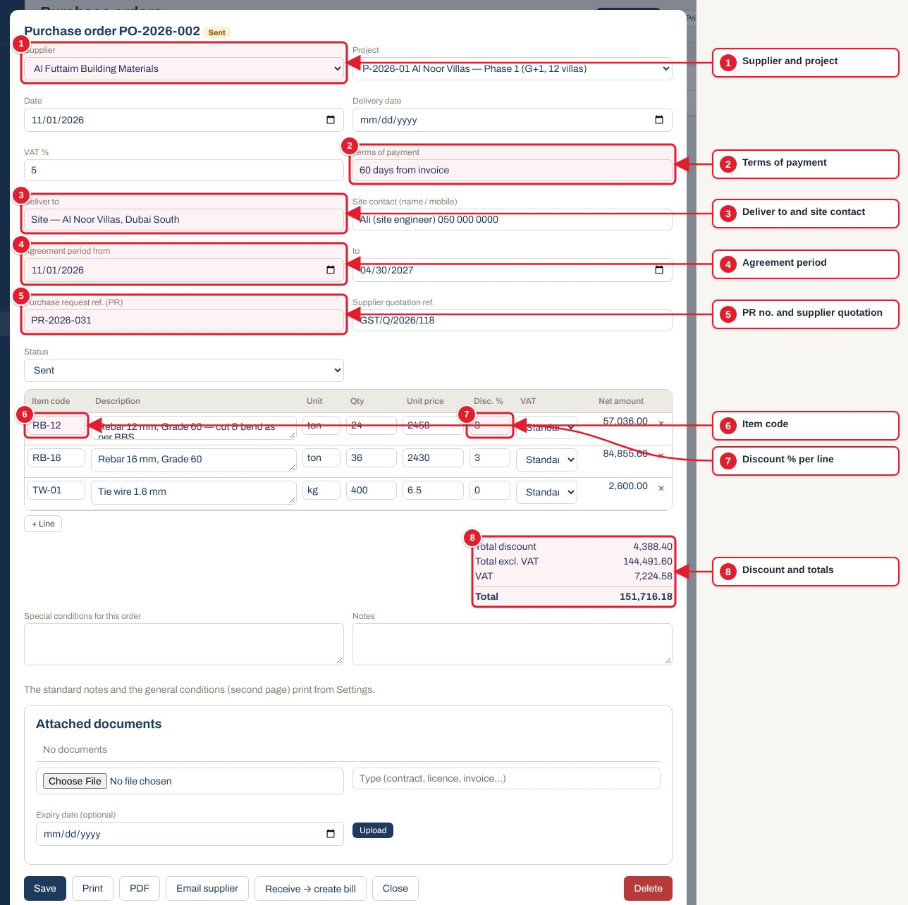

1. Supplier and project.
2. Terms of payment.
3. Deliver to and the site contact.
4. Agreement period from / to.
5. Purchase request no. and the supplier's quotation.
6. Item code per line.
7. Discount % per line; the net after the discount.
8. Total discount and the totals before and after VAT.

<!--/img-->
<!--img-->

**📷 The printed purchase order (page 1)**

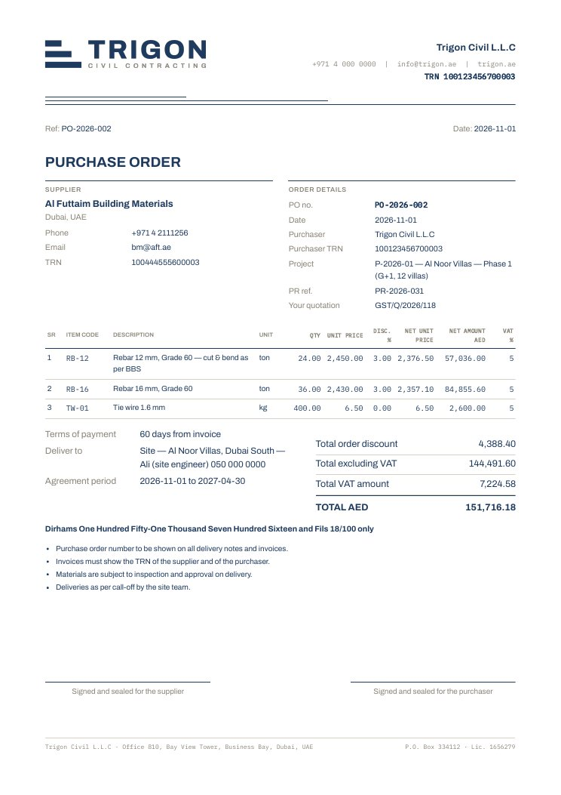

1. Supplier with TRN, Trigon with TRN, PR and quotation.
2. Lines with code and discount, total in words, standard notes and both signatures; the general conditions on page 2.

<!--/img-->

## 13. Expenses and purchases

Menu: **Expenses & purchases** (or **+ Expense** on the project page).
1. **+ New**.
2. **Date**, **Supplier**, **Project** (empty = overhead).
3. **Category**: Materials, Labour, Subcontractor, Equipment, Transport, Permits & fees, Accommodation, Visas & labour fees, Medical insurance, Overheads, Other — or **Fixed asset purchase (depreciated)** for assets.
4. **Description**, **Amount (ex VAT)**, **VAT amount (if any)**, **Supplier invoice no.**
5. Shared cost (rent, shared equipment…): tick **Split this expense across several projects**, add projects with **+ Project** and enter the % for each (must total 100%).
6. **Save**, then **Record payment** when you pay it.

> Do not enter salaries here as "Labour" — payroll is booked by the Payroll module.

<!--img-->

**📷 Expense split across two projects**

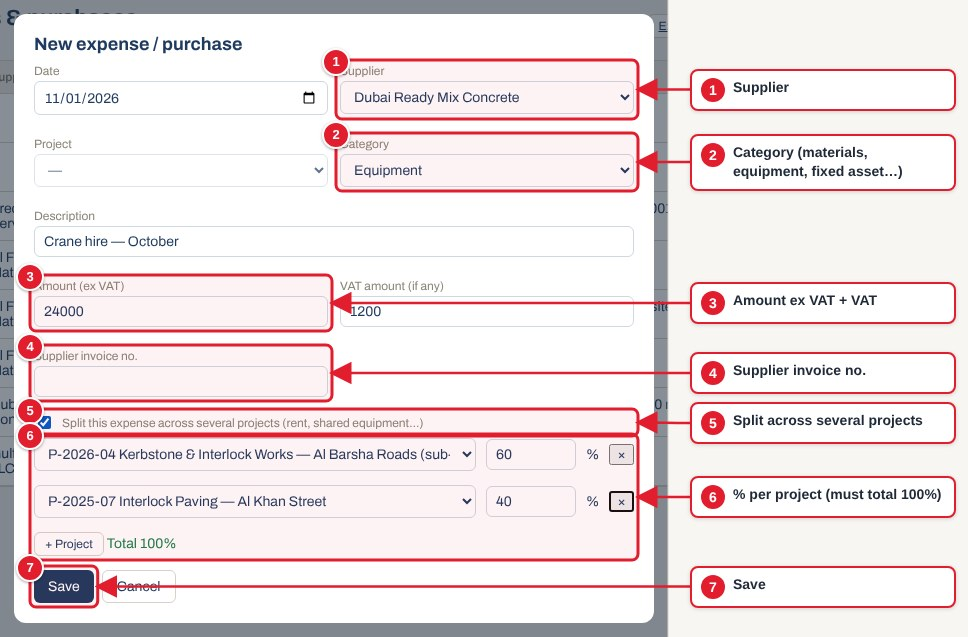

1. Supplier.
2. Category: sets the cost type in project reports (use Fixed asset purchase for assets).
3. Amount ex VAT and the VAT as on the supplier invoice.
4. Supplier invoice number for reference.
5. Tick to split the expense across projects.
6. Choose the projects and each %; the total must be 100% (shown in green).
7. Save, then Record payment when you pay.

<!--/img-->

---

## 14. Subcontracts and payment certificates

Menu: **Subcontracts & certificates**.

### 14.1 Subcontract
1. **+ Add**: **Subcontractor**, **Project**, **Scope of work**, **Contract value (ex VAT)**, **Retention %**, **Advance payment**, **Status**.
2. For the certificate and the agreement also fill: **Sub-contract agreement no.** and **date**, **Commencement / completion / extended completion dates**, **Approved variations (total)**, **VAT basis on certificates** (net after retention and contra charges, or on the work value) and **Contra charge uplift %** (e.g. 12) → **Save**.

<!--img-->

**📷 Subcontract and its certificates**

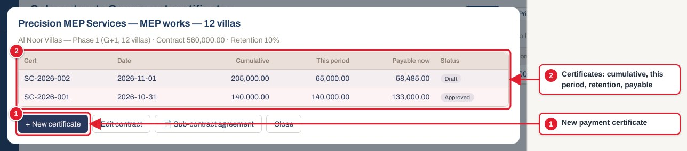

1. New payment certificate for this subcontract.
2. Previous certificates: cumulative, this period, retention, payable and status.

<!--/img-->
<!--img-->

**📷 Subcontract details**

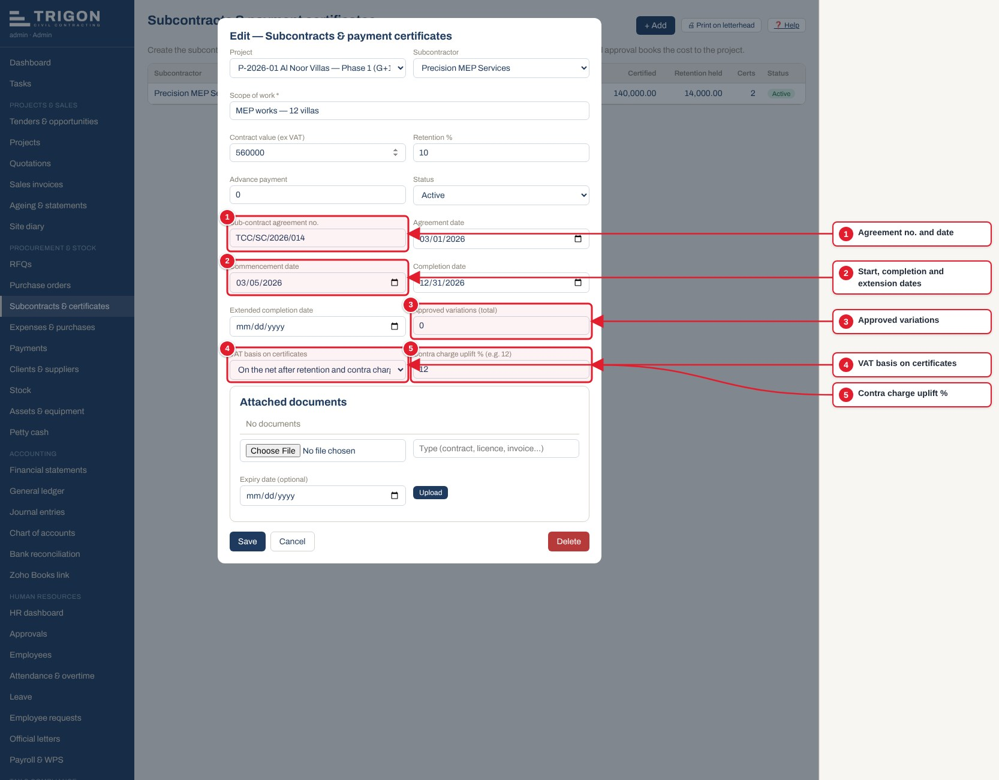

1. Agreement no. and date.
2. Start, completion and extended completion dates.
3. Total of approved variations.
4. VAT basis on certificates.
5. Contra charge uplift (e.g. 12%).

<!--/img-->

### 14.2 Payment certificate
1. Open the subcontract → **+ New certificate**.
2. **Date of issue**, **For works up to**, **Value of work done to date (cumulative)** and **Materials on site (cumulative)**.
3. This certificate's **Advance recovery**, **Contra charges** (or type the cost in **Contra charges — cost** and the uplift is added), and **Release of retention**.
4. **Subcontractor payment application** reference, **Cost codes** (one per line: code then amount) and **Notes**.
5. The summary shows this certificate; after saving, the cumulative A, B, previous payments and VAT summary.
6. **Print** / **PDF** — **PAYMENT CERTIFICATE FOR SUBCONTRACTOR** in the usual PC layout: contract value, variations, VAT, adjusted value and dates; work done, materials, advance (A); retention, contra charges, release, previous payments (B); net, VAT, net certified incl. VAT, VAT summary (previous / this / cumulative), cost codes, notes, amount in words and the signature boxes from Settings.
7. **Approve & book cost** (accountant): the certificate is locked and the cost of the period (work + materials − contra) is booked with the VAT as certified. The VAT basis is fixed on each certificate when created, so issued certificates never change.
8. Pay it from **Payments**.

<!--img-->

**📷 Subcontractor payment certificate window**

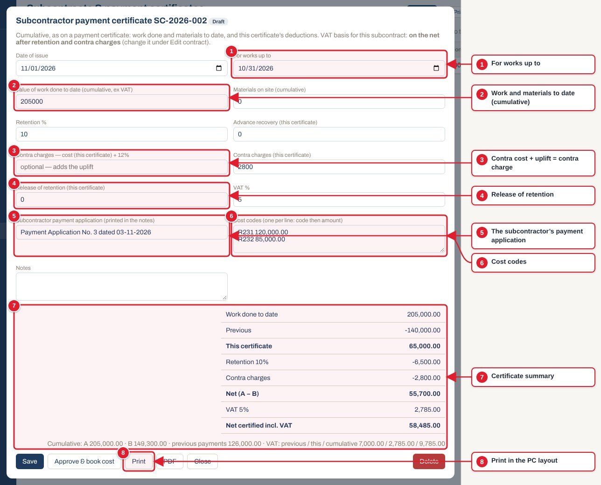

1. For works up to.
2. Work and materials to date, cumulative.
3. Contra cost: type it and the uplift is added into the contra charges.
4. Release of retention in this certificate.
5. The subcontractor's payment application; printed in the notes.
6. Cost codes: one per line, code then amount.
7. Certificate summary; after saving, the cumulative figures and VAT summary.
8. Print in the PC layout.

<!--/img-->
<!--img-->

**📷 The printed subcontractor payment certificate**

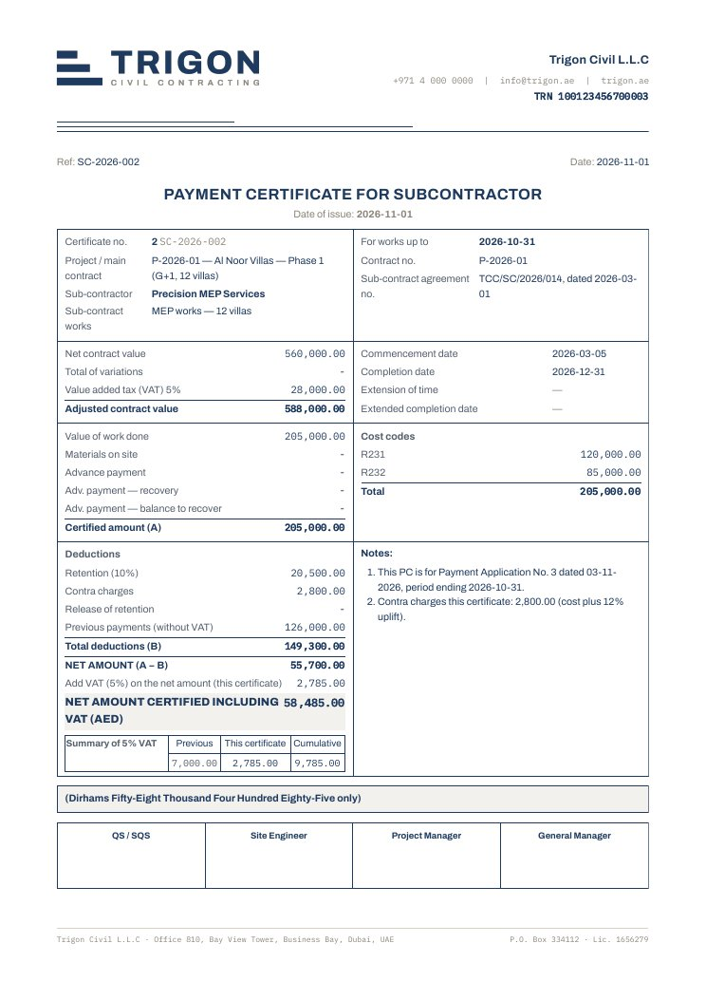

1. Contract details and dates, then certified (A), deductions (B), net and VAT.
2. VAT summary, cost codes, notes, amount in words and signature boxes.

<!--/img-->

### 14.3 Sub-contract agreement
1. Open the subcontract → **📄 Sub-contract agreement**.
2. **Payment within (days)**, **Defects liability period (months)**, **Sub-contractor trade licence no.**, and who signs for Trigon (empty = from Settings).
3. **Appendix 1 — Bill of quantities**: item, description, unit, quantity, rate. Tick **Use the total as the contract value** if needed.
4. **Appendix 2 — Particular conditions & scope**.
5. **Appendix 3 — Responsibility matrix**: for each item choose Contractor, Sub-contractor, Both or N/A, and a comment.
6. **Agreement wording for this subcontract**: the standard wording from Settings; change it for this subcontract only, or **Back to the standard wording**.
7. **Save**, then **Print** / **PDF**: cover page, the agreement with the fields filled in (names, licence and TRN, value in figures and words, retention and its release, payment days, contra uplift, dates), signature and witness lines, and each appendix on its own page.

<!--img-->

**📷 Sub-contract agreement window**

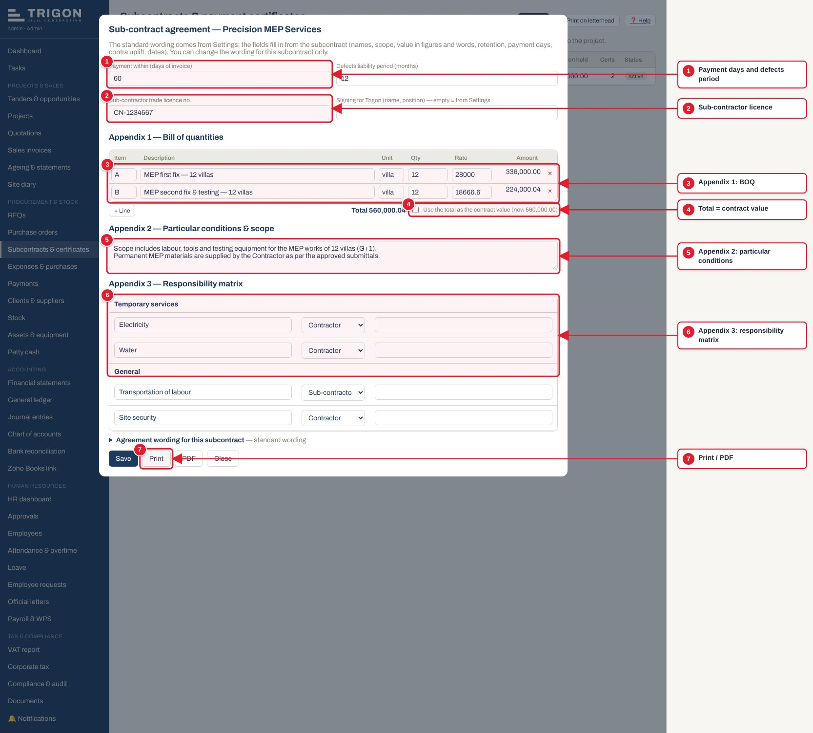

1. Payment days and defects period.
2. Sub-contractor licence no. (printed in the opening of the agreement).
3. Appendix 1: bill of quantities.
4. Use the BOQ total as the contract value.
5. Appendix 2: particular conditions and scope.
6. Appendix 3: responsibility matrix — contractor / sub-contractor / both / N/A.
7. Print / PDF.

<!--/img-->
<!--img-->

**📷 A page of the printed agreement**

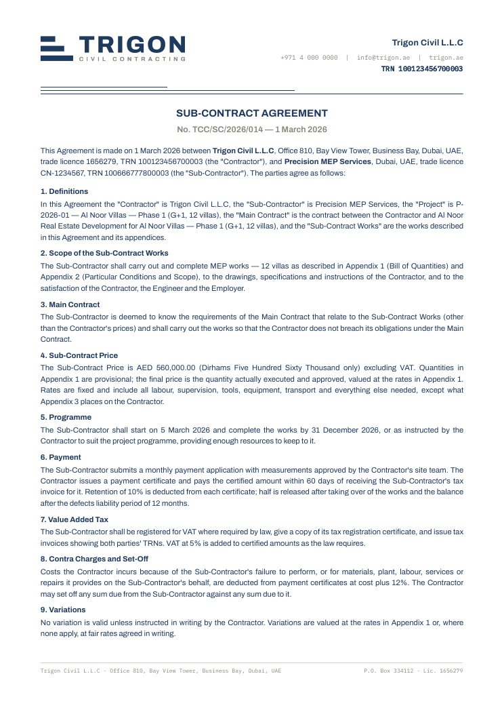

1. The parties and the clauses with the fields filled in from the subcontract.

<!--/img-->

## 15. Stock

Menu: **Stock**.
1. **+ Add** an item: **Code**, name, **Unit**, **Reorder level**, **Location**.
2. **Stock movement**: choose **Receive**, **Issue to project** or **Adjustment (+/−)**, the item, **Quantity**, **Unit cost (receipts)**, **Project**, **Reference** → **Save**.
3. The list shows quantity, **Avg cost**, **Value** and a **Low** flag under the reorder level.

> Stock tracks quantities and average cost only; material cost is booked through bills and purchase orders.

<!--img-->

**📷 Stock**

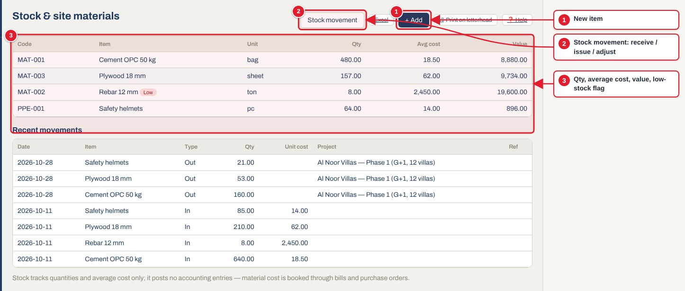

1. Add a new item.
2. Stock movement: receive, issue to project, or adjust.
3. Quantities, average cost, value, and a flag under the reorder level.

<!--/img-->

---

## 16. Assets and equipment

Menu: **Assets & equipment**.
1. **+ Add**: **Asset**, **Category**, **Serial / plate**, **Purchase date**, **Cost**, **Salvage value**, **Useful life (years)**, **Current project**, **Status**, **Disposal date** → **Save**.
2. Depreciation is straight-line monthly from the purchase month; the list shows **Accum. dep.** and **Net book value**.
3. Record the purchase bill with category **Fixed asset purchase** so it is not expensed in full.

<!--img-->

**📷 Assets & equipment**

1. Add an asset (vehicle, plant, equipment).
2. Accumulated depreciation and book value are calculated monthly.

<!--/img-->

---

## 17. Petty cash

Menu: **Petty cash**.
1. **+ Top up**: **Date**, **Amount**, **Note** → **Save**.
2. **+ Cash expense**: **Date**, **Project**, **Category**, **Description**, **Amount (ex VAT)**, VAT → **Save**. It is booked as a project expense and paid from the float.
3. The page shows the **Petty cash balance**. Keep a receipt or tax invoice for each expense.

<!--img-->

**📷 Petty cash**

1. Top up the cash float.
2. Cash expense on a project (booked as an expense with VAT).
3. Remaining float balance.

<!--/img-->

---

## 18. Adding an employee

Menu: **Employees**.

### 18.1 Employee record
1. **+ Add**.
2. Identity: **Name (as per passport)** (required), **Designation**, **Labour card / Person code (14 digits)**, **Emirates ID**, **Passport no.**, **Nationality**.
3. Employment: **Join date**, **Status** (Active), **Cost charged to** (a project, or General — head office), **Probation ends (max 6 months)**, **Line manager (approves leave first)**.
4. Salary: **Basic wage**, **Housing allowance**, **Transport allowance**, **Other allowances**.
5. WPS bank: **Bank / exchange house**, **Routing code (9 digits)**, **IBAN** — required for the salary file.
6. Expiry dates: **Emirates ID expiry**, **Residence visa expiry**, **Passport expiry**, **Labour card expiry** — alerts appear before they expire.
7. **Phone**, **Email**, **Emergency contact**, **Opening leave balance (days)**, **Notes**.
8. **Save**. The list shows **Monthly total**, **Gratuity (est.)** and flags a missing IBAN.

<!--img-->

**📷 Employee list**

1. Add a new employee.
2. Click an employee to open the full record.
3. Estimated end-of-service gratuity to date.
4. Shows “missing” in red when the IBAN is not entered.

<!--/img-->
<!--img-->

**📷 New employee form**

1. Name as in the passport (required). Next to it the designation.
2. 14-digit labour card number, Emirates ID, passport, nationality: needed for WPS and documents.
3. Join date: leave and gratuity are calculated from it.
4. Cost charged to: the project carrying the salary, or General for head office.
5. Basic wage and allowances (housing, transport, other).
6. Bank or exchange house, 9-digit routing code, IBAN: without them the employee is left out of the SIF.
7. Expiry of Emirates ID, visa, passport and labour card: alerts come before they expire.
8. Line manager: first to approve their leave.
9. End of probation (max 6 months).
10. Save.

<!--/img-->

### 18.2 After saving — open the employee again
- **Attached documents**: upload passport, visa, Emirates ID, contract… with expiry dates.
- **Employee portal account**: type **Username** and **Password (6+ chars)** → **Create account**. (Or **Reset password** if it exists.)
- **Onboarding & offboarding** → **Start onboarding**: tick the 12 steps as they are done (work permit and MOHRE contract, medical, Emirates ID, health insurance, ILOE, WPS salary account, safety induction…).
- **Notes & follow-up** with `@mentions`.

<!--img-->

**📷 Bottom of the employee record**

1. Attached documents: upload passport, visa, contract with expiry.
2. Employee portal account: username and password for their phone.
3. Onboarding & offboarding: the onboarding checklist, and the settlement when leaving.

<!--/img-->
<!--img-->

**📷 Onboarding checklist**

1. Tick each step when done; who did it and when is saved.
2. The leaving & final settlement part (section 25).

<!--/img-->

---

## 19. Attendance and overtime

Menu: **Attendance & overtime**.

<!--img-->

**📷 Daily attendance page**

1. Choose the date.
2. Clock in my crew, for workers without a phone.
3. Day status per employee: present, absent, leave, sick, holiday, off.
4. Overtime hours +25% (day) and +50% (night or rest day). They feed payroll.
5. The project worked on (for salary cost allocation).

<!--/img-->

### 19.1 Clock-in by phone (employee)
1. The employee opens **My portal** on the phone and presses **Clock in** (and **Clock out** at the end of the day).
2. The time comes from the server and the phone's location is attached.
3. Outside the site radius the record is flagged and the line manager alerted (or blocked — see 26.2).

### 19.2 Crew without phones (foreman / supervisor)
1. **Clock in my crew**.
2. Choose **In** or **Out**, tick the names, **Record**. The current time is saved with your phone's location.
3. HR only can enter a **Past time (HR correction)** (e.g. a forgotten clock-out).

<!--img-->

**📷 Clock in my crew**

1. Choose In or Out.
2. Tick the workers present.
3. Record: the server time is saved with your phone location.

<!--/img-->

### 19.3 Daily attendance sheet
1. Choose the date. For each employee set **Status**, **OT +25%**, **OT +50%**, **Project**, **Note** — each row saves automatically.
2. For work on the rest day, choose the compensation: **Pay +50%** or **Substitute day off**.
3. Overtime and absences feed the payroll when the month is generated.

---

## 20. Leave

Menu: **Leave**.
1. **Record leave** (or the employee requests it from the portal).
2. **Employee**, **Type** (Annual, Sick, Unpaid, Maternity, Paternity, Bereavement, Other), **From**, **To**, **Reason** → **Save**.
3. **Decide** — approve or reject with an optional note (it then follows the approval chain).
4. **Leave balances** shows per employee: months, accrued, opening, used, balance and sick days in the last 12 months. (2 days/month after 6 months, 30 days/year after a year.)
5. Sick-leave pay is calculated automatically in payroll: 15 days full pay, 30 half pay, 45 unpaid per year of service; unpaid during probation.

<!--img-->

**📷 Leave page**

1. Record leave for an employee.
2. Decide: approve or reject pending leave.
3. Leave balances per employee.

<!--/img-->
<!--img-->

**📷 Leave form**

1. Employee.
2. Leave type: annual, sick, unpaid…
3. From and to dates; the days are calculated.
4. Reason.
5. Save.

<!--/img-->

---

## 21. Employee requests and salary advances

Menu: **Employee requests**.

<!--img-->

**📷 Employee requests and advances**

1. File a request on behalf of an employee.
2. Letter request (salary certificate, NOC…): Issue letter directly.
3. Other requests (advance, renewal…): Decide.
4. New advance with instalments deducted from salary automatically.

<!--/img-->

### 21.1 Requests
1. Employees request from the portal, or HR presses **Request on behalf**.
2. **Employee**, **Request type** (Salary certificate, Employment certificate, No-objection certificate, Salary transfer letter, Experience certificate, Salary advance, Visa / ID / passport renewal, Complaint / feedback, Other), **Amount** and **Instalments** for advances, **Details**.
3. For letter requests press **Issue letter** (the request is approved and the letter is created); for others press **Decide**. **Reject** asks for a reason.

### 21.2 Salary advances
1. **Salary advances & repayment** → **+ New advance**.
2. **Employee**, **Amount**, **Instalments**, **First deduction month (YYYY-MM)**, **Paid by** (Bank / Cash), **Note** → **Save**.
3. The instalment is deducted automatically when the month's payroll is generated; the remaining balance shows on the payslip and in the final settlement.

---

## 22. Approvals

Menu: **Approvals**. Shows the leave and requests that reached your level of the approval chain.
1. Review the request (and the employee's leave balance).
2. **Approve** or **Reject** (with a note). After you approve it moves to the next level; the employee is told the final decision.

<!--img-->

**📷 Approvals page**

1. Approve: moves to the next level or is finally approved.
2. Reject with a reason; the employee is told.

<!--/img-->

---

## 23. Official letters

Menu: **Official letters**.
1. **New letter**.
2. **Employee**, **Letter type** (Salary certificate, Employment certificate, No-objection certificate, Salary transfer letter, Experience certificate), **Addressed to (optional)**, **Purpose**.
3. **Issue & print** — the letter gets a sequential reference number and prints on the bilingual official letterhead with stamp and signature. Review the wording before signing.
4. Reprint later with **Print** or **PDF** from the list.

<!--img-->

**📷 New letter form**

1. Employee.
2. Letter type: salary, employment, NOC, salary transfer, experience.
3. Addressed to (e.g. the bank or embassy).
4. Purpose (travel, loan…).
5. Issue & print: gets a reference number and prints on the official letterhead with stamp.

<!--/img-->

---

## 24. Payroll and WPS

Menu: **Payroll & WPS**. Monthly steps:
1. Check that attendance, leave and advances for the month are complete.
2. Choose the month and press **Generate month**.
3. Read **Missing data / warnings** (missing IBAN, routing code, person code…) and fix them in the employee record.
4. Adjust per employee if needed: **Days**, **Leave days**, **OT hrs (+25%)**, **OT hrs (+50%)**, **Bonus**, **Deductions**. **Net** recalculates.
   - Daily wage = gross ÷ 30. OT hour = basic ÷ 30 ÷ 8, +25% by day, +50% at night (10 pm–4 am) or on rest days/public holidays.
5. **Finalize payroll** — after this the month cannot be edited; the cost is split to projects and the end-of-service provision is booked.
6. **Download WPS SIF file** and upload it through your bank or exchange house portal (ask the bank to validate the first file).
7. After the transfer press **Mark salaries paid**. Salaries unpaid 15 days after month-end appear as a compliance alert.
8. Employees see their payslips in the portal; **Excel** exports the sheet.

<!--img-->

**📷 Monthly payroll before finalizing**

1. Choose the month.
2. Generate month: pulls salaries, attendance, overtime, leave and advances. If data is missing (IBAN, routing code…), a red “Missing data / warnings” box appears above the table — fix it in the employee record first.
3. Editable cells: days, overtime, bonus, deductions; the net recalculates.
4. Finalize payroll: locks the month and books entries and the gratuity provision.

<!--/img-->
<!--img-->

**📷 Finalized and paid payroll**

1. Download the SIF and upload it to the bank or exchange house portal.
2. After the transfer press Mark salaries paid; it shows Paid with the date.
3. Export the sheet to Excel.

<!--/img-->

---

## 25. Employee leaving and final settlement

Open the employee → **Onboarding & offboarding** → **Leaving & final settlement**.
1. **Last working day**, **Reason** (Resignation, Termination by the company, End of contract, Other), **Notice given on**, **Other deductions**.
2. **Start offboarding & calculate**. The system shows: **Salary to the last day**, leave encashment (on basic), end-of-service gratuity (21/30 days), notice-period shortfall (notice must be 30–90 days), **Outstanding advance**, **Deductions** and **Total**.
3. Change the inputs and press **Recalculate** if needed; tick the offboarding checklist.
4. **Complete & disable account** — the employee becomes "Left" and their system account is disabled.

<!--img-->

**📷 Leaving & final settlement**

1. Enter the last day, reason, notice date and any deductions.
2. Start offboarding & calculate: works out salary to the last day, leave pay, gratuity and advance.

<!--/img-->

---

## 26. HR dashboard: approval chains and attendance rules

Menu: **HR dashboard** — active employees, leave and requests waiting, who is on leave today, documents expiring within 60 days, and a monthly **Labour-law compliance** list (overtime limits, 7 days without rest, midday ban work, probation over 6 months, clock-ins outside the site).

<!--img-->

**📷 HR dashboard**

1. Active staff, pending leave and requests, who is on leave today.
2. Documents expiring within 60 days.
3. Labour-law compliance issues this month.

<!--/img-->

### 26.1 Approval chains
1. Under **Approval chains** set levels for **Leave** and **Employee requests**.
2. Each level: **Approver** (line manager or a role) and threshold (**From days** for leave, **From amount** for requests).
3. **Save**. Default: leave → line manager then HR; requests → HR, then admin from 5,000.

<!--img-->

**📷 Approval chains and attendance rules**

1. Approval chains: each level's approver and threshold (days or amount).
2. Save the chains.
3. Attendance rules: hours, rest day, outside-site clocking, Ramadan, midday ban.

<!--/img-->

### 26.2 Attendance rules
- **Daily working hours (max 8)**, **Break minutes**, **Weekly rest day**.
- **Clocking outside the site area**: *Allowed, flagged, manager alerted* or *Blocked*.
- **Ramadan from / to** (2 hours shorter days).
- **Midday ban from / to (MM-DD)** e.g. `06-15` to `09-15`, **Ban starts at / ends at** (12:30–15:00).
- **"Days in period" in the SIF file**.
- **Save** (administrator).

---

## 27. Employee portal (for staff)

The employee signs in with the account HR created (18.2) and lands on **My portal**:
1. **Clock in / Clock out** (attendance).
2. **Annual leave balance (days)**, accrued to date, sick leave in the last 12 months, document expiry dates.
3. **Request leave**: **Leave type**, **From**, **To**, **Reason** → **Save**.
4. **Other request**: **Request type**, amount/instalments for advances, **Details** → **Save**.
5. **My requests** — status; approved letters open with **Open letter** / **PDF**.
6. **Payslips** → **View / print**.
7. Install it on the phone (section 32.3) to receive notifications.

<!--img-->

**📷 Employee portal on a phone**

1. Big button to clock in and out with location.
2. Request leave.
3. Other request: salary certificate, NOC, advance…
4. Leave balance. Further down: my requests, letters and payslips.

<!--/img-->

---

## 28. Accounting

Most entries are made automatically from invoices, bills, payments, payroll and assets.

- **Chart of accounts** — **+ Account**: **Code (3–6 digits)**, **Name (English)**, **Name (Arabic)**, **Type** → **Save**. Built-in accounts cannot be deleted.
- **Journal entries** — **+ New entry**: date, **Memo**, lines (account, **Debit**, **Credit**; **+ Line**). It must be balanced → **Save**.
- **General ledger** — choose an account and **From / To**, **Show**. Positive balance = debit, negative = credit.
- **Financial statements** — choose **From / To** → **Show**: **Trial balance**, **Profit & loss**, **Balance sheet**.
- **Bank reconciliation**:
  1. **Add an account** (name, bank, IBAN, ledger) if you have more than one bank.
  2. **Import statement** — upload the bank CSV or paste the lines → **Import**.
  3. **Auto-match**, then **Match** the rest by hand (or **Unmatch**).
  4. Check that **Difference** is zero.

<!--img-->

**📷 Chart of accounts**

1. New account.
2. Click an account to edit its name.

<!--/img-->
<!--img-->

**📷 Manual journal entry**

1. Date and memo.
2. Lines: pick the account and type debit or credit.
3. Add a line.
4. Saving requires debits to equal credits.

<!--/img-->
<!--img-->

**📷 Financial statements**

1. Period from / to.
2. Show.
3. Revenue, expenses, net profit; then trial balance, P&L and balance sheet.

<!--/img-->
<!--img-->

**📷 Bank reconciliation**

1. Bank accounts.
2. Import the bank statement (CSV or paste).
3. Auto-match the lines.
4. Statement balance, book balance and the difference (should be zero).

<!--/img-->

---

## 29. Zoho Books link

Menu: **Zoho Books link** (administrator / accountant). Full details in [ZOHO.md](../ZOHO.md).
1. **Connection**: Zoho keys come from the server's `.env` file. Create a Self Client in the Zoho API console, generate a code with the shown scope, paste it in **Grant code** → **Connect**, then pick the **Zoho Books organisation**.
2. **Account & project mapping**: bank/cash, **Default expense account**, and a reporting tag or Zoho project per project.
3. Choose **Send transactions dated from**, then press **Dry run (nothing sent)** to preview.
4. **Send to Zoho now**, or tick **Enable the link** and **Send automatically every day**.
5. **Send history** → **Retry failed**. The **Daily transactions report** lists what was invoiced, billed, received and paid each day.
6. Standalone edition: use the **Zoho Books import files** instead.

<!--img-->

**📷 Zoho Books link**

1. Dry run: shows what would be created or updated in Zoho without writing anything. Once connected, Send to Zoho now appears next to it.
2. Daily transactions report: what was invoiced, billed, received and paid each day.

<!--/img-->

---

## 30. Tax and compliance

- **VAT report**: choose **From / To** → **Show**. Shows standard-rated, zero-rated and exempt sales, output VAT, purchases, recoverable input VAT, **Net VAT payable to FTA**, box 1 by emirate, and warnings (e.g. input VAT without supplier TRN). File within 28 days of period end via EmaraTax.
- **Corporate tax**: choose the year. Shows revenue, expenses, payroll, profit, taxable income and 9% above AED 375,000, and Small Business Relief if revenue is under AED 3m.
- **Compliance & audit**: all alerts (missing TRN/MOHRE ID, licence and visa expiries, unpaid salaries, bounced cheques…), key deadlines, e-invoicing readiness and the **Audit log** of every change.
- **Documents**: all attachments in one place, plus **Company documents (licence, MOA, insurance…)** — upload with an expiry date to get alerts.

> The system is not officially certified by the FTA, MOHRE or the Central Bank. Review returns and the SIF file with your accountant and bank.

<!--img-->

**📷 VAT report**

1. Tax period.
2. Sales, output and input VAT, net VAT.
3. Sales by emirate for box 1 of the return.

<!--/img-->
<!--img-->

**📷 Compliance & audit**

1. All alerts in one place: licence, ID and visa expiries, clients without TRN, late salaries, bounced cheques.
2. Key deadlines: VAT return, corporate tax, salaries and record retention.
3. E-invoicing readiness: invoices with missing data.

<!--/img-->
<!--img-->

**📷 Documents**

1. Company documents with expiry.
2. Every attachment in the system.

<!--/img-->

---

## 31. Tasks, notes and notifications

- **Tasks**: **+ Task** → **Task**, **Assignee**, **Due date**, **Status**, **Tag**, **Project**, **Details**, **Sub-tasks** → **Save**. Switch between **My tasks** and **All open tasks**.
- **Notes**: on projects and employees, mention `@username` to notify a colleague.
- **Notifications**: approvals, decisions, mentions and alerts. **Turn on notifications on this device** to receive them on the phone (on iPhone, add the app to the Home Screen first — iOS 16.4+). **Send a test**, **Mark all read**.

<!--img-->

**📷 New task**

1. Task title.
2. The assignee, who is notified.
3. Due date.
4. Related project.
5. Save.

<!--/img-->
<!--img-->

**📷 Notifications**

1. Turn on notifications on this device (phone) to get approvals and alerts even when the app is closed. Below it is the list, with Mark all read when there are notifications.

<!--/img-->

---

## 32. Printing, PDF, Excel and mobile

1. **Documents** (quotation, invoice, PO, IPC, letter, payslip): **Print** or **PDF** inside the document.
2. **Any page**: **🖨 Print on letterhead**. **Excel** exports the list.
3. **Install on phone**:
   - iPhone: Safari → Share → **Add to Home Screen**.
   - Android: browser menu → **Install app / Add to Home screen**.
   - When a new version is available, tap the banner to update.

<!--img-->

**📷 The system on a phone**

1. The ☰ button opens the menu.

<!--/img-->
<!--img-->

**📷 The menu on a phone**

1. Pick a page from the menu.

<!--/img-->

---

**Letterhead on every page:** printed documents repeat the letterhead at the top of every page and keep room for the footer, so text never runs under them. Tax invoices, credit notes and subcontractor certificates show the **legal name** and TRN at the top; proformas show no TRN.

---

## 33. Backup and good practice

1. **Settings** → **Backup** → **Download backup** — at least weekly, store it outside the computer. It contains attachments and the email password; keep it safe.
2. Use a long, unique administrator password; do not share the admin account — give each person their own user and role.
3. Keep financial records 5–7 years.
4. After each code update restart the server.

---

## 34. Common questions

| Question | Answer |
|---|---|
| I can't delete an invoice | Tax invoices cannot be deleted. Issue a **credit note**, or the administrator can **Void** it with a reason. |
| I can't delete a project | It has invoices or expenses — set its status to **Cancelled**. |
| Payroll is locked | It was finalized. Corrections go into next month (bonus / deductions). |
| An employee doesn't see their portal | Their user must be linked to the employee record (Settings → Users, or create the account from the employee record). |
| A site engineer sees no projects | Settings → Users → **Projects** → tick their projects. |
| Phone clock-in says outside the site | Set the project's latitude/longitude/radius (7.1, step 9). |
| "This page could not be loaded… old version" | Restart the server and refresh the page (Ctrl+F5). |
